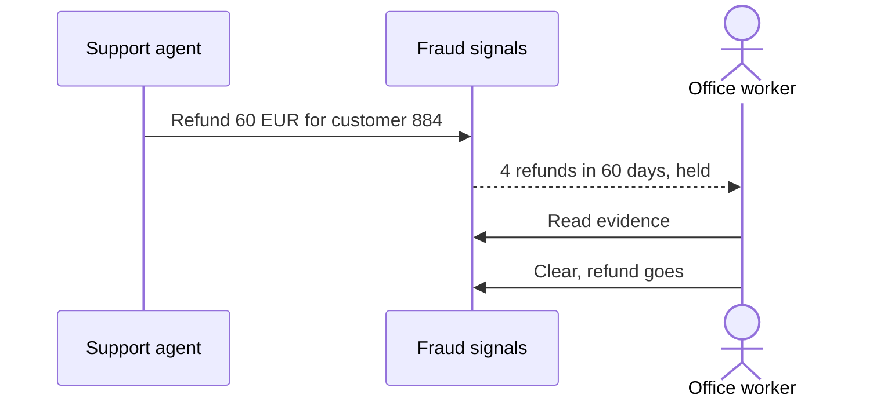

🏠 [Specs](../../../../README.md) › 🧩 [Functional capabilities](../../../README.md) ›
🎧 [F16 Customer support agents](../../README.md) › 📝 [Use cases](../README.md) ›
📝 [Use cases: FL-F16-03 Review and monitor](README.md) › 📝 UC-F16-15 Detect refund abuse and fraud signals

# 📝 UC-F16-15 Detect refund abuse and fraud signals

**Status:** ✅ specified

## Summary

Before any automatic refund, simple-ERP checks the customer and the order for fraud signals; a request with a signal
goes to a person with the evidence, who clears or confirms it.

## Personas

- [U16 Office worker](../../../../01-users/personas/u16-office-worker.md)
- [U02 Manager](../../../../01-users/personas/u02-manager.md), who sets the thresholds

## Goal

Refund abuse stopped without slowing honest customers.

## Trigger

A refund action prepared by an agent.

## Frequency

Each refund.

## Preconditions

- Signals and thresholds are set.

## Postconditions

- Success: honest refunds go through; suspect ones decided by a person.
- Failure: none: a signal always stops the automatic refund.

## Main flow

1. An agent prepares a refund; simple-ERP checks the signals (BR-F16-12).
2. A signal is raised: the refund is held and the request goes to a person with the evidence (S-F16-13).
3. The office worker reads the evidence: refund history, account age, delivery proof.
4. They clear it (the refund goes) or confirm abuse (refused with the reason).
5. The support lead sees the signals and decisions per period.

## Alternative flows

- 4a. Confirmed abuse: the customer's next refunds always go to a person.

## Error flows

- 1e. The back-office tool does not answer: the signal check cannot run; the refund waits for a person.
- Any step: a service does not answer; the call is retried first (BR-F3-32), then the message follows the error pattern
  (D122) and what was typed stays on the screen.

## Business rules

- [BR-F16-12 Fraud signals stop automatic refunds](../../business-rules/br-f16-12-fraud-signals-stop-automatic-refunds.md)
- [BR-F16-07 Refund limits per intent](../../business-rules/br-f16-07-refund-limits-per-intent.md)

## Entities

- [E-F16-11 Fraud signal](../../data/e-f16-11-fraud-signal.md)

## Permissions

Office workers decide; the support lead sets thresholds; customers never see the signals.

## Notifications

- The office worker on each held refund.

## Audit events

Signals raised, decisions with reasons.

## AI involvement

The AI assistant summarises the evidence; a person decides.

## API, MCP and A2A exposure

Through the API (T5) and as AI assistant tools (T6), with the caller's rights (BR-F3-34).

## Screens

- [S-F16-13 Fraud signals](../../screens/03-review-and-monitor/s-f16-13-fraud-signals.md)

## Flowchart

See [FL-F16-03 Review and monitor](../../flows/fl-f16-03-review-and-monitor.md#flowchart).

## Sequence diagram

## Acceptance criteria

1. **Given** customer 884 with 4 refunds in 60 days and a threshold of 3 **when** a refund is prepared **then** it is
   held for a person.
2. **Given** a lost-parcel claim with a signed delivery proof **when** checked **then** it is held.
3. **Given** a first refund of 40.00 EUR **when** checked **then** it goes automatically.
4. **Given** abuse confirmed **when** the next refund comes **then** it goes to a person.

## Non-functional notes

D408's targets ([Performance](../../../../05-non-functional/performance.md)): 95 % of screens within 1 second; lists
paged on the server, the first page within 1 second; reports within 5 seconds or in the background.

## Regulatory references

None.

## Related use cases

- [UC-F16-01 Resolve a customer request automatically](../01-resolve-a-request/uc-f16-01-resolve-a-customer-request-automatically.md)
- [UC-F16-04 Review, correct and escalate](uc-f16-04-review-correct-and-escalate.md)

## Open questions

None.

---

⬅️ [UC-F16-14](../02-automate-an-intent/uc-f16-14-discover-intents-from-past-requests.md) · ⬆️ [Up](README.md) ·
➡️ [UC-F16-16](../06-take-in-every-request/uc-f16-16-turn-any-request-into-a-work-request.md)
