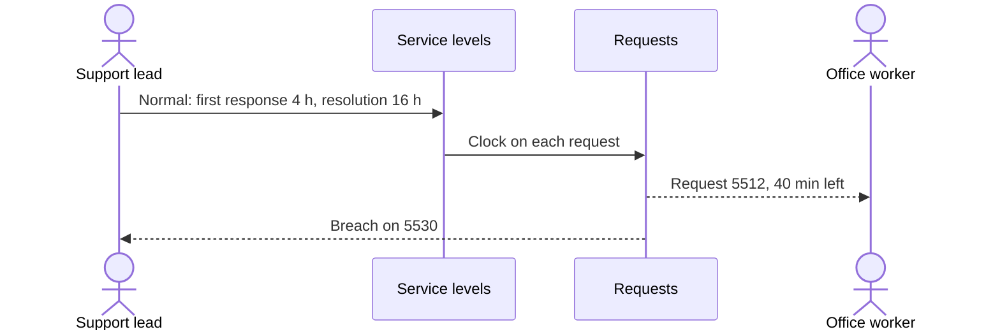

🏠 [Specs](../../../../README.md) › 🧩 [Functional capabilities](../../../README.md) ›
🎧 [F16 Customer support agents](../../README.md) › 📝 [Use cases](../README.md) ›
📝 [Use cases: FL-F16-04 Human agent workspace](README.md) › 📝 UC-F16-07 Set service levels and follow targets

# 📝 UC-F16-07 Set service levels and follow targets

**Status:** ✅ specified

## Summary

The support lead defines service-level policies per priority with first-response and resolution targets in business
hours; requests carry a clock, near-breach requests are flagged and breaches counted.

## Personas

- [U02 Manager](../../../../01-users/personas/u02-manager.md)

## Goal

Every request answered and resolved within its promised time, and breaches seen early.

## Trigger

Setting up support; a contract promising response times (SC14).

## Frequency

Policies set once, changed a few times a year; clocks on every request.

## Preconditions

- Support is set up with its business hours.

## Postconditions

- Success: policies active; each request shows its clock and target.
- Failure: the policy stays a draft.

## Main flow

1. The support lead opens Service levels (S-F16-07) and creates a policy per priority.
2. They set the first-response and resolution targets and the business hours (BR-F16-05).
3. They set how priority is set: by intent, by customer (a contract's level) or by hand.
4. Each request gets its priority and clock; the workspace shows the time left.
5. Requests near breach are flagged; breached ones are counted on the dashboard (UC-F16-05).

## Alternative flows

- 3a. A customer with a support contract (SC14) gets the contract's policy.
- 4a. Waiting for the customer: the clock pauses.

## Error flows

- 2e. A resolution target shorter than the first-response target: refused.
- 5e. A breach: the request is marked, its priority raised and the support lead told.
- Any step: a service does not answer; the call is retried first (BR-F3-32), then the message follows the error pattern
  (D122) and what was typed stays on the screen.

## Business rules

- [BR-F16-05 Service levels per priority](../../business-rules/br-f16-05-service-levels-per-priority.md)

## Entities

- [E-F16-05 Service-level policy](../../data/e-f16-05-service-level-policy.md)
- [E-F16-01 Customer request](../../data/e-f16-01-customer-request.md)

## Permissions

Support lead and owner set policies; office workers see clocks.

## Notifications

- Office workers on their requests near breach; the support lead at each breach.

## Audit events

Policies created and changed; breaches.

## AI involvement

The AI assistant may suggest targets from the last 3 months' times.

## API, MCP and A2A exposure

Through the API (T5) and as AI assistant tools (T6), with the caller's rights (BR-F3-34).

## Screens

- [S-F16-07 Service levels](../../screens/04-human-agent-workspace/s-f16-07-service-levels.md)

## Flowchart

See [FL-F16-04 Human agent workspace](../../flows/fl-f16-04-human-agent-workspace.md#flowchart).

## Sequence diagram

## Acceptance criteria

1. **Given** policy Normal with first response in 4 business hours **when** a request arrives on Monday 10:00 **then**
   its first-response target is Monday 14:00.
2. **Given** a request waiting for the customer for 3 hours **when** computed **then** the clock pauses for those 3
   hours.
3. **Given** an urgent request not resolved within 8 business hours **when** the time passes **then** it is marked
   breached and the lead told.
4. **Given** a resolution target of 2 hours under a first response of 4 hours **when** saved **then** it is refused.

## Non-functional notes

D408's targets ([Performance](../../../../05-non-functional/performance.md)): 95 % of screens within 1 second; lists
paged on the server, the first page within 1 second; reports within 5 seconds or in the background.

## Regulatory references

None.

## Related use cases

- [UC-F16-08 Support requests in the agent workspace](uc-f16-08-work-requests-in-the-agent-workspace.md)
- [UC-F16-05 Monitor resolution and accuracy](../03-review-and-monitor/uc-f16-05-monitor-resolution-and-accuracy.md)

## Open questions

None.

---

⬅️ [UC-F16-06](../01-resolve-a-request/uc-f16-06-connect-the-helpdesk-and-back-office-tools.md) · ⬆️ [Up](README.md) ·
➡️ [UC-F16-08 Support requests in the agent workspace](uc-f16-08-work-requests-in-the-agent-workspace.md)
