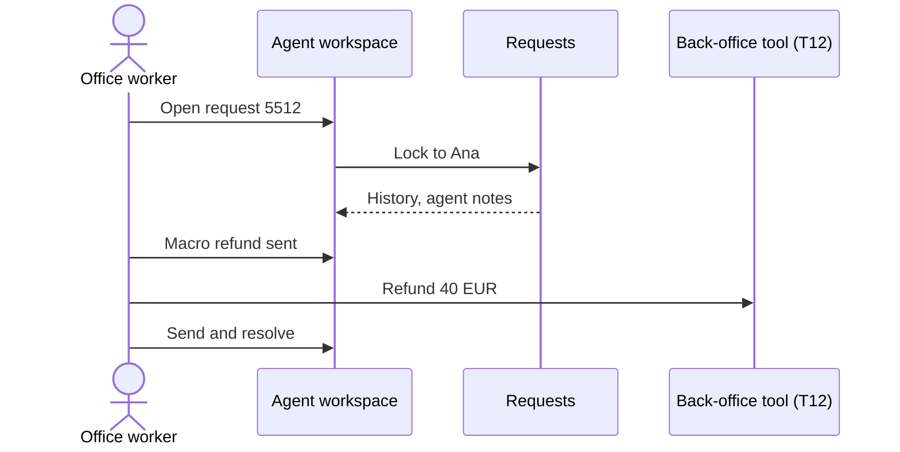

🏠 [Specs](../../../../README.md) › 🧩 [Functional capabilities](../../../README.md) ›
🎧 [F16 Customer support agents](../../README.md) › 📝 [Use cases](../README.md) ›
📝 [Use cases: FL-F16-04 Human agent workspace](README.md) › 📝 UC-F16-08 Support requests in the agent workspace

# 📝 UC-F16-08 Support requests in the agent workspace

**Status:** ✅ specified

## Summary

Office workers handle the requests routed to people in one workspace: queues filled by assignment rules, the customer's
history and the agent's notes, macros, and a lock so that two people never answer the same request.

## Personas

- [U16 Office worker](../../../../01-users/personas/u16-office-worker.md)
- [U02 Manager](../../../../01-users/personas/u02-manager.md), who sets queues and macros

## Goal

Each human request answered quickly, once, with the whole context.

## Trigger

A request routed to a person (escalated, shadow, human intent).

## Frequency

All day for office workers.

## Preconditions

- Queues and assignment rules exist.

## Postconditions

- Success: the request answered and resolved or handed back.
- Failure: the request stays in its queue.

## Main flow

1. The office worker opens the Agent workspace (S-F16-08); their assigned requests are listed with clocks.
2. They open a request; it is locked to them (BR-F16-06); the history, the agent's notes and the customer's data show.
3. They insert a macro and adapt it.
4. They act within their rights (refund, re-send) and send the answer.
5. They resolve the request; the satisfaction survey goes out (UC-F16-09).

## Alternative flows

- 1a. The support lead creates queues and assignment rules (round robin or least busy).
- 4a. The action needs approval above a limit (BR-F16-07): it waits for the lead.

## Error flows

- 2e. Someone else has it open: shown read-only with who has it.
- 4e. The same action was already done (BR-F16-08): refused, the earlier action shown.
- Any step: a service does not answer; the call is retried first (BR-F3-32), then the message follows the error pattern
  (D122) and what was typed stays on the screen.

## Business rules

- [BR-F16-06 One person on a request at a time](../../business-rules/br-f16-06-one-person-on-a-request-at-a-time.md)
- [BR-F16-07 Refund limits per intent](../../business-rules/br-f16-07-refund-limits-per-intent.md)
- [BR-F16-08 No duplicate action](../../business-rules/br-f16-08-no-duplicate-action.md)

## Entities

- [E-F16-06 Queue](../../data/e-f16-06-queue.md)
- [E-F16-07 Macro](../../data/e-f16-07-macro.md)
- [E-F16-01 Customer request](../../data/e-f16-01-customer-request.md)

## Permissions

Office workers handle their queues; the support lead manages queues, macros and takeovers.

## Notifications

- The office worker when a request is assigned; the lead when a queue grows over 50 items (F16 notifications).

## Audit events

Assignments, locks, answers, actions and resolutions, with who and when.

## AI involvement

The AI assistant may draft the answer from the procedure and the history; the person sends it.

## API, MCP and A2A exposure

Through the API (T5) and as AI assistant tools (T6), with the caller's rights (BR-F3-34).

## Screens

- [S-F16-08 Agent workspace](../../screens/04-human-agent-workspace/s-f16-08-agent-workspace.md)

## Flowchart

See [FL-F16-04 Human agent workspace](../../flows/fl-f16-04-human-agent-workspace.md#flowchart).

## Sequence diagram

## Acceptance criteria

1. **Given** request 5512 assigned to Ana by round robin **when** she opens it **then** it is locked to her with the
   history and the agent's notes.
2. **Given** Paul opens 5512 while Ana answers **when** opened **then** he sees "Ana is answering" and cannot send.
3. **Given** the macro "Refund sent" **when** inserted **then** first name and amount are filled.
4. **Given** a refund of 40.00 EUR already done for that order **when** Ana tries again **then** it is refused and the
   first refund is shown.

## Non-functional notes

D408's targets ([Performance](../../../../05-non-functional/performance.md)): 95 % of screens within 1 second; lists
paged on the server, the first page within 1 second; reports within 5 seconds or in the background.

## Regulatory references

None.

## Related use cases

- [UC-F16-07 Set service levels and follow targets](uc-f16-07-set-service-levels-and-follow-targets.md)
- [UC-F16-04 Review, correct and escalate](../03-review-and-monitor/uc-f16-04-review-correct-and-escalate.md)
- [UC-F16-11 Handle a request in the customer's language](uc-f16-11-handle-a-request-in-the-customers-language.md)

## Open questions

None.

---

⬅️ [UC-F16-07 Set service levels and follow targets](uc-f16-07-set-service-levels-and-follow-targets.md) ·
⬆️ [Up](README.md) · ➡️ [UC-F16-09](../05-customer-side/uc-f16-09-rate-the-answer-and-measure-satisfaction.md)
