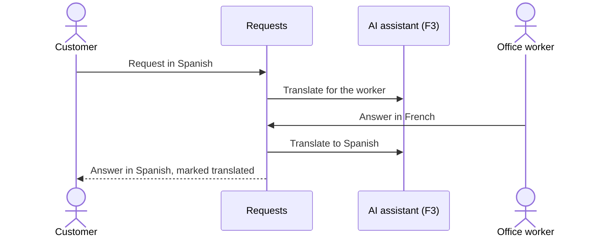

🏠 [Specs](../../../../README.md) › 🧩 [Functional capabilities](../../../README.md) ›
🎧 [F16 Customer support agents](../../README.md) › 📝 [Use cases](../README.md) ›
📝 [Use cases: FL-F16-04 Human agent workspace](README.md) › 📝 UC-F16-11 Handle a request in the customer's language

# 📝 UC-F16-11 Handle a request in the customer's language

**Status:** 🔄 waiting for the owner

## Summary

A request written in another language is answered in that language when the company supports it; agents and people work
from the procedure in the company's language and see the original next to the translation.

## Personas

- [U09 Customer](../../../../01-users/personas/u09-customer.md)
- [U16 Office worker](../../../../01-users/personas/u16-office-worker.md)

## Goal

Customers served in their language without bilingual staff.

## Trigger

A request in a language other than the company's.

## Frequency

Daily for companies selling abroad.

## Preconditions

- Supported languages are set.

## Postconditions

- Success: the answer in the customer's language, marked as translated.
- Failure: the answer in the default language with a line saying so.

## Main flow

1. A request arrives in Spanish; SimpleERP detects the language.
2. The agent or the office worker sees the request translated with the original next to it (S-F16-08).
3. The answer is written from the procedure in the company's language.
4. SimpleERP translates it into Spanish and marks it as translated (BR-F16-11).
5. The customer receives it in Spanish; the history keeps both versions.

## Alternative flows

- 2a. The office worker reads Spanish and answers in it directly: no translation mark.

## Error flows

- 1e. The language is not supported: the answer goes in English (Proposed) with a line saying so.
- Any step: a service does not answer; the call is retried first (BR-F3-32), then the message follows the error pattern
  (D122) and what was typed stays on the screen.

## Business rules

- [BR-F16-11 Answers in the customer's language](../../business-rules/br-f16-11-answers-in-the-customers-language.md)

## Entities

- [E-F16-01 Customer request](../../data/e-f16-01-customer-request.md)

## Permissions

As the request.

## Notifications

- None.

## Audit events

Language detected, translation done.

## AI involvement

The AI assistant translates (F3, local by default); the translation is marked.

## API, MCP and A2A exposure

Through the API (T5) and as AI assistant tools (T6), with the caller's rights (BR-F3-34).

## Screens

- [S-F16-08 Agent workspace](../../screens/04-human-agent-workspace/s-f16-08-agent-workspace.md)

## Flowchart

See [FL-F16-04 Human agent workspace](../../flows/fl-f16-04-human-agent-workspace.md#flowchart).

## Sequence diagram

## Acceptance criteria

1. **Given** a request in Spanish and Spanish supported **when** answered in French **then** the customer receives
   Spanish marked as translated.
2. **Given** a request in Finnish not supported **when** answered **then** the answer is in English with a line saying
   so.
3. **Given** the history **when** opened **then** both versions show.

## Non-functional notes

D408's targets ([Performance](../../../../05-non-functional/performance.md)): 95 % of screens within 1 second; lists
paged on the server, the first page within 1 second; reports within 5 seconds or in the background.

## Regulatory references

None.

## Related use cases

- [UC-F16-08 Support requests in the agent workspace](uc-f16-08-work-requests-in-the-agent-workspace.md)
- [UC-F16-01 Resolve a customer request automatically](../01-resolve-a-request/uc-f16-01-resolve-a-customer-request-automatically.md)

## Open questions

None.

---

⬅️ [UC-F16-10 Publish the help centre](../05-customer-side/uc-f16-10-publish-the-help-centre.md) · ⬆️ [Up](README.md) ·
➡️ [UC-F16-12 Follow a request's status](../05-customer-side/uc-f16-12-follow-a-requests-status.md)
