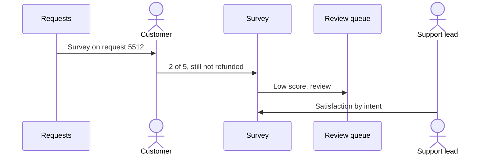

🏠 [Specs](../../../../README.md) › 🧩 [Functional capabilities](../../../README.md) ›
🎧 [F16 Customer support agents](../../README.md) › 📝 [Use cases](../README.md) ›
📝 [Use cases: FL-F16-05 Customer side](README.md) › 📝 UC-F16-09 Rate the answer and measure satisfaction

# 📝 UC-F16-09 Rate the answer and measure satisfaction

**Status:** ✅ specified

## Summary

After a request is resolved, the customer rates the answer from 1 to 5 with an optional comment; the support lead
follows satisfaction per intent, per agent or person, and low scores go to the review queue.

## Personas

- [U09 Customer](../../../../01-users/personas/u09-customer.md)
- [U02 Manager](../../../../01-users/personas/u02-manager.md), who follows the results

## Goal

Quality judged by customers, and poor answers fixed.

## Trigger

A request resolved.

## Frequency

Each resolved request.

## Preconditions

- The customer has not opted out of surveys.

## Postconditions

- Success: a rating recorded and counted.
- Failure: the survey expires with no answer.

## Main flow

1. The request is resolved; SimpleERP sends one survey on the request's channel (BR-F16-09).
2. The customer opens it (S-F16-09) and gives a score and a comment.
3. SimpleERP records the rating with the request, its intent and who handled it.
4. A score of 2 or less puts the request in the review queue (UC-F16-04).
5. The support lead sees satisfaction per intent and handler on the dashboard (UC-F16-05).

## Alternative flows

- 2a. The customer answers in the chat right after the answer: the rating is taken there.

## Error flows

- 2e. The survey has expired: the customer is told and nothing is recorded.
- Any step: a service does not answer; the call is retried first (BR-F3-32), then the message follows the error pattern
  (D122) and what was typed stays on the screen.

## Business rules

- [BR-F16-09 Satisfaction asked once per resolved request](../../business-rules/br-f16-09-satisfaction-asked-once-per-resolved-request.md)

## Entities

- [E-F16-08 Satisfaction rating](../../data/e-f16-08-satisfaction-rating.md)
- [E-F16-01 Customer request](../../data/e-f16-01-customer-request.md)

## Permissions

The customer rates their own requests; the lead and owner read results; office workers see their own.

## Notifications

- The support lead daily of low scores (with the review queue).

## Audit events

Survey sent, answered or expired.

## AI involvement

The AI assistant may group comments by theme for the lead.

## API, MCP and A2A exposure

Through the API (T5) and as AI assistant tools (T6), with the caller's rights (BR-F3-34).

## Screens

- [S-F16-09 Satisfaction survey](../../screens/05-customer-side/s-f16-09-satisfaction-survey.md)

## Flowchart

See [FL-F16-05 Customer side](../../flows/fl-f16-05-customer-side.md#flowchart).

## Sequence diagram

## Acceptance criteria

1. **Given** request 5512 resolved by the agent **when** the customer gives 5 **then** the rating counts for the
   late-delivery intent and the agent.
2. **Given** a score of 2 with "still not refunded" **when** recorded **then** the request enters the review queue.
3. **Given** a customer who opted out **when** a request is resolved **then** no survey is sent.
4. **Given** a survey link opened after it expired **when** opened **then** nothing is recorded.

## Non-functional notes

D408's targets ([Performance](../../../../05-non-functional/performance.md)): 95 % of screens within 1 second; lists
paged on the server, the first page within 1 second; reports within 5 seconds or in the background.

## Regulatory references

None.

## Related use cases

- [UC-F16-04 Review, correct and escalate](../03-review-and-monitor/uc-f16-04-review-correct-and-escalate.md)
- [UC-F16-05 Monitor resolution and accuracy](../03-review-and-monitor/uc-f16-05-monitor-resolution-and-accuracy.md)
- [UC-F16-13 Ask for a person](uc-f16-13-ask-for-a-person.md)

## Open questions

None.

---

⬅️ [UC-F16-08](../04-human-agent-workspace/uc-f16-08-work-requests-in-the-agent-workspace.md) · ⬆️ [Up](README.md) ·
➡️ [UC-F16-10 Publish the help centre](uc-f16-10-publish-the-help-centre.md)
