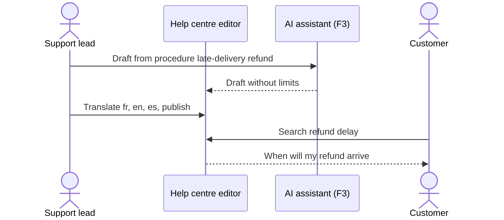

🏠 [Specs](../../../../README.md) › 🧩 [Functional capabilities](../../../README.md) ›
🎧 [F16 Customer support agents](../../README.md) › 📝 [Use cases](../README.md) ›
📝 [Use cases: FL-F16-05 Customer side](README.md) › 📝 UC-F16-10 Publish the help centre

# 📝 UC-F16-10 Publish the help centre

**Status:** ✅ specified

## Summary

The support lead publishes a public help centre: articles drawn from the procedures and frequent answers, in the
supported languages, searchable by customers before they write.

## Personas

- [U02 Manager](../../../../01-users/personas/u02-manager.md)
- [U09 Customer](../../../../01-users/personas/u09-customer.md), who searches it

## Goal

Customers find answers alone; fewer requests.

## Trigger

A frequent question; a new procedure.

## Frequency

A few articles a month.

## Preconditions

- Supported languages are set.

## Postconditions

- Success: articles published and searchable.
- Failure: the article stays a draft.

## Main flow

1. The support lead opens the Help centre (S-F16-10) and creates an article, or asks the AI assistant to draft one from
   a procedure.
2. They remove anything internal (limits, steps) and any customer data (BR-F16-10).
3. They translate it into the supported languages (BR-F16-11).
4. They publish; the article appears in the public help centre and in the request form's suggestions.
5. Customers vote "helpful"; the lead sees views, votes and the requests that followed a view.

## Alternative flows

- 1a. The AI assistant proposes articles for the intents with the most requests.

## Error flows

- 4e. The article mentions a customer's data: publishing is refused.
- Any step: a service does not answer; the call is retried first (BR-F3-32), then the message follows the error pattern
  (D122) and what was typed stays on the screen.

## Business rules

- [BR-F16-10 The help centre shows only published public articles](../../business-rules/br-f16-10-the-help-centre-shows-only-published-public-articles.md)
- [BR-F16-11 Answers in the customer's language](../../business-rules/br-f16-11-answers-in-the-customers-language.md)

## Entities

- [E-F16-09 Help-centre article](../../data/e-f16-09-help-centre-article.md)

## Permissions

Support lead writes and publishes; everyone reads published articles.

## Notifications

- None.

## Audit events

Articles created, published, archived.

## AI involvement

The AI assistant drafts and translates articles; the lead publishes.

## API, MCP and A2A exposure

Through the API (T5) and as AI assistant tools (T6), with the caller's rights (BR-F3-34).

## Screens

- [S-F16-10 Help centre](../../screens/05-customer-side/s-f16-10-help-centre.md)

## Flowchart

See [FL-F16-05 Customer side](../../flows/fl-f16-05-customer-side.md#flowchart).

## Sequence diagram

## Acceptance criteria

1. **Given** the article "When will my refund arrive?" published in French and English **when** a customer searches
   "refund" **then** it is found.
2. **Given** an article quoting an order number **when** published **then** it is refused.
3. **Given** a customer writing a request **when** they type "refund" **then** the article is suggested.
4. **Given** 41 helpful votes **when** the lead opens it **then** views, votes and the requests that followed show.

## Non-functional notes

D408's targets ([Performance](../../../../05-non-functional/performance.md)): 95 % of screens within 1 second; lists
paged on the server, the first page within 1 second; reports within 5 seconds or in the background.

## Regulatory references

None.

## Related use cases

- [UC-F16-12 Follow a request's status](uc-f16-12-follow-a-requests-status.md)
- [UC-F16-02 Write and test a procedure for an intent](../02-automate-an-intent/uc-f16-02-write-and-test-a-procedure.md)

## Open questions

None.

---

⬅️ [UC-F16-09 Rate the answer and measure satisfaction](uc-f16-09-rate-the-answer-and-measure-satisfaction.md) ·
⬆️ [Up](README.md) ·
➡️ [UC-F16-11](../04-human-agent-workspace/uc-f16-11-handle-a-request-in-the-customers-language.md)
