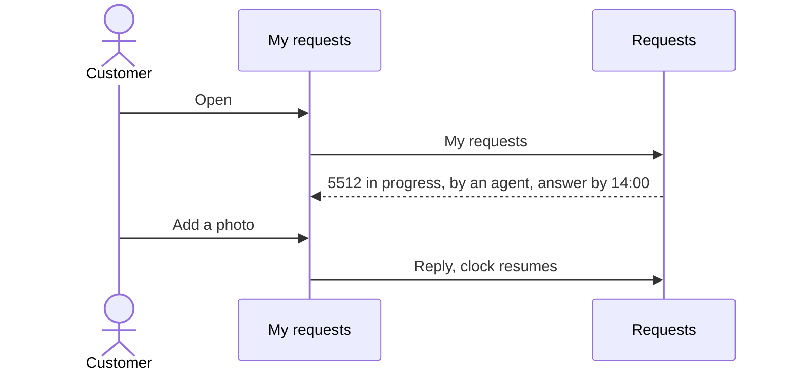

🏠 [Specs](../../../../README.md) › 🧩 [Functional capabilities](../../../README.md) ›
🎧 [F16 Customer support agents](../../README.md) › 📝 [Use cases](../README.md) ›
📝 [Use cases: FL-F16-05 Customer side](README.md) › 📝 UC-F16-12 Follow a request's status

# 📝 UC-F16-12 Follow a request's status

**Status:** ✅ specified

## Summary

The customer sees each of their requests in the customer portal or by its link: status, the expected time, the messages,
and whether an agent or a person handles it.

## Personas

- [U09 Customer](../../../../01-users/personas/u09-customer.md)

## Goal

The customer knows where their request is without writing again.

## Trigger

A request sent.

## Frequency

Each request.

## Preconditions

- The customer has a portal account (F6) or the request's link.

## Postconditions

- Success: status seen; a reply can be added.
- Failure: no access without the link or account.

## Main flow

1. The customer opens My requests in the portal (S-F16-11).
2. They see each request with its status, the expected time from its service level and who handles it.
3. They open one and read the messages.
4. They add a reply or a file; the clock resumes.

## Alternative flows

- 1a. No account: the link in the acknowledgement email opens the request alone.

## Error flows

- 1e. The link has expired: the customer is asked to sign in or ask for a new link.
- Any step: a service does not answer; the call is retried first (BR-F3-32), then the message follows the error pattern
  (D122) and what was typed stays on the screen.

## Business rules

- [BR-F16-04 Customers know, and can reach a person](../../business-rules/br-f16-04-customers-know-and-can-reach-a-person.md)
- [BR-F16-05 Service levels per priority](../../business-rules/br-f16-05-service-levels-per-priority.md)

## Entities

- [E-F16-01 Customer request](../../data/e-f16-01-customer-request.md)

## Permissions

The customer sees only their own requests (BR-F6-03).

## Notifications

- The customer at each status change, on the request's channel.

## Audit events

Replies and files added.

## AI involvement

Messages written by an agent say so (BR-F16-04).

## API, MCP and A2A exposure

Through the API (T5) and as AI assistant tools (T6), with the caller's rights (BR-F3-34).

## Screens

- [S-F16-11 My requests](../../screens/05-customer-side/s-f16-11-my-requests.md)

## Flowchart

See [FL-F16-05 Customer side](../../flows/fl-f16-05-customer-side.md#flowchart).

## Sequence diagram

## Acceptance criteria

1. **Given** request 5512 in progress **when** the customer opens My requests **then** they see "in progress, handled by
   an AI agent, answer expected by 14:00".
2. **Given** a reply with a photo **when** sent **then** the clock resumes.
3. **Given** another customer's request number typed **when** opened **then** it is refused.

## Non-functional notes

D408's targets ([Performance](../../../../05-non-functional/performance.md)): 95 % of screens within 1 second; lists
paged on the server, the first page within 1 second; reports within 5 seconds or in the background.

## Regulatory references

None.

## Related use cases

- [UC-F16-13 Ask for a person](uc-f16-13-ask-for-a-person.md)
- [UC-F16-01 Resolve a customer request automatically](../01-resolve-a-request/uc-f16-01-resolve-a-customer-request-automatically.md)

## Open questions

None.

---

⬅️ [UC-F16-11](../04-human-agent-workspace/uc-f16-11-handle-a-request-in-the-customers-language.md) ·
⬆️ [Up](README.md) · ➡️ [UC-F16-13 Ask for a person](uc-f16-13-ask-for-a-person.md)
