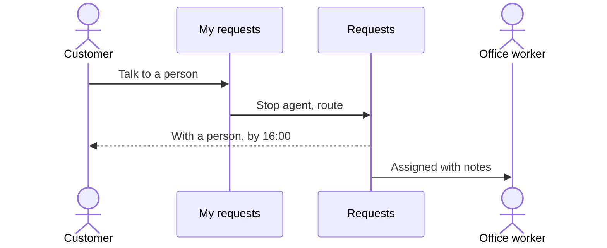

🏠 [Specs](../../../../README.md) › 🧩 [Functional capabilities](../../../README.md) ›
🎧 [F16 Customer support agents](../../README.md) › 📝 [Use cases](../README.md) ›
📝 [Use cases: FL-F16-05 Customer side](README.md) › 📝 UC-F16-13 Ask for a person

# 📝 UC-F16-13 Ask for a person

**Status:** ✅ specified

## Summary

At any time, the customer asks for a person; the request leaves the agent and goes to a queue with the whole history,
and the customer is told who will answer and when.

## Personas

- [U09 Customer](../../../../01-users/personas/u09-customer.md)
- [U16 Office worker](../../../../01-users/personas/u16-office-worker.md), who takes it over

## Goal

The customer reaches a human whenever they want.

## Trigger

The customer's choice, by a button or by writing it.

## Frequency

A few per hundred requests.

## Preconditions

- A request exists.

## Postconditions

- Success: the request in a human queue with its history.
- Failure: none: the request is never left with the agent once asked.

## Main flow

1. The customer chooses "Talk to a person" on the request (S-F16-11) or writes it.
2. SimpleERP stops the agent and routes the request to the right queue (BR-F16-04).
3. The customer is told the request is with a person and the expected time.
4. An office worker takes it with the agent's notes (UC-F16-08).

## Alternative flows

- 1a. Voice: the customer says it; the call is transferred (F4 telephony).

## Error flows

- 2e. Outside business hours: the customer is told when a person will answer.
- Any step: a service does not answer; the call is retried first (BR-F3-32), then the message follows the error pattern
  (D122) and what was typed stays on the screen.

## Business rules

- [BR-F16-04 Customers know, and can reach a person](../../business-rules/br-f16-04-customers-know-and-can-reach-a-person.md)
- [BR-F16-05 Service levels per priority](../../business-rules/br-f16-05-service-levels-per-priority.md)

## Entities

- [E-F16-01 Customer request](../../data/e-f16-01-customer-request.md)

## Permissions

Any customer on their own requests.

## Notifications

- The office worker on assignment; the customer with the expected time.

## Audit events

Escalation asked, routed.

## AI involvement

The agent stops acting once asked.

## API, MCP and A2A exposure

Through the API (T5) and as AI assistant tools (T6), with the caller's rights (BR-F3-34).

## Screens

- [S-F16-11 My requests](../../screens/05-customer-side/s-f16-11-my-requests.md)

## Flowchart

See [FL-F16-05 Customer side](../../flows/fl-f16-05-customer-side.md#flowchart).

## Sequence diagram

## Acceptance criteria

1. **Given** request 5512 handled by an agent **when** the customer asks for a person **then** the agent stops and the
   request goes to the refunds queue.
2. **Given** Saturday **when** asked **then** the customer is told a person answers Monday from 9:00.
3. **Given** the request escalated **when** the worker opens it **then** the agent's notes show.

## Non-functional notes

D408's targets ([Performance](../../../../05-non-functional/performance.md)): 95 % of screens within 1 second; lists
paged on the server, the first page within 1 second; reports within 5 seconds or in the background.

## Regulatory references

None.

## Related use cases

- [UC-F16-08 Support requests in the agent workspace](../04-human-agent-workspace/uc-f16-08-work-requests-in-the-agent-workspace.md)
- [UC-F16-12 Follow a request's status](uc-f16-12-follow-a-requests-status.md)

## Open questions

None.

---

⬅️ [UC-F16-12 Follow a request's status](uc-f16-12-follow-a-requests-status.md) · ⬆️ [Up](README.md) ·
➡️ [UC-F16-14](../02-automate-an-intent/uc-f16-14-discover-intents-from-past-requests.md)
