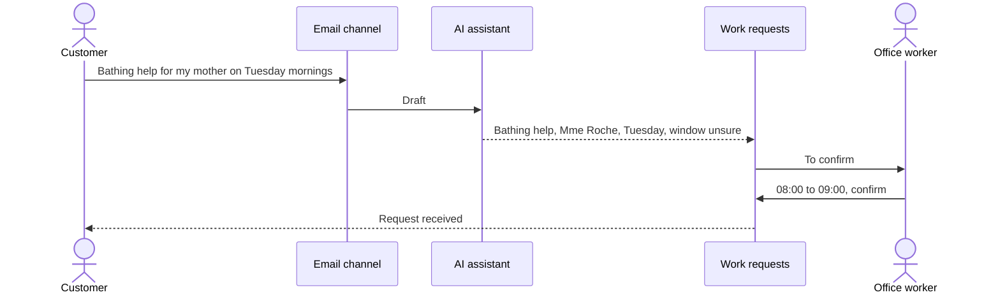

🏠 [Specs](../../../../README.md) › 🧩 [Functional capabilities](../../../README.md) ›
🎧 [F16 Customer support agents](../../README.md) › 📝 [Use cases](../README.md) ›
📝 [Use cases: FL-F16-06 Take in every request](README.md) › 📝 UC-F16-16 Turn any customer request into a work request

# 📝 UC-F16-16 Turn any customer request into a work request

**Status:** ✅ specified

## Summary

Whatever its type and channel, a customer request becomes one schedulable work request. The AI drafts it from the free
text or the source record: request type, customer, place, time window, duration, needs, priority, the linked record. A
person confirms or completes the draft when the AI is unsure of a field. Planners and managers then see every work
request in one aggregated view, as a list or on the map.

## Personas

- [U09 Customer](../../../../01-users/personas/u09-customer.md), who sends the request
- [U16 Office worker](../../../../01-users/personas/u16-office-worker.md), who confirms the drafts
- [U29 Dispatcher](../../../../01-users/personas/u29-dispatcher.md) and
  [U25 Care coordinator](../../../../01-users/personas/u25-care-coordinator.md), as planners (D517)
- [U02 Manager](../../../../01-users/personas/u02-manager.md)

## Goal

No request is lost between channels, and each one reaches scheduling with what it needs.

## Trigger

A customer request arrives on any channel: the portal, an email, a phone call, a chat, a sales order, a contract, a
care plan visit, an engagement, a booking, an API call.

## Frequency

Every customer request: from a few a day to thousands a day per company.

## Preconditions

- Request types are published
  [UC-F2-30](../../../f02-no-code-configuration/use-cases/12-set-up-request-types/uc-f02-30-set-up-a-request-type.md).
- The channel is connected ([UC-F16-06](../01-resolve-a-request/uc-f16-06-connect-the-helpdesk-and-back-office-tools.md)
  for the helpdesk; the record's own capability for orders, contracts, care plans and bookings).

## Postconditions

- **Succeeded:** one work request, ready, linked to its source (customer request, order, contract, care plan visit,
  engagement, booking), its address placed on the map.
- **Failed:** the work request stays "to confirm" with what is missing; nothing reaches scheduling.

## Main flow

1. A request arrives. A free-text one is a customer request
   ([E-F16-01](../../data/e-f16-01-customer-request.md)); a structured one is a record of its capability (a sales order
   to deliver, a care plan visit, a booking).
2. The AI drafts the work request ([E-F16-12](../../data/e-f16-12-work-request.md)): request type, customer, place,
   time window, duration (the request type's default), needs, priority, linked record.
3. Each field drafted carries the AI's confidence. All sure: the work request is ready. Any field unsure: it is "to
   confirm".
4. The office worker opens the work requests to confirm
   ([S-F16-14](../../screens/06-take-in-every-request/s-f16-14-work-requests.md)), the source beside the draft, and
   confirms or completes it.
5. The address is geocoded
   ([REQ-T13-02](../../../../03-technical/t13-maps-and-geodata/requirements/req-t13-02-geocoding.md)).
6. The work request is ready; planners see it on S-F16-14 and schedule it
   [UC-F9-33](../../../f09-hr-and-projects/use-cases/12-schedule-customer-requests/uc-f09-33-schedule-a-work-request.md).
7. The customer is told the request was received, on the channel it came from.

## Alternative flows

- 1a. A structured record (an order, a care plan visit, a booking) has every field: no AI drafting; the work request is
  ready at once.
- 1b. A request answered with no work to plan (an invoice copy) is not turned into a work request (D517); the
  support agent of
  [UC-F16-01](../01-resolve-a-request/uc-f16-01-resolve-a-customer-request-automatically.md) answers it as before.
- 4a. The office worker splits a request into two work requests (a delivery and an installation).
- 6a. The customer cancels: the work request is cancelled, at any state before "in progress".

## Error flows

- 1e. The same request arrives twice (an email, then a call): the AI links it to the first and proposes to merge.
- 2e. The AI cannot tell the request type: "to confirm" with the types it hesitated between.
- 5e. The address cannot be placed (none found, or several): "to confirm" with the candidates; listed but not on the
  map.
- Any step: a service does not answer; the call is retried first
  ([BR-F3-32](../../../f03-assistant/business-rules/br-f03-32-retry-before-an-error.md)), then the draft waits with
  "Drafting not done" and the office worker fills it by hand.

## Business rules

- [BR-F16-13](../../business-rules/br-f16-13-every-request-becomes-a-work-request.md)
- [BR-F16-04](../../business-rules/br-f16-04-customers-know-and-can-reach-a-person.md)
- [BR-F16-08 No duplicate action](../../business-rules/br-f16-08-no-duplicate-action.md)
- [BR-F1-32](../../../f01-administration/business-rules/br-f01-32-map-right-for-planners-and-managers.md)

## Entities

- [E-F16-01 Customer request](../../data/e-f16-01-customer-request.md): read
- [E-F16-12 Work request](../../data/e-f16-12-work-request.md): created, changed
- [E-F2-25 Request type](../../../f02-no-code-configuration/data/e-f02-25-request-type.md): read
- [E-T13-01 Geocoded place](../../../../03-technical/t13-maps-and-geodata/data/e-t13-01-geocoded-place.md): created

## Permissions

Office workers confirm drafts on the queues they work. Planners and managers see the work requests of their teams and
sites; only roles with the map right see the map layout (BR-F1-32). Customers see their own requests only.

## Notifications

- The customer: request received, on its channel.
- The office worker: drafts to confirm, in their queue.
- The planner: an urgent work request ready.

## Audit events

Work request drafted (source, AI confidence per field), confirmed or completed (by whom, the fields changed), geocoded,
cancelled, merged.

## AI involvement

The AI drafts; it never schedules. A person confirms every field the AI is unsure of. A customer writing in a chat is
told they deal with an AI
[CR-FR-056](../../../../10-country-packs/france/ai-and-recording/cr-fr-056-people-know-they-deal-with-an-ai.md).

## API, MCP and A2A exposure

T5 operation "create a work request" with the caller's rights (an outside system sends requests through it); the MCP
tool of F16; an A2A skill "send a work request" for a partner's agent.

## Screens

- [S-F16-11 My requests](../../screens/05-customer-side/s-f16-11-my-requests.md)
- [S-F16-14 Work requests](../../screens/06-take-in-every-request/s-f16-14-work-requests.md)

## Flowchart

See [FL-F16-06 Take in every request](../../flows/fl-f16-06-take-in-every-request.md#flowchart).

## Sequence diagram

## Acceptance criteria

1. **Given** an email "bathing help for my mother on Tuesday mornings" **when** it arrives **then** a work request is
   drafted with type "Bathing help", customer Mme Roche, Tuesday, and the window marked unsure.
2. **Given** that draft **when** the office worker sets 08:00 to 09:00 and confirms **then** it is ready and placed on
   the map.
3. **Given** Distribution Lemoine's sales order SO-4410 to deliver **when** it is confirmed in F6 **then** a ready work
   request is created with the delivery address and window, without AI drafting.
4. **Given** an address matching two places **when** geocoded **then** the work request stays "to confirm" with both.
5. **Given** a sales person without the map right **when** they open the work requests **then** they see the list
   layout only.

## Non-functional notes

A draft within 10 seconds of arrival; D408's targets for the list
([Performance](../../../../05-non-functional/performance.md)).

## Regulatory references

[CR-FR-056](../../../../10-country-packs/france/ai-and-recording/cr-fr-056-people-know-they-deal-with-an-ai.md).

## Related use cases

- [UC-F16-01](../01-resolve-a-request/uc-f16-01-resolve-a-customer-request-automatically.md)
- [UC-F16-17 Follow the arrival of a visit](uc-f16-17-follow-the-arrival-of-a-visit.md)
- [UC-F9-33](../../../f09-hr-and-projects/use-cases/12-schedule-customer-requests/uc-f09-33-schedule-a-work-request.md)

## Open questions

None.

---

⬅️ [UC-F16-15](../03-review-and-monitor/uc-f16-15-detect-refund-abuse-and-fraud-signals.md) · ⬆️ [Up](README.md) ·
➡️ [UC-F16-17 Follow the arrival of a visit](uc-f16-17-follow-the-arrival-of-a-visit.md)
