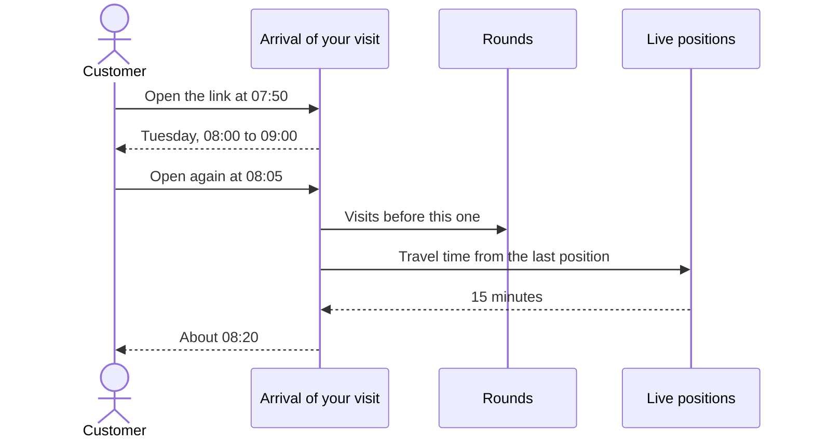

🏠 [Specs](../../../../README.md) › 🧩 [Functional capabilities](../../../README.md) ›
🎧 [F16 Customer support agents](../../README.md) › 📝 [Use cases](../README.md) ›
📝 [Use cases: FL-F16-06 Take in every request](README.md) › 📝 UC-F16-17 Follow the arrival of a visit

# 📝 UC-F16-17 Follow the arrival of a visit

**Status:** 🔄 draft (GH-2 step S4b, from VD-20, VD-21 / D502, D503)

## Summary

The customer whose visit is scheduled sees its day and time window, then, during that window only, the expected
arrival time. They open it from the portal or from the link in a message. They see an arrival time near their own
address, never where the employee is, and nothing of it is kept.

## Personas

- [U09 Customer](../../../../01-users/personas/u09-customer.md)

## Goal

The customer knows when the visit or the delivery arrives without calling.

## Trigger

The work request is scheduled (the customer is told the window); the visit's window starts (the arrival time shows).

## Frequency

Each visit or delivery to a customer's place.

## Preconditions

- The work request is scheduled, at the customer's place
  ([E-F16-12](../../data/e-f16-12-work-request.md)).
- The customer has the portal or the message link.

## Postconditions

- **Succeeded:** the customer saw the window and the arrival time.
- **Failed:** the customer sees the window only, or the visit's state.

## Main flow

1. The work request is scheduled; the customer gets a message with the day, the window and a link.
2. The customer opens the link or the portal
   ([S-F16-15](../../screens/06-take-in-every-request/s-f16-15-arrival-of-your-visit.md)): the day, the window, the
   service, the first name of the person coming (D517).
3. The window starts; the screen shows the expected arrival time ("about 08:20"), computed from the person's round and,
   where the team option is on, their live position
   ([BR-F9-32](../../../f09-hr-and-projects/business-rules/br-f09-32-who-sees-a-position.md)).
4. The arrival time updates as the round moves; a delay beyond the window sends a message.
5. The person checks in; the screen says "Arrived", then "Done" at check-out.

## Alternative flows

- 2a. The customer asks to change the window: a message to the planner; the work request is re-planned
  [UC-F9-35](../../../f09-hr-and-projects/use-cases/12-schedule-customer-requests/uc-f09-35-re-plan-after-a-change.md).
- 2b. The customer cancels: the work request is cancelled and the round ordered again.
- 3a. The team option is off: the arrival time comes from the round's order and the check-ins of the earlier visits.

## Error flows

- 2e. The link has expired (after the visit, or for another customer): the visit's state only, never a time or a place.
- 3e. No arrival time can be computed: "Arriving between 08:00 and 09:00" stays.

## Business rules

- [BR-F9-32 Who sees a person's position](../../../f09-hr-and-projects/business-rules/br-f09-32-who-sees-a-position.md)
- [BR-F16-04](../../business-rules/br-f16-04-customers-know-and-can-reach-a-person.md)

## Entities

- [E-F16-12 Work request](../../data/e-f16-12-work-request.md): read
- [E-F9-26 Round](../../../f09-hr-and-projects/data/e-f09-26-round.md): read
- [E-F9-32 Live position](../../../f09-hr-and-projects/data/e-f09-32-live-position.md): read, to compute a time only

## Permissions

The customer of the work request only, through the portal or a link valid for that visit. The customer never sees the
employee's position, route or other visits; nothing of the arrival time is kept.

## Notifications

- The customer: the day and the window once scheduled; the window started; a delay beyond the window; arrived and done
  (Proposed: the arrived message only if the customer asked for it).

## Audit events

Link sent; link opened (when, not where); window changed or cancelled by the customer.

## AI involvement

None.

## API, MCP and A2A exposure

T5 read operation for the portal and the link, with the customer's rights; no MCP tool; no A2A skill.

## Screens

- [S-F16-15 Arrival of your visit](../../screens/06-take-in-every-request/s-f16-15-arrival-of-your-visit.md)
- [S-F16-11 My requests](../../screens/05-customer-side/s-f16-11-my-requests.md)

## Flowchart

See [FL-F16-06 Take in every request](../../flows/fl-f16-06-take-in-every-request.md#flowchart).

## Sequence diagram

## Acceptance criteria

1. **Given** Mme Roche's visit on Tuesday between 08:00 and 09:00 **when** her daughter opens the link on Monday
   **then** the day and the window show, and no arrival time.
2. **Given** 08:05 on Tuesday **when** the link is opened **then** "about 08:20" shows and no position or route.
3. **Given** the carer delayed to 09:20 **when** the arrival time passes the window **then** a message is sent.
4. **Given** the visit done **when** the link is opened the next day **then** only "Done" shows.

## Non-functional notes

The page within 1 second (D408); served live, no app needed
([D407](../../../../06-decisions/technical/d407-front-end.md)).

## Regulatory references

[CR-FR-054](../../../../10-country-packs/france/data-protection/cr-fr-054-location-with-consent.md);
[CR-FR-211](../../../../10-country-packs/france/data-protection/cr-fr-211-live-geolocation-of-employees.md).

## Related use cases

- [UC-F16-16 Turn any customer request into a work request](uc-f16-16-turn-any-request-into-a-work-request.md)
- [UC-F16-12 Follow a request's status](../05-customer-side/uc-f16-12-follow-a-requests-status.md)
- [UC-F9-37](../../../f09-hr-and-projects/use-cases/12-schedule-customer-requests/uc-f09-37-share-my-position-during-work.md)

## Open questions

None.

---

⬅️ [UC-F16-16 Turn any customer request into a work request](uc-f16-16-turn-any-request-into-a-work-request.md) ·
⬆️ [Up](README.md) ·
➡️ [UC-F16-18 Run the community forum](../07-live-chat-voice-and-contracts/uc-f16-18-run-the-community-forum.md)
