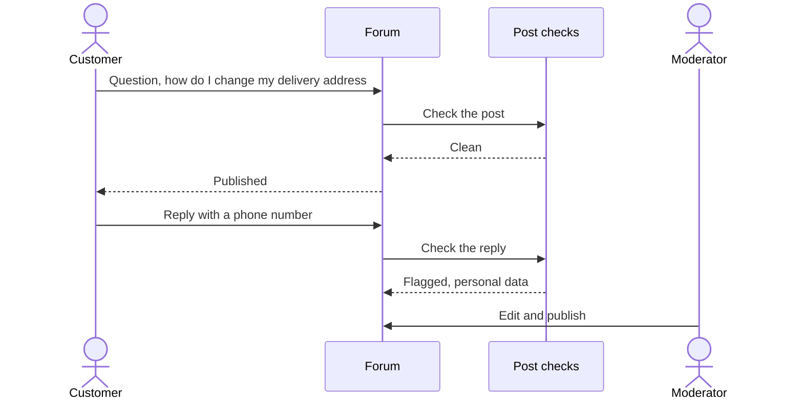

🏠 [Specs](../../../../README.md) › 🧩 [Functional capabilities](../../../README.md) ›
🎧 [F16 Customer support agents](../../README.md) › 📝 [Use cases](../README.md) ›
📝 [Use cases: FL-F16-07 Forum, live chat, voice and support contracts](README.md) ›
📝 UC-F16-18 Run the community forum

# 📝 UC-F16-18 Run the community forum

**Status:** ✅ specified

## Summary

Customers ask and answer questions in a public community forum of the company: questions are grouped by category,
answers are voted and one can be accepted. Posts that look like spam, abuse or personal data are flagged and wait for a
moderator before they are visible; the AI agent can propose an answer from the help centre, marked as AI.

## Personas

- [U09 Customer](../../../../01-users/personas/u09-customer.md)
- [U16 Office worker](../../../../01-users/personas/u16-office-worker.md)

## Goal

Customers help each other and find answers without opening a request, and nothing harmful is published.

## Trigger

A customer asks a question, answers one or reports a post; a moderator opens the moderation queue.

## Frequency

Daily moderation; posts at any hour.

## Preconditions

- The help centre is published ([UC-F16-10](../05-customer-side/uc-f16-10-publish-the-help-centre.md)).
- The forum's categories and rules are set by the company.
- Customers have portal accounts
  ([UC-F6-11](../../../f06-customers-and-sales/use-cases/02-quote-to-order/uc-f06-11-use-the-customer-portal.md)).

## Postconditions

- **Succeeded:** each post is saved ([E-F16-13 Forum post](../../data/e-f16-13-forum-post.md)) and published, or held
  when flagged; an accepted answer is marked; unanswered questions are offered to the company's staff.
- **Failed:** the post is kept as a draft in the customer's account with the reason it was not published.

## Main flow

1. A customer opens the forum on their phone
   ([S-F16-16 Forum](../../screens/07-live-chat-voice-and-contracts/s-f16-16-forum.md)), searches for their question and
   finds similar ones.
2. The customer posts a question with a category; simple-ERP checks it for spam, abuse, personal data and links.
3. A clean post is published at once; a flagged post waits in the moderation queue
   ([BR-F16-14](../../business-rules/br-f16-14-flagged-posts-are-moderated-before-publication.md)).
4. Other customers and the company's staff answer; the AI agent may propose an answer from the help centre, labelled as
   AI, which a moderator accepts or rejects.
5. The customer who asked accepts one answer; answers are voted up.
6. A moderator works the queue on a desktop: publish, edit and publish, hide or remove a post, with a reason.

## Alternative flows

- 2a. The question matches a help-centre article: the customer is shown the article before posting.
- 4a. A staff member answers as the company: their answer is marked as the company's.
- 6a. A reader reports a published post: it is hidden at once and waits in the queue.

## Error flows

- 2e. The service that checks posts does not answer: the post is held as Flagged and the customer is told it will be
  read by a person.
- 3e. A post shows an email address or a phone number: it is held, and the moderator removes the data before publishing.
- 6e. A moderator removes a post: the author is told the reason and can appeal once.
- Any step: a service does not answer; the call is retried first
  ([BR-F3-32](../../../f03-assistant/business-rules/br-f03-32-retry-before-an-error.md)), then the message follows the
  error pattern ([D122](../../../../06-decisions/ux/d122-error-message-standard.md)) and what the user typed stays on
  the screen.

## Business rules

- [BR-F16-14](../../business-rules/br-f16-14-flagged-posts-are-moderated-before-publication.md)
- [BR-F16-10](../../business-rules/br-f16-10-the-help-centre-shows-only-published-public-articles.md)
- [BR-F16-11](../../business-rules/br-f16-11-answers-in-the-customers-language.md)

## Entities

- [E-F16-13 Forum post](../../data/e-f16-13-forum-post.md): created, changed
- [E-F16-09 Help-centre article](../../data/e-f16-09-help-centre-article.md): read, the articles shown and suggested
- [E-F16-01 Customer request](../../data/e-f16-01-customer-request.md): created, an unanswered question turned into a
  request when the customer asks

## Permissions

Customers post and vote under their portal account. Office workers moderate and answer as the company. The
owner sets the forum's rules and reads its figures.

## Notifications

The customer, on their phone: an answer to their question, an accepted answer, a post held or removed with the reason.
The moderators: posts waiting.

## Audit events

Each post, edit, flag, publication, hiding, removal, appeal and acceptance, with who or what, when and the reason; each
AI answer proposed and its decision.

## AI involvement

The AI agent drafts an answer from the help centre and marks it as AI; a moderator reads and accepts it before it shows.
It never removes a post alone ([BR-F16-04](../../business-rules/br-f16-04-customers-know-and-can-reach-a-person.md)).

## API, MCP and A2A exposure

T5 operations of the capability for the personas above: create, read, update and list. The MCP tool of the
capability may read and propose, never confirm alone. No A2A skill.

## Screens

- [S-F16-16 Forum](../../screens/07-live-chat-voice-and-contracts/s-f16-16-forum.md)

## Flowchart

See
[FL-F16-07 Forum, live chat, voice and support contracts](../../flows/fl-f16-07-live-chat-voice-and-contracts.md#flowchart).

## Sequence diagram

## Acceptance criteria

1. **Given** a clean question **when** the customer posts it **then** it is published at once.
2. **Given** a post with a phone number **when** the customer posts it **then** it is held and not visible until a
   moderator publishes it.
3. **Given** a published post reported by a reader **when** the report arrives **then** the post is hidden and waits in
   the queue.
4. **Given** a removed post **when** the author is told **then** they see the reason and one appeal.

## Non-functional notes

The screen answers within 2 seconds for 10,000 records; every change is audited.

## Regulatory references

A forum host must offer a way to report illegal content, act on it quickly and keep what is needed to
identify the authors for the authorities; the posts of private people are personal data. AI answers show that they come
from an AI:
[CR-FR-056](../../../../10-country-packs/france/ai-and-recording/cr-fr-056-people-know-they-deal-with-an-ai.md). The
France-pack rule is written later. Related:
[CR-FR-050](../../../../10-country-packs/france/data-protection/cr-fr-050-privacy-by-design.md),
[CR-FR-052](../../../../10-country-packs/france/data-protection/cr-fr-052-storage-limitation.md).

## Related use cases

- [UC-F16-19](uc-f16-19-answer-website-visitors-in-live-chat.md)
- [UC-F16-10 Publish the help centre](../05-customer-side/uc-f16-10-publish-the-help-centre.md)
- [UC-F16-19](uc-f16-19-answer-website-visitors-in-live-chat.md)
- [UC-F16-11](../04-human-agent-workspace/uc-f16-11-handle-a-request-in-the-customers-language.md)
- [UC-F11-15](../../../f11-online-shop/use-cases/05-grow-the-shop/uc-f11-15-collect-and-moderate-reviews.md)

## Open questions

None.

---

⬅️ [UC-F16-17 Follow the arrival of a visit](../06-take-in-every-request/uc-f16-17-follow-the-arrival-of-a-visit.md) ·
⬆️ [Up](README.md) ·
➡️ [UC-F16-19 Answer website visitors in live chat](uc-f16-19-answer-website-visitors-in-live-chat.md)
