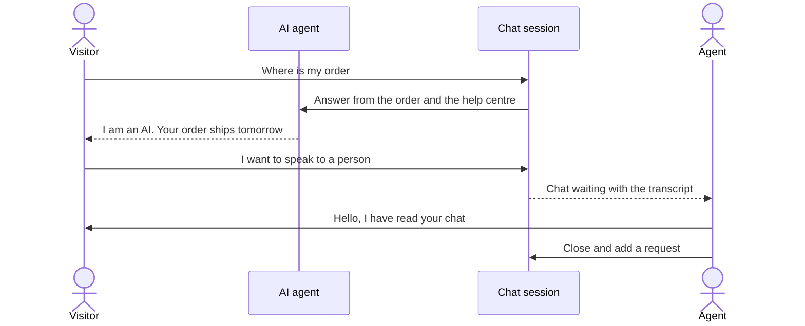

🏠 [Specs](../../../../README.md) › 🧩 [Functional capabilities](../../../README.md) ›
🎧 [F16 Customer support agents](../../README.md) › 📝 [Use cases](../README.md) ›
📝 [Use cases: FL-F16-07 Forum, live chat, voice and support contracts](README.md) ›
📝 UC-F16-19 Answer website visitors in live chat

# 📝 UC-F16-19 Answer website visitors in live chat

**Status:** 🔄 waiting for the owner

## Summary

A visitor or a customer chats from the company's website or the portal: the AI agent answers first from the help centre
and the customer's data, and hands the chat to a person at once when asked or when it cannot answer. The person reads
the whole conversation and continues it without asking again.

## Personas

- [U16 Office worker](../../../../01-users/personas/u16-office-worker.md)
- [U09 Customer](../../../../01-users/personas/u09-customer.md)

## Goal

Visitors get an answer in seconds at any hour and a person when they need one, never starting over.

## Trigger

A visitor opens the chat window on a page of the site or the portal.

## Frequency

Dozens to thousands of chats a day.

## Preconditions

- The chat is switched on for the website ([E-F11-01 Website](../../../f11-online-shop/data/e-f11-01-website.md)).
- The agents' opening hours and routing are set
  ([UC-F16-07](../04-human-agent-workspace/uc-f16-07-set-service-levels-and-follow-targets.md)).
- The AI agent's intents and procedures are active
  ([UC-F16-02](../02-automate-an-intent/uc-f16-02-write-and-test-a-procedure.md)).

## Postconditions

- **Succeeded:** the chat is saved ([E-F16-14 Chat session](../../data/e-f16-14-chat-session.md)) with its transcript,
  its outcome and its rating; a request exists when the matter went on; the customer's record shows the conversation.
- **Failed:** a chat the company cannot answer becomes a request with the whole transcript
  ([UC-F16-16](../06-take-in-every-request/uc-f16-16-turn-any-request-into-a-work-request.md)).

## Main flow

1. A visitor opens the chat on the site, on a phone or a desktop
   ([S-F16-17 Live chat](../../screens/07-live-chat-voice-and-contracts/s-f16-17-live-chat.md)), says their language and
   asks a question.
2. The AI agent identifies the visitor if they are signed in, finds the intent and answers from the help centre or acts
   within its procedure ([UC-F16-01](../01-resolve-a-request/uc-f16-01-resolve-a-customer-request-automatically.md)).
3. The AI agent says it is an AI at the first message and offers a person at any time
   ([BR-F16-04](../../business-rules/br-f16-04-customers-know-and-can-reach-a-person.md)).
4. When the visitor asks for a person or the AI agent cannot answer, the chat moves to Waiting and the agents' desktop
   shows it with the whole transcript.
5. An agent takes the chat, reads what was said and what the AI agent tried, and continues; the customer is not asked
   again ([BR-F16-15](../../business-rules/br-f16-15-the-ai-hands-over-to-a-person-with-the-full-history.md)).
6. The chat closes; the customer may rate it; the transcript joins the customer's record and a request if needed.

## Alternative flows

- 2a. The visitor is a prospect: the chat captures their name and email with their consent and creates a lead
  [UC-F6-01](../../../f06-customers-and-sales/use-cases/01-lead-to-quote/uc-f06-01-capture-and-qualify-a-lead.md).
- 4a. No agent is on duty: the chat takes a message, becomes a request and promises an answer by the service level.
- 5a. An agent transfers the chat to a colleague with the right skill: the history goes along.

## Error flows

- 2e. The AI agent is not sure: it says so and hands over instead of guessing
  ([BR-F16-01](../../business-rules/br-f16-01-automatic-only-above-the-bar.md)).
- 4e. The handover cannot reach any agent in 60 seconds: the visitor is told and offered a call back or a request.
- 5e. The visitor leaves: the chat closes as Missed and the transcript is kept as a request when it holds a question.
- Any step: a service does not answer; the call is retried first
  ([BR-F3-32](../../../f03-assistant/business-rules/br-f03-32-retry-before-an-error.md)), then the message follows the
  error pattern ([D122](../../../../06-decisions/ux/d122-error-message-standard.md)) and what the user typed stays on
  the screen.

## Business rules

- [BR-F16-15](../../business-rules/br-f16-15-the-ai-hands-over-to-a-person-with-the-full-history.md)
- [BR-F16-04](../../business-rules/br-f16-04-customers-know-and-can-reach-a-person.md)
- [BR-F16-11](../../business-rules/br-f16-11-answers-in-the-customers-language.md)
- [BR-F16-03](../../business-rules/br-f16-03-agents-act-only-as-their-procedure-allows.md)

## Entities

- [E-F16-14 Chat session](../../data/e-f16-14-chat-session.md): created, changed
- [E-F16-01 Customer request](../../data/e-f16-01-customer-request.md): created, a request when the matter goes on
- [E-F16-06 Queue](../../data/e-f16-06-queue.md): read, the queue and the agents' skills
- [E-F6-01 Customer record](../../../f06-customers-and-sales/data/e-f06-01-customer-record.md): read, the customer
  behind a signed-in visitor

## Permissions

Visitors and customers chat. Office workers answer within their queue. The owner reads the chats' figures; a
customer reads their own transcripts in the portal.

## Notifications

The agent, in the app and with a sound: a chat waiting, with its wait time. The customer: the transcript by email at
their request.

## Audit events

Each chat, message, handover, transfer, closing and rating, with who or what, when and the reason; each action the AI
agent took.

## AI involvement

The AI agent answers and acts within its procedures and the bar of
[BR-F16-01](../../business-rules/br-f16-01-automatic-only-above-the-bar.md); it says it is an AI and hands over on
request or doubt, with the transcript and what it tried.

## API, MCP and A2A exposure

T5 operations of the capability for the personas above: create, read, update and list. The MCP tool of the
capability may read and propose, never confirm alone. No A2A skill.

## Screens

- [S-F16-17 Live chat](../../screens/07-live-chat-voice-and-contracts/s-f16-17-live-chat.md)

## Flowchart

See
[FL-F16-07 Forum, live chat, voice and support contracts](../../flows/fl-f16-07-live-chat-voice-and-contracts.md#flowchart).

## Sequence diagram

## Acceptance criteria

1. **Given** a visitor who asks for a person **when** the request is sent **then** the chat moves to Waiting and the
   agent sees the whole transcript.
2. **Given** a handover **when** the agent opens the chat **then** the customer is not asked what they already said.
3. **Given** no agent on duty **when** the visitor asks for a person **then** the chat becomes a request with the
   transcript.
4. **Given** the AI agent unsure of an answer **when** it replies **then** it says it is unsure and hands over.

## Non-functional notes

The screen answers within 2 seconds for 10,000 records; every change is audited.

## Regulatory references

The AI agent must say it is an AI:
[CR-FR-056](../../../../10-country-packs/france/ai-and-recording/cr-fr-056-people-know-they-deal-with-an-ai.md). A chat
stores the visitor's words:
[CR-FR-050](../../../../10-country-packs/france/data-protection/cr-fr-050-privacy-by-design.md),
[CR-FR-052](../../../../10-country-packs/france/data-protection/cr-fr-052-storage-limitation.md). (Proposed) The
France-pack rule on chat transcripts and the visitor's information is written later.

## Related use cases

- [UC-F16-18 Run the community forum](uc-f16-18-run-the-community-forum.md)
- [UC-F16-20](uc-f16-20-answer-phone-calls-with-the-voice-agent.md)
- [UC-F16-18 Run the community forum](uc-f16-18-run-the-community-forum.md)
- [UC-F16-20](uc-f16-20-answer-phone-calls-with-the-voice-agent.md)
- [UC-F16-13 Ask for a person](../05-customer-side/uc-f16-13-ask-for-a-person.md)
- [UC-F16-08](../04-human-agent-workspace/uc-f16-08-work-requests-in-the-agent-workspace.md)

## Open questions

None.

---

⬅️ [UC-F16-18 Run the community forum](uc-f16-18-run-the-community-forum.md) · ⬆️ [Up](README.md) ·
➡️ [UC-F16-20 Answer phone calls with the voice agent](uc-f16-20-answer-phone-calls-with-the-voice-agent.md)
