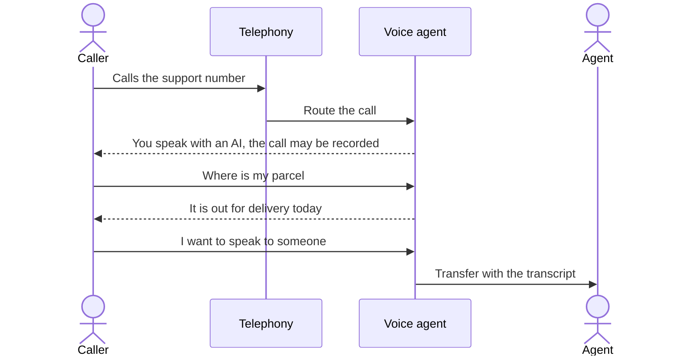

🏠 [Specs](../../../../README.md) › 🧩 [Functional capabilities](../../../README.md) ›
🎧 [F16 Customer support agents](../../README.md) › 📝 [Use cases](../README.md) ›
📝 [Use cases: FL-F16-07 Forum, live chat, voice and support contracts](README.md) ›
📝 UC-F16-20 Answer phone calls with the voice agent

# 📝 UC-F16-20 Answer phone calls with the voice agent

**Status:** 🔄 waiting for the owner

## Summary

The AI agent answers the company's phone calls: it greets the caller, says it is an AI, understands the request, answers
or acts within its procedures, and transfers the call to a person on request or when it cannot help. The call arrives
through the telephony of F4 and is logged as a request.

## Personas

- [U09 Customer](../../../../01-users/personas/u09-customer.md)
- [U16 Office worker](../../../../01-users/personas/u16-office-worker.md)

## Goal

Callers get an answer at any hour without waiting in a queue, know they speak with an AI, and can always reach a person.

## Trigger

A call arrives on a number routed to the voice agent
([UC-F4-19](../../../f04-meetings/use-cases/10-benchmark-additions/uc-f04-19-route-incoming-calls.md)).

## Frequency

Dozens to thousands of calls a day.

## Preconditions

- The company's telephony is connected and the number is routed to the voice agent
  ([UC-F4-19](../../../f04-meetings/use-cases/10-benchmark-additions/uc-f04-19-route-incoming-calls.md)).
- The intents and procedures the voice agent may use are active
  ([UC-F16-03](../02-automate-an-intent/uc-f16-03-roll-an-intent-out.md)).
- The announcement of the call and of the AI agent is recorded in each language.

## Postconditions

- **Succeeded:** the call is logged with its transcript, its outcome and its request
  ([E-F16-01 Customer request](../../data/e-f16-01-customer-request.md)); a transferred call reaches an agent with the
  transcript so far.
- **Failed:** a call that cannot be handled is transferred to a person or to a voice mailbox that creates a request.

## Main flow

1. A caller dials the number; the voice agent answers and says, before anything else, that the caller speaks with an AI
   ([BR-F16-16](../../business-rules/br-f16-16-callers-are-told-they-speak-with-an-ai.md)) and that the call may be
   recorded.
2. The caller states the request; the voice agent understands it in the caller's language and identifies the customer by
   what they say and the number they call from.
3. The voice agent answers or acts within the procedure of the intent
   ([UC-F16-01](../01-resolve-a-request/uc-f16-01-resolve-a-customer-request-automatically.md)), confirming each act by
   voice.
4. When the caller asks for a person, or the voice agent is unsure, it transfers the call to an agent and passes the
   transcript so far.
5. The call ends; the voice agent logs a summary and, if needed, creates a request
   ([UC-F16-16](../06-take-in-every-request/uc-f16-16-turn-any-request-into-a-work-request.md)).
6. A supervisor reviews calls on the voice agent screen
   ([S-F16-18 Voice agent](../../screens/07-live-chat-voice-and-contracts/s-f16-18-voice-agent.md)): the transcript, the
   outcome and the agent's confidence.

## Alternative flows

- 2a. The caller speaks a language the voice agent does not handle: it says so in the languages it knows and transfers
  to a person.
- 3a. The action needs a verification (a payment, an address change): the voice agent asks for it in a way the procedure
  allows and never reads a full card number aloud.
- 5a. The caller hangs up before the end: the call is logged as Dropped with what was understood.

## Error flows

- 1e. The telephony does not answer: the call rings the fallback number of an agent.
- 3e. The voice agent does not understand twice: it transfers rather than ask a third time.
- 4e. No agent is on duty: the voice agent offers a call back and creates a request with the number.
- Any step: a service does not answer; the call is retried first
  ([BR-F3-32](../../../f03-assistant/business-rules/br-f03-32-retry-before-an-error.md)), then the message follows the
  error pattern ([D122](../../../../06-decisions/ux/d122-error-message-standard.md)) and what the user typed stays on
  the screen.

## Business rules

- [BR-F16-16](../../business-rules/br-f16-16-callers-are-told-they-speak-with-an-ai.md)
- [BR-F16-04](../../business-rules/br-f16-04-customers-know-and-can-reach-a-person.md)
- [BR-F16-03](../../business-rules/br-f16-03-agents-act-only-as-their-procedure-allows.md)

## Entities

- [E-F16-01 Customer request](../../data/e-f16-01-customer-request.md): created, a request when the matter goes on
- [E-F4-12 Call route](../../../f04-meetings/data/e-f04-12-call-route.md): read, the call route
- [E-F4-02 Transcript](../../../f04-meetings/data/e-f04-02-transcript.md): created, the transcript when recording is on

## Permissions

Callers use the number. Office workers and supervisors review the calls of their queue. The owner sets the
voice agent's languages and opening hours.

## Notifications

The agent: a transferred call with its transcript so far. The supervisor: calls the voice agent was unsure of.

## Audit events

Each call, announcement, intent, action, transfer and ending, with when and the confidence; each recording and its
deletion.

## AI involvement

The voice agent is an AI agent: it says so first, follows the procedures of
[BR-F16-03](../../business-rules/br-f16-03-agents-act-only-as-their-procedure-allows.md), and never builds a voice print
of the caller ([CR-FR-053](../../../../10-country-packs/france/data-protection/cr-fr-053-no-biometric-voice-prints.md)).

## API, MCP and A2A exposure

T5 operations of the capability for the personas above: create, read, update and list. The MCP tool of the
capability may read and propose, never confirm alone. No A2A skill.

## Screens

- [S-F16-18 Voice agent](../../screens/07-live-chat-voice-and-contracts/s-f16-18-voice-agent.md)

## Flowchart

See
[FL-F16-07 Forum, live chat, voice and support contracts](../../flows/fl-f16-07-live-chat-voice-and-contracts.md#flowchart).

## Sequence diagram

## Acceptance criteria

1. **Given** any incoming call **when** the voice agent answers **then** its first sentence says the caller speaks with
   an AI.
2. **Given** a caller who asks for a person **when** the voice agent hears it **then** the call is transferred with the
   transcript so far.
3. **Given** a caller in a language not handled **when** the voice agent answers **then** it says so and transfers.
4. **Given** a call recorded **when** the call ends **then** the recording is kept only as long as the retention rule
   and the caller's voice is never stored as a voice print.

## Non-functional notes

The screen answers within 2 seconds for 10,000 records; every change is audited.

## Regulatory references

Callers must know they speak with an AI:
[CR-FR-056](../../../../10-country-packs/france/ai-and-recording/cr-fr-056-people-know-they-deal-with-an-ai.md). A
recording is announced:
[CR-FR-059](../../../../10-country-packs/france/ai-and-recording/cr-fr-059-recordings-are-announced.md), and kept
proportionate:
[CR-FR-207](../../../../10-country-packs/france/data-protection/cr-fr-207-call-recording-proportionate.md). No voice
print: [CR-FR-053](../../../../10-country-packs/france/data-protection/cr-fr-053-no-biometric-voice-prints.md).
(Proposed) The France-pack rule on AI disclosure to callers and its wording is written later.

## Related use cases

- [UC-F16-19](uc-f16-19-answer-website-visitors-in-live-chat.md)
- [UC-F16-21 Warn customers before they ask](uc-f16-21-warn-customers-before-they-ask.md)
- [UC-F16-19](uc-f16-19-answer-website-visitors-in-live-chat.md)
- [UC-F16-01](../01-resolve-a-request/uc-f16-01-resolve-a-customer-request-automatically.md)
- [UC-F4-16](../../../f04-meetings/use-cases/07-prepare-and-capture-anywhere/uc-f04-16-call-from-the-softphone.md)
- [UC-F4-19](../../../f04-meetings/use-cases/10-benchmark-additions/uc-f04-19-route-incoming-calls.md)
- [UC-F3-20](../../../f03-assistant/use-cases/13-voice-agents-and-briefings/uc-f03-20-talk-to-the-assistant-hands-free.md)

## Open questions

None.

---

⬅️ [UC-F16-19 Answer website visitors in live chat](uc-f16-19-answer-website-visitors-in-live-chat.md) ·
⬆️ [Up](README.md) · ➡️ [UC-F16-21 Warn customers before they ask](uc-f16-21-warn-customers-before-they-ask.md)
