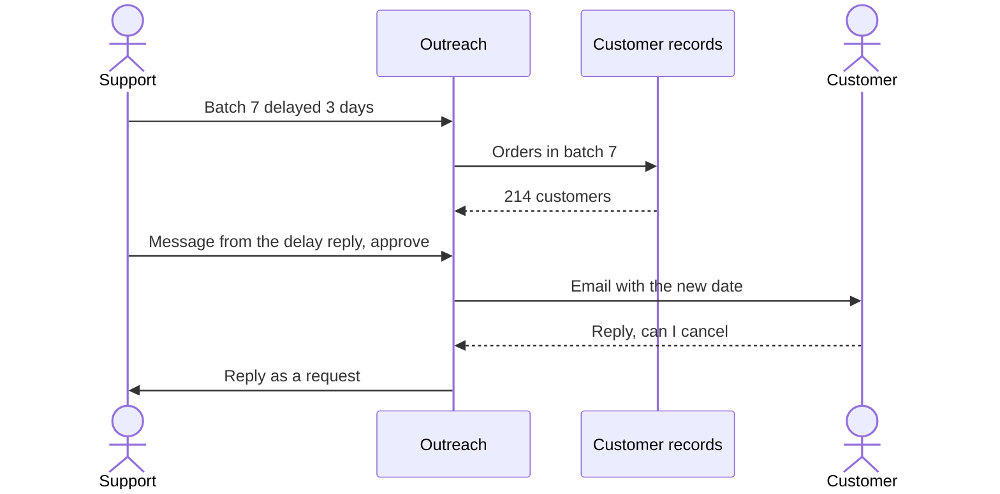

🏠 [Specs](../../../../README.md) › 🧩 [Functional capabilities](../../../README.md) ›
🎧 [F16 Customer support agents](../../README.md) › 📝 [Use cases](../README.md) ›
📝 [Use cases: FL-F16-07 Forum, live chat, voice and support contracts](README.md) ›
📝 UC-F16-21 Warn customers before they ask

# 📝 UC-F16-21 Warn customers before they ask

**Status:** 🔄 waiting for the owner

## Summary

The support team warns customers before they ask: when a known incident or a late delivery affects some customers,
support selects exactly those customers from the records, writes one message and sends it by email, SMS or in the app,
with the next step and a way to answer.

## Personas

- [U16 Office worker](../../../../01-users/personas/u16-office-worker.md)

## Goal

Affected customers hear from the company first, support receives fewer requests and nobody else is disturbed.

## Trigger

An incident, a delay or a defect is known and its customers can be identified, see
[UC-F7-01](../../../f07-purchasing-and-stock/use-cases/01-procure/uc-f07-01-request-and-approve-a-purchase.md) and then
[UC-F11-28](../../../f11-online-shop/use-cases/10-fulfil-from-stores-and-report/uc-f11-28-fulfil-online-orders-from-a-store.md).

## Frequency

A few outreaches a month; each reaches tens to thousands of customers.

## Preconditions

- The cause is recorded and the affected records can be selected (late orders, a faulty batch, a service outage).
- The customers' contact details and preferences are known
  ([E-F5-10](../../../f05-social-media/data/e-f05-10-consent-and-suppression-record.md)).

## Postconditions

- **Succeeded:** the outreach is saved ([E-F16-15 Outreach](../../data/e-f16-15-outreach.md)) with its audience, its
  message, its sent and failed counts and the replies, which become requests.
- **Failed:** nothing is sent; the draft shows the audience and what blocked it.

## Main flow

1. Support opens the proactive outreach screen
   ([S-F16-19](../../screens/07-live-chat-voice-and-contracts/s-f16-19-proactive-outreach.md)) and describes the cause:
   for example, orders of a batch delayed by 3 days.
2. simple-ERP selects the customers whose records match the cause and shows the count and a sample
   ([BR-F16-17](../../business-rules/br-f16-17-outreach-targets-affected-customers-only.md)).
3. Support writes the message from a canned reply ([UC-F16-23](uc-f16-23-use-canned-replies.md)) with the variables
   filled from each customer's order; the AI agent may suggest the wording, marked as AI.
4. A second person approves the message and the audience when it reaches more than a set number of customers.
5. simple-ERP sends it on each customer's channel, within quiet hours, and counts delivered and failed.
6. Replies arrive as requests
   ([UC-F16-16](../06-take-in-every-request/uc-f16-16-turn-any-request-into-a-work-request.md)); support closes the
   outreach when the cause is solved.

## Alternative flows

- 3a. The customer has no contact channel: they are listed as unreachable and support can call them.
- 5a. The outreach is cancelled before sending: the draft stays and no one is contacted.
- 6a. The cause is solved earlier: a second outreach tells the same customers it is over.

## Error flows

- 2e. The selection returns every customer: the screen refuses to send and asks for a narrower cause.
- 5e. The channel provider refuses part of the batch: the failed ones are listed and retried on another channel.
- 5f. A customer opted out of service messages: they are not contacted
  ([BR-F16-17](../../business-rules/br-f16-17-outreach-targets-affected-customers-only.md)).
- Any step: a service does not answer; the call is retried first
  ([BR-F3-32](../../../f03-assistant/business-rules/br-f03-32-retry-before-an-error.md)), then the message follows the
  error pattern ([D122](../../../../06-decisions/ux/d122-error-message-standard.md)) and what the user typed stays on
  the screen.

## Business rules

- [BR-F16-17](../../business-rules/br-f16-17-outreach-targets-affected-customers-only.md)
- [BR-F16-04](../../business-rules/br-f16-04-customers-know-and-can-reach-a-person.md)
- [BR-F16-11](../../business-rules/br-f16-11-answers-in-the-customers-language.md)

## Entities

- [E-F16-15 Outreach](../../data/e-f16-15-outreach.md): created, changed
- [E-F16-01 Customer request](../../data/e-f16-01-customer-request.md): created, replies as requests
- [E-F16-07 Macro](../../data/e-f16-07-macro.md): read, the message wording
- [E-F5-10](../../../f05-social-media/data/e-f05-10-consent-and-suppression-record.md): read, the contact preferences

## Permissions

Support (office workers) prepares; a second office worker or the owner approves an outreach above 500
customers.

## Notifications

The customer: the message itself. Support: a send finished with its counts, and the replies.

## Audit events

Each outreach (cause, selection, audience count, message, approver, sent and failed counts, by whom and when); each
opt-out honoured.

## AI involvement

The AI agent may suggest the wording and the audience query and marks them as AI; support reads and approves. It never
sends.

## API, MCP and A2A exposure

T5 operations of the capability for the personas above: create, read, update and list. The MCP tool of the
capability may read and propose, never confirm alone. No A2A skill.

## Screens

- [S-F16-19](../../screens/07-live-chat-voice-and-contracts/s-f16-19-proactive-outreach.md)

## Flowchart

See
[FL-F16-07 Forum, live chat, voice and support contracts](../../flows/fl-f16-07-live-chat-voice-and-contracts.md#flowchart).

## Sequence diagram

## Acceptance criteria

1. **Given** a delayed batch of 214 orders **when** support selects the cause **then** 214 customers are listed and
   nobody else.
2. **Given** a customer who opted out of service messages **when** the outreach is sent **then** they receive nothing.
3. **Given** an audience of 3,000 customers with a limit of 500 **when** support sends **then** a second approval is
   asked first.
4. **Given** a customer who replies **when** the reply arrives **then** it becomes a request with the outreach as its
   context.

## Non-functional notes

The screen answers within 2 seconds for 10,000 records; every change is audited.

## Regulatory references

A message about an order or a service is a service message, not marketing; marketing messages need consent
([CR-FR-063](../../../../10-country-packs/france/consumer/cr-fr-063-electronic-marketing-consent.md)). A message that
also sells is marketing. (Proposed) The France-pack rule on service messages is written later.

## Related use cases

- [UC-F16-20](uc-f16-20-answer-phone-calls-with-the-voice-agent.md)
- [UC-F16-22 Sell prepaid support hours](uc-f16-22-sell-prepaid-support-hours.md)
- [UC-F16-19](uc-f16-19-answer-website-visitors-in-live-chat.md)
- [UC-F16-22 Sell prepaid support hours](uc-f16-22-sell-prepaid-support-hours.md)
- [UC-F16-23 Use canned replies](uc-f16-23-use-canned-replies.md)
- [UC-F5-08](../../../f05-social-media/use-cases/05-benchmark-additions/uc-f05-08-run-email-campaigns.md)

## Open questions

None.

---

⬅️ [UC-F16-20 Answer phone calls with the voice agent](uc-f16-20-answer-phone-calls-with-the-voice-agent.md) ·
⬆️ [Up](README.md) · ➡️ [UC-F16-22 Sell prepaid support hours](uc-f16-22-sell-prepaid-support-hours.md)
