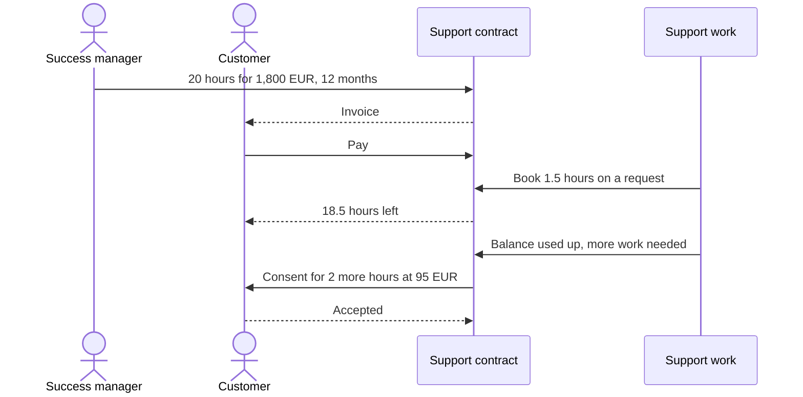

🏠 [Specs](../../../../README.md) › 🧩 [Functional capabilities](../../../README.md) ›
🎧 [F16 Customer support agents](../../README.md) › 📝 [Use cases](../README.md) ›
📝 [Use cases: FL-F16-07 Forum, live chat, voice and support contracts](README.md) ›
📝 UC-F16-22 Sell prepaid support hours

# 📝 UC-F16-22 Sell prepaid support hours

**Status:** ✅ specified

## Summary

The customer success manager sells prepaid support hours: a customer buys a block of hours for a price, valid for a
period; support work on their requests is booked against the block and the balance is visible to both sides. When the
block is used up, further work needs the customer's consent.

## Personas

- [U41 Customer success manager](../../../../01-users/personas/u41-customer-success-manager.md)
- [U09 Customer](../../../../01-users/personas/u09-customer.md)

## Goal

Customers buy support in advance at a known price, see what is left, and are never billed for work they did not agree
to.

## Trigger

A customer asks for support beyond what their plan includes, or a customer's block is almost used.

## Frequency

A few contracts a month; a balance check on each request of a customer under contract.

## Preconditions

- The customer has a customer record
  ([E-F6-01 Customer record](../../../f06-customers-and-sales/data/e-f06-01-customer-record.md)) and an account.
- A support product with an hourly price exists
  ([E-F6-08 Sales price list](../../../f06-customers-and-sales/data/e-f06-08-sales-price-list.md)).
- Time is booked on requests
  ([UC-F9-16](../../../f09-hr-and-projects/use-cases/03-time/uc-f09-16-record-and-validate-timesheets.md)).

## Postconditions

- **Succeeded:** the support contract is saved ([E-F16-16 Support contract](../../data/e-f16-16-support-contract.md))
  and invoiced
  [UC-F6-06](../../../f06-customers-and-sales/use-cases/03-invoice-and-get-paid/uc-f06-06-invoice-deposits-progress-and-final.md);
  each request books its time against the balance; the customer sees the balance on their phone.
- **Failed:** no contract is created and no hour is booked; the customer is not invoiced.

## Main flow

1. The customer success manager opens the support contracts screen
   ([S-F16-20](../../screens/07-live-chat-voice-and-contracts/s-f16-20-support-contracts.md)) and creates a contract:
   the customer, the hours, the price, the start and the validity.
2. SimpleERP issues the quote and the invoice; the contract becomes Active when it is paid, see
   [UC-F6-03](../../../f06-customers-and-sales/use-cases/01-lead-to-quote/uc-f06-03-create-and-send-a-quote.md) and then
   [UC-F6-07](../../../f06-customers-and-sales/use-cases/03-invoice-and-get-paid/uc-f06-07-get-paid-online-and-reconcile.md).
3. Support works on the customer's requests and books time on them; each booking reduces the balance.
4. The customer sees the hours left in the portal on their phone and gets an alert at 20 percent.
5. When the balance reaches zero, SimpleERP asks the customer's consent before more hours are worked
   ([BR-F16-18](../../business-rules/br-f16-18-work-beyond-the-prepaid-balance-needs-consent.md)).
6. At the end of validity the contract expires; the manager may renew it, with the unused hours treated as the terms
   say.

## Alternative flows

- 3a. A request needs a specialist at a higher rate: the booking uses the rate of the contract and shows the conversion
  in hours.
- 5a. The customer consents to a further block: a new contract is created from the same screen.
- 6a. The customer asks for a refund of unused hours: the contract's terms decide and the credit note follows
  [UC-F6-09](../../../f06-customers-and-sales/use-cases/03-invoice-and-get-paid/uc-f06-09-credit-note-and-refund.md).

## Error flows

- 2e. The invoice is not paid: the contract stays Offered and no hour is booked.
- 5e. The customer refuses further hours: the request is kept, answered within what the plan includes, and the customer
  is told what remains.
- 5f. The customer cannot be reached for consent: work stops and the request waits.
- Any step: a service does not answer; the call is retried first
  ([BR-F3-32](../../../f03-assistant/business-rules/br-f03-32-retry-before-an-error.md)), then the message follows the
  error pattern ([D122](../../../../06-decisions/ux/d122-error-message-standard.md)) and what the user typed stays on
  the screen.

## Business rules

- [BR-F16-18](../../business-rules/br-f16-18-work-beyond-the-prepaid-balance-needs-consent.md)
- [BR-F6-10](../../../f06-customers-and-sales/business-rules/br-f06-10-usage-is-billed-from-metered-data.md)
- [BR-F6-11](../../../f06-customers-and-sales/business-rules/br-f06-11-over-the-credit-limit-orders-are-held.md)

## Entities

- [E-F16-16 Support contract](../../data/e-f16-16-support-contract.md): created, changed
- [E-F6-05 Invoice](../../../f06-customers-and-sales/data/e-f06-05-invoice.md): created, the invoice of the block
- [E-F9-17 Timesheet line](../../../f09-hr-and-projects/data/e-f09-17-timesheet-line.md): read, the time booked on
  requests
- [E-F16-01 Customer request](../../data/e-f16-01-customer-request.md): read, the requests worked

## Permissions

Customer success manager sells and reads the balances. Office workers book time. The customer reads their own contract
and balance. The owner reads the contracts' figures.

## Notifications

The customer, on their phone: the balance at 20 percent, at zero (with the consent question), the expiry in 30 days. The
manager: a contract almost used.

## Audit events

Each contract sold, paid, renewed and expired; each booking (request, hours, by whom); each consent asked and its
answer.

## AI involvement

No AI step of its own. The AI assistant may open the screen and prefill it from the user's words; the user checks and
confirms ([BR-F3-07](../../../f03-assistant/business-rules/br-f03-07-no-deletes-no-irreversible-acts.md)).

## API, MCP and A2A exposure

T5 operations of the capability for the personas above: create, read, update and list. The MCP tool of the
capability may read and propose, never confirm alone. No A2A skill.

## Screens

- [S-F16-20](../../screens/07-live-chat-voice-and-contracts/s-f16-20-support-contracts.md)

## Flowchart

See
[FL-F16-07 Forum, live chat, voice and support contracts](../../flows/fl-f16-07-live-chat-voice-and-contracts.md#flowchart).

## Sequence diagram

## Acceptance criteria

1. **Given** a contract of 20 hours **when** support books 1.5 hours **then** the balance shows 18.5 hours.
2. **Given** a balance of zero **when** support needs more time **then** the customer's consent is asked first and no
   hour is booked before the answer.
3. **Given** a contract that expired **when** support books time **then** the booking is refused and the renewal is
   offered.
4. **Given** a customer on a phone **when** they open their contract **then** they see the balance, the validity and the
   bookings.

## Non-functional notes

The screen answers within 2 seconds for 10,000 records; every change is audited.

## Regulatory references

A prepaid service must tell the customer the price, the validity, what happens to unused hours and how to
stop; for a consumer, the information before an online order and the withdrawal right apply:
[CR-FR-065](../../../../10-country-packs/france/consumer/cr-fr-065-online-pre-contract-information.md),
[CR-FR-036](../../../../10-country-packs/france/consumer/cr-fr-036-withdrawal-right.md). The France-pack rule on prepaid
services is written later.

## Related use cases

- [UC-F16-21 Warn customers before they ask](uc-f16-21-warn-customers-before-they-ask.md)
- [UC-F16-23 Use canned replies](uc-f16-23-use-canned-replies.md)
- [UC-F16-21 Warn customers before they ask](uc-f16-21-warn-customers-before-they-ask.md)
- [UC-F16-23 Use canned replies](uc-f16-23-use-canned-replies.md)
- [UC-F6-10](../../../f06-customers-and-sales/use-cases/04-subscriptions/uc-f06-10-manage-subscriptions.md)
- [UC-F6-16](../../../f06-customers-and-sales/use-cases/05-benchmark-additions/uc-f06-16-bill-usage-commitments-and-milestones.md)

## Open questions

None.

---

⬅️ [UC-F16-21 Warn customers before they ask](uc-f16-21-warn-customers-before-they-ask.md) · ⬆️ [Up](README.md) ·
➡️ [UC-F16-23 Use canned replies](uc-f16-23-use-canned-replies.md)
