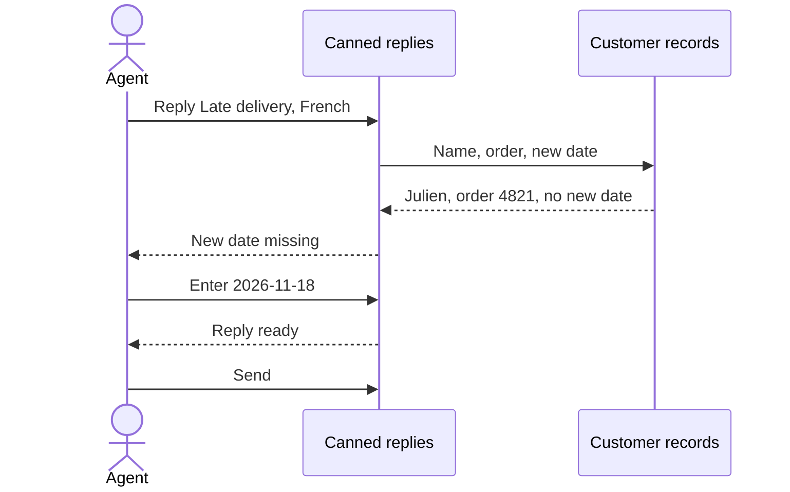

🏠 [Specs](../../../../README.md) › 🧩 [Functional capabilities](../../../README.md) ›
🎧 [F16 Customer support agents](../../README.md) › 📝 [Use cases](../README.md) ›
📝 [Use cases: FL-F16-07 Forum, live chat, voice and support contracts](README.md) › 📝 UC-F16-23 Use canned replies

# 📝 UC-F16-23 Use canned replies

**Status:** ✅ specified

## Summary

Support keeps a library of canned replies: ready answers to frequent requests, in each language, with variables that are
filled from the request and its customer's records (name, order number, date). A reply that needs a variable the records
do not hold cannot be sent until a person supplies it.

## Personas

- [U16 Office worker](../../../../01-users/personas/u16-office-worker.md)

## Goal

Agents and the AI agent answer frequent requests in seconds with correct details, and nothing is invented to fill a gap.

## Trigger

An agent opens a request and picks a canned reply, or a canned reply is attached to an intent's procedure.

## Frequency

Hundreds of uses a day; the library changes a few times a month.

## Preconditions

- The request is linked to its customer and its records
  ([E-F16-01 Customer request](../../data/e-f16-01-customer-request.md)).
- Canned replies exist for the request's language ([E-F16-07 Macro](../../data/e-f16-07-macro.md), section "Canned
  replies (D566)").

## Postconditions

- **Succeeded:** the reply is inserted with its variables filled from the records and sent; the use is counted on the
  reply and its request.
- **Failed:** the reply is not sent; the missing variables are listed and highlighted.

## Main flow

1. An agent opens a request in the workspace
   ([UC-F16-08](../04-human-agent-workspace/uc-f16-08-work-requests-in-the-agent-workspace.md)) and the screen suggests
   canned replies for its intent and language
   ([S-F16-21](../../screens/07-live-chat-voice-and-contracts/s-f16-21-canned-replies.md)).
2. The agent picks a reply; SimpleERP fills each variable from the request and the customer's records
   ([BR-F16-19](../../business-rules/br-f16-19-variables-come-from-the-request-never-guessed.md)).
3. A variable that has no value is shown as missing and blocks sending until the agent enters it or removes the
   sentence.
4. The agent adapts the text if needed and sends it.
5. A support lead writes and edits replies in the library, with the variables each needs and the languages.
6. The AI agent uses the same replies in its procedures, with the same rule
   ([UC-F16-02](../02-automate-an-intent/uc-f16-02-write-and-test-a-procedure.md)).

## Alternative flows

- 2a. The customer's language differs from the agent's: the reply in the customer's language is offered
  ([BR-F16-11](../../business-rules/br-f16-11-answers-in-the-customers-language.md)).
- 4a. The agent finds the reply wrong: they flag it and the support lead reviews it.
- 5a. A reply is retired: it stays on the requests where it was used and is no longer offered.

## Error flows

- 2e. A variable has two possible values (two open orders): the agent chooses; the reply is not filled by guess.
- 3e. The customer's records are not readable by this agent: the variable shows as restricted and cannot be filled.
- 5e. A reply uses a variable the library does not know: it cannot be saved.
- Any step: a service does not answer; the call is retried first
  ([BR-F3-32](../../../f03-assistant/business-rules/br-f03-32-retry-before-an-error.md)), then the message follows the
  error pattern ([D122](../../../../06-decisions/ux/d122-error-message-standard.md)) and what the user typed stays on
  the screen.

## Business rules

- [BR-F16-19](../../business-rules/br-f16-19-variables-come-from-the-request-never-guessed.md)
- [BR-F16-03](../../business-rules/br-f16-03-agents-act-only-as-their-procedure-allows.md)
- [BR-F16-11](../../business-rules/br-f16-11-answers-in-the-customers-language.md)

## Entities

- [E-F16-07 Macro](../../data/e-f16-07-macro.md): created, changed, read, a canned reply being a macro that sends a
  text with typed variables (D566)
- [E-F16-02 Intent](../../data/e-f16-02-intent.md): read, the intent a reply is for
- [E-F16-01 Customer request](../../data/e-f16-01-customer-request.md): read, the request and its records

## Permissions

Support lead writes and retires replies; office workers use them; the owner reads the library and the use
counts.

## Notifications

None to customers: the use case sends no message of its own. The support lead: a reply flagged as wrong.

## Audit events

Each reply created, edited, retired and used (request, by whom or by the AI agent, with the variables filled and from
which records); each missing variable and how it was settled.

## AI involvement

The AI agent may propose a reply for a new intent and marks it as AI; a support lead approves it. In use, the AI agent
fills variables from records only and never guesses
([BR-F16-19](../../business-rules/br-f16-19-variables-come-from-the-request-never-guessed.md)).

## API, MCP and A2A exposure

T5 operations of the capability for the personas above: create, read, update and list. The MCP tool of the
capability may read and propose, never confirm alone. No A2A skill.

## Screens

- [S-F16-21](../../screens/07-live-chat-voice-and-contracts/s-f16-21-canned-replies.md)

## Flowchart

See
[FL-F16-07 Forum, live chat, voice and support contracts](../../flows/fl-f16-07-live-chat-voice-and-contracts.md#flowchart).

## Sequence diagram

## Acceptance criteria

1. **Given** a reply with a variable for the order number **when** the agent picks it on an order's request **then** the
   number is filled from the order.
2. **Given** a reply with a variable the records do not hold **when** the agent tries to send **then** sending is
   blocked and the variable is highlighted.
3. **Given** a customer with two open orders **when** the agent picks the reply **then** the agent chooses the order and
   the reply is not filled by guess.
4. **Given** an agent without the right to read the customer's payments **when** a reply needs an amount **then** the
   variable shows as restricted.

## Non-functional notes

The screen answers within 2 seconds for 10,000 records; every change is audited.

## Regulatory references

None specific beyond the replies being personal data processing of the customer's records:
[CR-FR-050](../../../../10-country-packs/france/data-protection/cr-fr-050-privacy-by-design.md).

## Related use cases

- [UC-F16-22 Sell prepaid support hours](uc-f16-22-sell-prepaid-support-hours.md)
- [UC-F16-18 Run the community forum](uc-f16-18-run-the-community-forum.md)
- [UC-F16-21 Warn customers before they ask](uc-f16-21-warn-customers-before-they-ask.md)
- [UC-F16-19](uc-f16-19-answer-website-visitors-in-live-chat.md)
- [UC-F16-08](../04-human-agent-workspace/uc-f16-08-work-requests-in-the-agent-workspace.md)

## Open questions

None.

---

⬅️ [UC-F16-22 Sell prepaid support hours](uc-f16-22-sell-prepaid-support-hours.md) · ⬆️ [Up](README.md)
