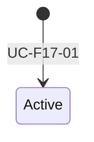

🏠 [Specs](../../../README.md) › 🧩 [Functional capabilities](../../README.md) ›
🔭 [F17 Competitive analysis](../README.md) › 🗃️ [Data](README.md) › 🗃️ E-F17-01 Competitor

# 🗃️ E-F17-01 Competitor

**Status:** ✅ specified

## Purpose

A company the customer follows.

## Fields

| Name | Type | Required | Validation | Default | Example | Personal data | Custom fields |
|---|---|---|---|---|---|---|---|
| name, identifiers, website | records | yes | BR-F17-02 | - | Rival SA, 552 100 554, rival.example | no | yes |
| followed signals | list | yes | - | all | prices, jobs | no | no |

## Relations

As its use cases.

## Lifecycle

## Indexes and search

By number, date, partner.

## Retention

Kept for the period of its kind of record in the country pack (D293), or else its kind's default in the
[retention schedule](../../../05-non-functional/data-retention.md).

## Audit

Every change.

## Import and export

CSV, FEC where relevant.

## Used by

- [UC-F17-01](../use-cases/01-set-up-and-profiles/uc-f17-01-list-competitors.md)
- [UC-F17-02](../use-cases/01-set-up-and-profiles/uc-f17-02-build-a-profile-from-registers-and-filings.md)
- [UC-F17-20](../use-cases/03-analyse-and-arm-sales/uc-f17-20-ask-the-assistant-about-a-competitor.md)

## Open questions

None.

---

⬆️ [Up](README.md) · ➡️ [E-F17-02 Company fact](e-f17-02-company-fact.md)
