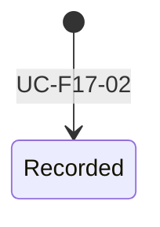

🏠 [Specs](../../../README.md) › 🧩 [Functional capabilities](../../README.md) ›
🔭 [F17 Competitive analysis](../README.md) › 🗃️ [Data](README.md) › 🗃️ E-F17-02 Company fact

# 🗃️ E-F17-02 Company fact

**Status:** ✅ specified

## Purpose

A sourced fact from a register or filing.

## Fields

| Name | Type | Required | Validation | Default | Example | Personal data | Custom fields |
|---|---|---|---|---|---|---|---|
| competitor, fact, value | records | yes | BR-F17-02 | - | Rival SA, revenue 2025, 12 M | no | no |
| source, read on | records | yes | BR-F17-02 | - | register link, 2026-11-03 | no | no |

## Relations

As its use cases.

## Lifecycle

## Indexes and search

By number, date, partner.

## Retention

Kept 3 years by default, then summarised (BR-F17-11).

## Audit

Every change.

## Import and export

CSV, FEC where relevant.

## Used by

- [UC-F17-02](../use-cases/01-set-up-and-profiles/uc-f17-02-build-a-profile-from-registers-and-filings.md)
- [UC-F17-09](../use-cases/02-collect-signals/uc-f17-09-follow-funding-deals-and-legal-events.md)

## Open questions

None.

---

⬅️ [E-F17-01 Competitor](e-f17-01-competitor.md) · ⬆️ [Up](README.md) ·
➡️ [E-F17-03 Price point](e-f17-03-price-point.md)
