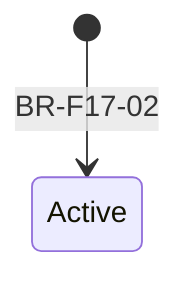

🏠 [Specs](../../../README.md) › 🧩 [Functional capabilities](../../README.md) ›
🔭 [F17 Competitive analysis](../README.md) › 🗃️ [Data](README.md) › 🗃️ E-F17-03 Price point

# 🗃️ E-F17-03 Price point

**Status:** ✅ specified

## Purpose

A price read for a product.

## Fields

| Name | Type | Required | Validation | Default | Example | Personal data | Custom fields |
|---|---|---|---|---|---|---|---|
| product, price, currency, date | records | yes | BR-F17-02 | - | Plan Pro, 49, EUR, 2026-11-03 | no | no |

## Relations

As its use cases.

## Lifecycle

## Indexes and search

By number, date, partner.

## Retention

Kept 3 years by default, then summarised (BR-F17-11).

## Audit

Every change.

## Import and export

CSV, FEC where relevant.

## Used by

- [UC-F17-03](../use-cases/02-collect-signals/uc-f17-03-track-products-and-prices.md)
- [UC-F17-11](../use-cases/03-analyse-and-arm-sales/uc-f17-11-compare-side-by-side.md)

## Open questions

None.

---

⬅️ [E-F17-02 Company fact](e-f17-02-company-fact.md) · ⬆️ [Up](README.md) ·
➡️ [E-F17-04 Job signal](e-f17-04-job-signal.md)
