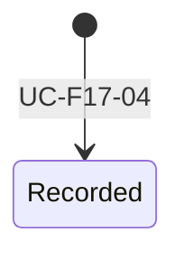

🏠 [Specs](../../../README.md) › 🧩 [Functional capabilities](../../README.md) ›
🔭 [F17 Competitive analysis](../README.md) › 🗃️ [Data](README.md) › 🗃️ E-F17-04 Job signal

# 🗃️ E-F17-04 Job signal

**Status:** ✅ specified

## Purpose

Job offers counted by role and place.

## Fields

| Name | Type | Required | Validation | Default | Example | Personal data | Custom fields |
|---|---|---|---|---|---|---|---|
| competitor, role, place, count, period | records | yes | BR-F17-04 | - | Rival SA, developer, Lyon, 12, Nov | no | no |

## Relations

As its use cases.

## Lifecycle

## Indexes and search

By number, date, partner.

## Retention

Kept 3 years by default, then summarised (BR-F17-11).

## Audit

Every change.

## Import and export

CSV, FEC where relevant.

## Used by

- [UC-F17-04](../use-cases/02-collect-signals/uc-f17-04-follow-job-offers.md)

## Open questions

None.

---

⬅️ [E-F17-03 Price point](e-f17-03-price-point.md) · ⬆️ [Up](README.md) ·
➡️ [E-F17-05 Tender award](e-f17-05-tender-award.md)
