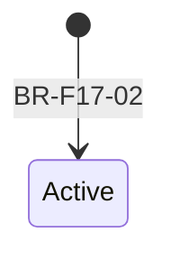

🏠 [Specs](../../../README.md) › 🧩 [Functional capabilities](../../README.md) ›
🔭 [F17 Competitive analysis](../README.md) › 🗃️ [Data](README.md) › 🗃️ E-F17-05 Tender award

# 🗃️ E-F17-05 Tender award

**Status:** ✅ specified

## Purpose

A public contract won.

## Fields

| Name | Type | Required | Validation | Default | Example | Personal data | Custom fields |
|---|---|---|---|---|---|---|---|
| competitor, buyer, amount, date | records | yes | BR-F17-02 | - | Rival SA, City of X, 240 000, 2026-10-02 | no | no |

## Relations

As its use cases.

## Lifecycle

## Indexes and search

By number, date, partner.

## Retention

Kept 3 years by default, then summarised (BR-F17-11).

## Audit

Every change.

## Import and export

CSV, FEC where relevant.

## Used by

- [UC-F17-05](../use-cases/02-collect-signals/uc-f17-05-follow-tenders-won.md)

## Open questions

None.

---

⬅️ [E-F17-04 Job signal](e-f17-04-job-signal.md) · ⬆️ [Up](README.md) · ➡️ [E-F17-06 IP filing](e-f17-06-ip-filing.md)
