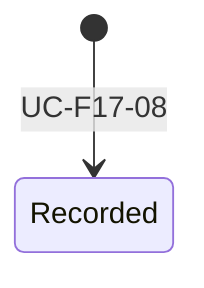

🏠 [Specs](../../../README.md) › 🧩 [Functional capabilities](../../README.md) ›
🔭 [F17 Competitive analysis](../README.md) › 🗃️ [Data](README.md) › 🗃️ E-F17-08 Mention

# 🗃️ E-F17-08 Mention

**Status:** ✅ specified

## Purpose

A news, social or corporate event.

## Fields

| Name | Type | Required | Validation | Default | Example | Personal data | Custom fields |
|---|---|---|---|---|---|---|---|
| competitor, kind, summary, link, date | records | yes | BR-F17-02 | - | Rival SA, funding, 5 M raised | no | no |

## Relations

As its use cases.

## Lifecycle

## Indexes and search

By number, date, partner.

## Retention

Kept 3 years by default, then summarised (BR-F17-11).

## Audit

Every change.

## Import and export

CSV, FEC where relevant.

## Used by

- [UC-F17-08](../use-cases/02-collect-signals/uc-f17-08-follow-news-press-and-social-media.md)
- [UC-F17-09](../use-cases/02-collect-signals/uc-f17-09-follow-funding-deals-and-legal-events.md)
- [UC-F17-25 Report share of voice and the price-index trend](../use-cases/06-price-intelligence/uc-f17-25-report-share-of-voice-and-the-price-index-trend.md)

## Open questions

None.

---

⬅️ [E-F17-07 Review digest](e-f17-07-review-digest.md) · ⬆️ [Up](README.md) ·
➡️ [E-F17-09 Data provider](e-f17-09-data-provider.md)
