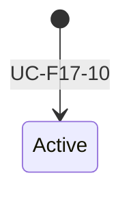

🏠 [Specs](../../../README.md) › 🧩 [Functional capabilities](../../README.md) ›
🔭 [F17 Competitive analysis](../README.md) › 🗃️ [Data](README.md) › 🗃️ E-F17-09 Data provider

# 🗃️ E-F17-09 Data provider

**Status:** ✅ specified

## Purpose

A paid source and its licence.

## Fields

| Name | Type | Required | Validation | Default | Example | Personal data | Custom fields |
|---|---|---|---|---|---|---|---|
| provider, vault key name, licence limits | records | yes | BR-F17-06 | - | Provider P, provider_p_key, no export | no | no |

## Relations

As its use cases.

## Lifecycle

## Indexes and search

By number, date, partner.

## Retention

Kept for the period of its kind of record in the country pack (D293), or else its kind's default in the
[retention schedule](../../../05-non-functional/data-retention.md).

## Audit

Every change.

## Import and export

CSV, FEC where relevant.

## Used by

- [UC-F17-10](../use-cases/01-set-up-and-profiles/uc-f17-10-connect-paid-data-providers.md)
- [UC-F17-22 Follow data-provider costs against the budget](../use-cases/01-set-up-and-profiles/uc-f17-22-follow-data-provider-costs-against-the-budget.md)

## Open questions

None.

---

⬅️ [E-F17-08 Mention](e-f17-08-mention.md) · ⬆️ [Up](README.md) · ➡️ [E-F17-10 Analysis](e-f17-10-analysis.md)
