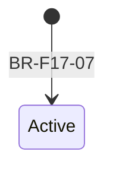

🏠 [Specs](../../../README.md) › 🧩 [Functional capabilities](../../README.md) ›
🔭 [F17 Competitive analysis](../README.md) › 🗃️ [Data](README.md) › 🗃️ E-F17-10 Analysis

# 🗃️ E-F17-10 Analysis

**Status:** ✅ specified

## Purpose

A comparison, SWOT or positioning.

## Fields

| Name | Type | Required | Validation | Default | Example | Personal data | Custom fields |
|---|---|---|---|---|---|---|---|
| kind, competitors, text, citations, readers | records | yes | BR-F17-07, BR-F17-09 | - | SWOT, Rival SA, ..., 14, owner | no | no |

## Relations

As its use cases.

## Lifecycle

## Indexes and search

By number, date, partner.

## Retention

Kept for the period of its kind of record in the country pack (D293), or else its kind's default in the
[retention schedule](../../../05-non-functional/data-retention.md).

## Audit

Every change.

## Import and export

CSV, FEC where relevant.

## Used by

- [UC-F17-11](../use-cases/03-analyse-and-arm-sales/uc-f17-11-compare-side-by-side.md)
- [UC-F17-12](../use-cases/03-analyse-and-arm-sales/uc-f17-12-write-a-sourced-swot-and-positioning.md)
- [UC-F17-16](../use-cases/04-alerts-and-sharing/uc-f17-16-receive-a-periodic-digest.md)
- [UC-F17-19](../use-cases/04-alerts-and-sharing/uc-f17-19-restrict-access-to-analyses.md)
- [UC-F17-20](../use-cases/03-analyse-and-arm-sales/uc-f17-20-ask-the-assistant-about-a-competitor.md)

## Open questions

None.

---

⬅️ [E-F17-09 Data provider](e-f17-09-data-provider.md) · ⬆️ [Up](README.md) ·
➡️ [E-F17-11 Battle card](e-f17-11-battle-card.md)
