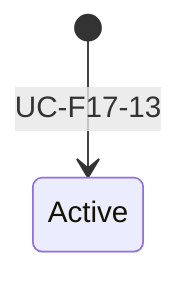

🏠 [Specs](../../../README.md) › 🧩 [Functional capabilities](../../README.md) ›
🔭 [F17 Competitive analysis](../README.md) › 🗃️ [Data](README.md) › 🗃️ E-F17-11 Battle card

# 🗃️ E-F17-11 Battle card

**Status:** ✅ specified

## Purpose

A sales card per competitor.

## Fields

| Name | Type | Required | Validation | Default | Example | Personal data | Custom fields |
|---|---|---|---|---|---|---|---|
| competitor, strengths, traps, answers, updated | records | yes | BR-F17-07 | - | Rival SA, ..., 2026-11-04 | no | no |

## Relations

As its use cases.

## Lifecycle

## Indexes and search

By number, date, partner.

## Retention

Kept for the period of its kind of record in the country pack (D293), or else its kind's default in the
[retention schedule](../../../05-non-functional/data-retention.md).

## Audit

Every change.

## Import and export

CSV, FEC where relevant.

## Used by

- [UC-F17-13](../use-cases/03-analyse-and-arm-sales/uc-f17-13-prepare-battle-cards-for-sales.md)
- [UC-F17-24 Feed battle cards from call topics](../use-cases/07-sales-enablement/uc-f17-24-feed-battle-cards-from-call-topics.md)

## Open questions

None.

---

⬅️ [E-F17-10 Analysis](e-f17-10-analysis.md) · ⬆️ [Up](README.md) ·
➡️ [E-F17-12 Win-loss record](e-f17-12-win-loss-record.md)
