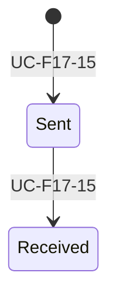

🏠 [Specs](../../../README.md) › 🧩 [Functional capabilities](../../README.md) ›
🔭 [F17 Competitive analysis](../README.md) › 🗃️ [Data](README.md) › 🗃️ E-F17-13 Alert

# 🗃️ E-F17-13 Alert

**Status:** ✅ specified

## Purpose

A change above a threshold.

## Fields

| Name | Type | Required | Validation | Default | Example | Personal data | Custom fields |
|---|---|---|---|---|---|---|---|
| competitor, change, threshold, sent | records | yes | BR-F17-10 | - | Rival SA, price -12 %, 5 %, yes | no | no |

## Relations

As its use cases.

## Lifecycle

## Indexes and search

By number, date, partner.

## Retention

Kept for the period of its kind of record in the country pack (D293), or else its kind's default in the
[retention schedule](../../../05-non-functional/data-retention.md).

## Audit

Every change.

## Import and export

CSV, FEC where relevant.

## Used by

- [UC-F17-15](../use-cases/04-alerts-and-sharing/uc-f17-15-get-alerts-on-changes.md)
- [UC-F17-16](../use-cases/04-alerts-and-sharing/uc-f17-16-receive-a-periodic-digest.md)

## Open questions

None.

---

⬅️ [E-F17-12 Win-loss record](e-f17-12-win-loss-record.md) · ⬆️ [Up](README.md) ·
➡️ [E-F17-14 Market estimate](e-f17-14-market-estimate.md)
