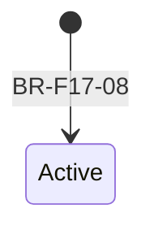

🏠 [Specs](../../../README.md) › 🧩 [Functional capabilities](../../README.md) ›
🔭 [F17 Competitive analysis](../README.md) › 🗃️ [Data](README.md) › 🗃️ E-F17-14 Market estimate

# 🗃️ E-F17-14 Market estimate

**Status:** ✅ specified

## Purpose

A market share estimate.

## Fields

| Name | Type | Required | Validation | Default | Example | Personal data | Custom fields |
|---|---|---|---|---|---|---|---|
| market, year, shares, method | records | yes | BR-F17-08 | - | home care Lyon, 2025, 18 %, filings | no | no |

## Relations

As its use cases.

## Lifecycle

## Indexes and search

By number, date, partner.

## Retention

Kept for the period of its kind of record in the country pack (D293), or else its kind's default in the
[retention schedule](../../../05-non-functional/data-retention.md).

## Audit

Every change.

## Import and export

CSV, FEC where relevant.

## Used by

- [UC-F17-17](../use-cases/03-analyse-and-arm-sales/uc-f17-17-estimate-market-shares-in-a-territory.md)

## Open questions

None.

---

⬅️ [E-F17-13 Alert](e-f17-13-alert.md) · ⬆️ [Up](README.md) ·
➡️ [E-F17-15 Collection rule](e-f17-15-collection-rule.md)
