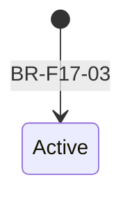

🏠 [Specs](../../../README.md) › 🧩 [Functional capabilities](../../README.md) ›
🔭 [F17 Competitive analysis](../README.md) › 🗃️ [Data](README.md) › 🗃️ E-F17-15 Collection rule

# 🗃️ E-F17-15 Collection rule

**Status:** ✅ specified

## Purpose

What may be read, how often, how long.

## Fields

| Name | Type | Required | Validation | Default | Example | Personal data | Custom fields |
|---|---|---|---|---|---|---|---|
| source, allowed, rate, retention | records | yes | BR-F17-03, BR-F17-11 | - | rival.example, yes, daily, 3 years | no | no |

## Relations

As its use cases.

## Lifecycle

## Indexes and search

By number, date, partner.

## Retention

Kept for the period of its kind of record in the country pack (D293), or else its kind's default in the
[retention schedule](../../../05-non-functional/data-retention.md).

## Audit

Every change.

## Import and export

CSV, FEC where relevant.

## Used by

- [UC-F17-18](../use-cases/01-set-up-and-profiles/uc-f17-18-set-lawful-collection-rules.md)

## Open questions

None.

---

⬅️ [E-F17-14 Market estimate](e-f17-14-market-estimate.md) · ⬆️ [Up](README.md) ·
➡️ [E-F17-16 Tender opportunity](e-f17-16-tender-opportunity.md)
