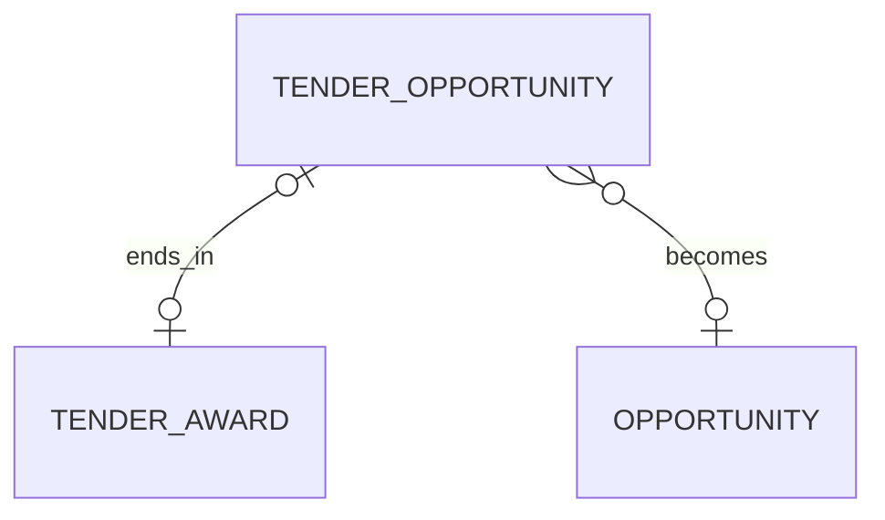
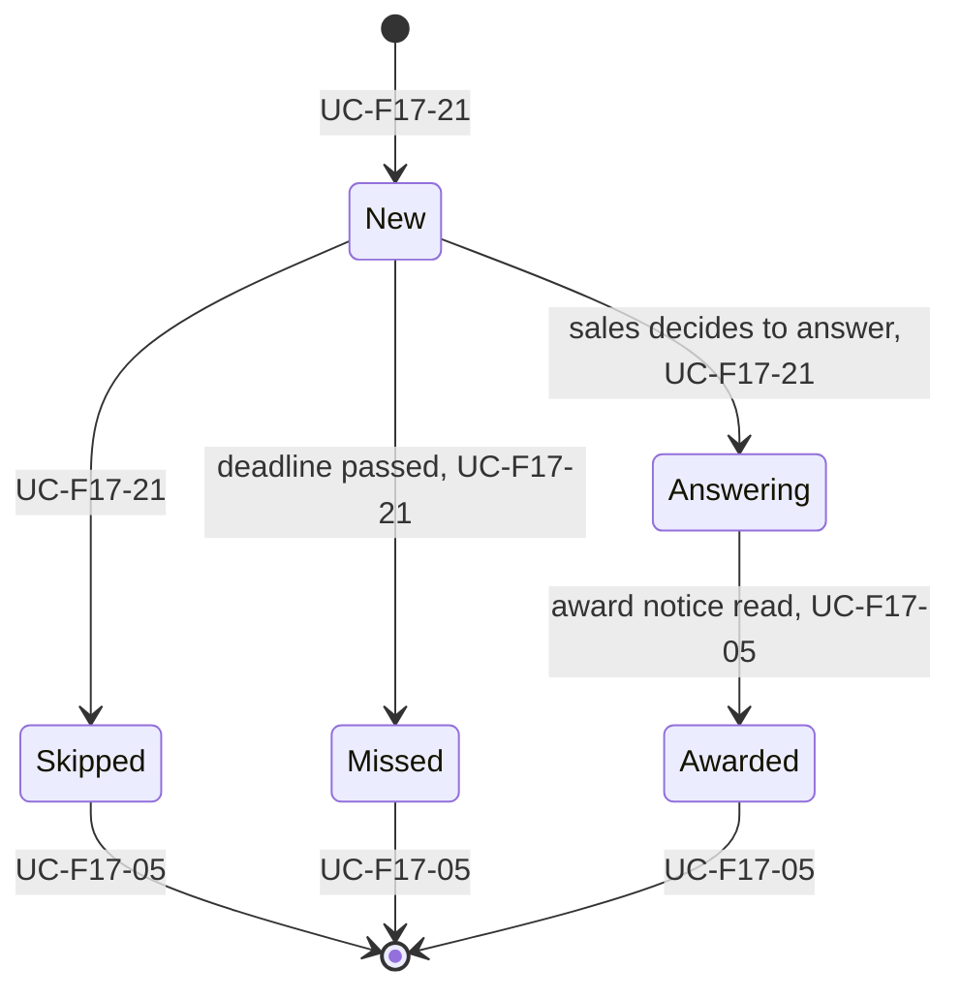

🏠 [Specs](../../../README.md) › 🧩 [Functional capabilities](../../README.md) ›
🔭 [F17 Competitive analysis](../README.md) › 🗃️ [Data](README.md) › 🗃️ E-F17-16 Tender opportunity

# 🗃️ E-F17-16 Tender opportunity

**Status:** ✅ specified

## Purpose

A public tender notice matched to the company, with the decision to answer it or not.

## Fields

| Name | Type | Required | Validation | Default | Example | Personal data | Custom fields |
|---|---|---|---|---|---|---|---|
| title | text | yes | - | from the notice | Maintenance of school buildings | no | no |
| buyer | text | yes | - | from the notice | City of X | no | no |
| codes | list | yes | activity codes | from the notice | 45453000 | no | no |
| estimated amount | amount | no | - | from the notice | 240 000.00 EUR | no | no |
| deadline | date and time | yes | - | from the notice | 2026-12-04 12:00 | no | no |
| source | link | yes | official notice | - | notice link | no | no |
| decision | choice | no | answer, skip | - | answer | no | no |
| reason | text | if skipped | - | - | outside capacity | no | no |

## Relations

## Lifecycle

## Indexes and search

By deadline, buyer, code, amount and decision.

## Retention

As collected facts: BR-F17-11.

## Audit

Every creation and change, with who, when, the old and the new value.

## Import and export

CSV and JSON export through the API (T5); no bulk import.

## Used by

- [UC-F17-21 Watch tenders to answer](../use-cases/05-tender-watch/uc-f17-21-watch-tenders-to-answer.md)
- [UC-F17-05 Follow tenders won](../use-cases/02-collect-signals/uc-f17-05-follow-tenders-won.md)

## Open questions

None.

---

⬅️ [E-F17-15 Collection rule](e-f17-15-collection-rule.md) · ⬆️ [Up](README.md) ·
➡️ [E-F17-17 Price index](e-f17-17-price-index.md)
