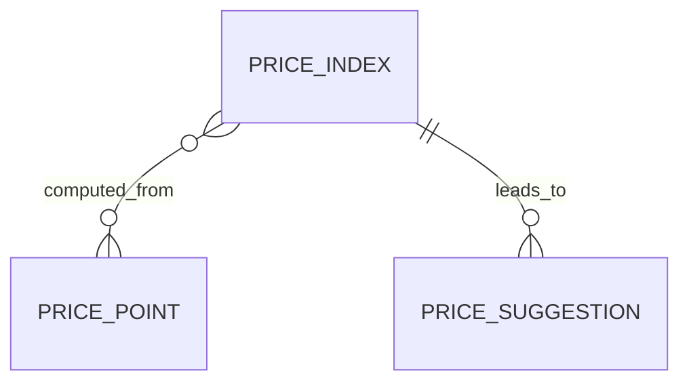
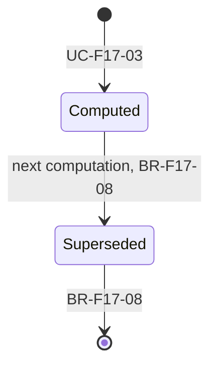

🏠 [Specs](../../../README.md) › 🧩 [Functional capabilities](../../README.md) ›
🔭 [F17 Competitive analysis](../README.md) › 🗃️ [Data](README.md) › 🗃️ E-F17-17 Price index

# 🗃️ E-F17-17 Price index

**Status:** ✅ specified

## Purpose

The level of competitors' like-for-like prices against the company's own, per product family and date.

## Fields

| Name | Type | Required | Validation | Default | Example | Personal data | Custom fields |
|---|---|---|---|---|---|---|---|
| family | text | yes | a product family of F6 | - | Plans | no | no |
| date | date | yes | - | - | 2026-11-12 | no | no |
| index | number | yes | 100 means the same price | computed | 104 | no | no |
| basket | list | yes | like-for-like pairs (BR-F17-08) | - | 6 pairs | no | no |
| points | count | yes | at least 3 | - | 18 | no | no |

## Relations

## Lifecycle

## Indexes and search

By family and date; trend over 24 months.

## Retention

As collected facts: BR-F17-11.

## Audit

Every creation and change, with who, when, the old and the new value.

## Import and export

CSV and JSON export through the API (T5); no bulk import.

## Used by

- [UC-F17-23 Suggest price-list changes from the price index](../use-cases/06-price-intelligence/uc-f17-23-suggest-price-list-changes-from-the-price-index.md)
- [UC-F17-25 Report share of voice and the price-index trend](../use-cases/06-price-intelligence/uc-f17-25-report-share-of-voice-and-the-price-index-trend.md)
- [UC-F17-03 Track products and prices](../use-cases/02-collect-signals/uc-f17-03-track-products-and-prices.md)
- [UC-F17-11 Compare side by side](../use-cases/03-analyse-and-arm-sales/uc-f17-11-compare-side-by-side.md)

## Open questions

None.

---

⬅️ [E-F17-16 Tender opportunity](e-f17-16-tender-opportunity.md) · ⬆️ [Up](README.md) ·
➡️ [E-F17-18 Price suggestion](e-f17-18-price-suggestion.md)
