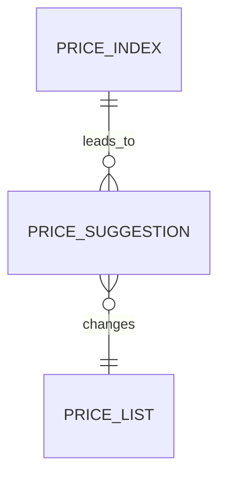
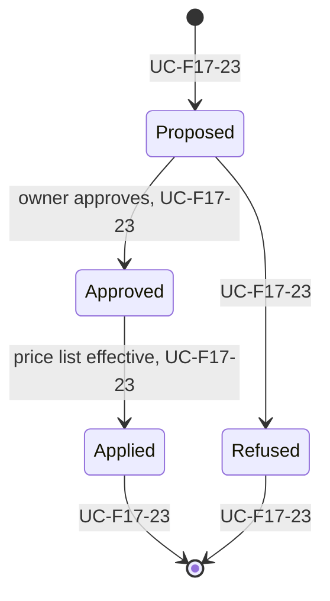

🏠 [Specs](../../../README.md) › 🧩 [Functional capabilities](../../README.md) ›
🔭 [F17 Competitive analysis](../README.md) › 🗃️ [Data](README.md) › 🗃️ E-F17-18 Price suggestion

# 🗃️ E-F17-18 Price suggestion

**Status:** 🔄 waiting for the owner

## Purpose

A proposed change of a price in an F6 price list, drawn from the price index, waiting for approval.

## Fields

| Name | Type | Required | Validation | Default | Example | Personal data | Custom fields |
|---|---|---|---|---|---|---|---|
| product | link | yes | an F6 product | - | Plan Pro | no | no |
| current, proposed | amounts | yes | - | computed | 49.00, 47.00 EUR | no | no |
| from | date | yes | in the future | first of next month | 2026-12-01 | no | no |
| evidence | list | yes | price points | - | 6 points | no | no |
| status | choice | yes | proposed, approved, refused | proposed | approved | no | no |

## Relations

## Lifecycle

## Indexes and search

By product, status and date.

## Retention

(Proposed) 3 years.

## Audit

Every creation and change, with who, when, the old and the new value.

## Import and export

CSV and JSON export through the API (T5); no bulk import.

## Used by

- [UC-F17-23 Suggest price-list changes from the price index](../use-cases/06-price-intelligence/uc-f17-23-suggest-price-list-changes-from-the-price-index.md)

## Open questions

None.

---

⬅️ [E-F17-17 Price index](e-f17-17-price-index.md) · ⬆️ [Up](README.md) ·
➡️ [E-F17-19 Data cost line](e-f17-19-data-cost-line.md)
