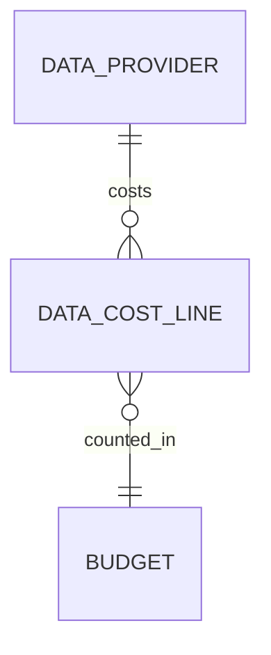
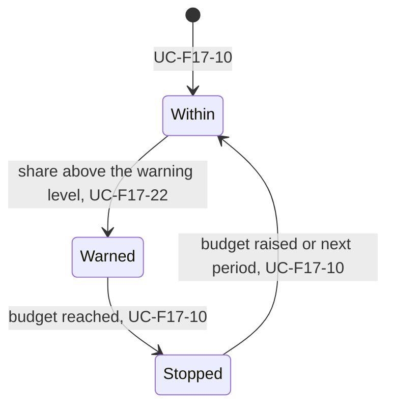

🏠 [Specs](../../../README.md) › 🧩 [Functional capabilities](../../README.md) ›
🔭 [F17 Competitive analysis](../README.md) › 🗃️ [Data](README.md) › 🗃️ E-F17-19 Data cost line

# 🗃️ E-F17-19 Data cost line

**Status:** ✅ specified

## Purpose

The spend on a paid data provider for a period, counted against its F22 budget.

## Fields

| Name | Type | Required | Validation | Default | Example | Personal data | Custom fields |
|---|---|---|---|---|---|---|---|
| provider | link | yes | a data provider | - | Provider P | no | no |
| period | month | yes | - | - | 2026-11 | no | no |
| calls, amount | number, amount | yes | - | from the provider's bill or meter | 8 200 calls, 410.00 EUR | no | no |
| budget | amount | yes | from F22 | - | 500.00 EUR | no | no |
| state | choice | yes | within, warned, stopped | within | warned | no | no |

## Relations

## Lifecycle

## Indexes and search

By provider and period.

## Retention

As accounting records: CR-FR-002.

## Audit

Every creation and change, with who, when, the old and the new value.

## Import and export

CSV and JSON export through the API (T5); no bulk import.

## Used by

- [UC-F17-22 Follow data-provider costs against the budget](../use-cases/01-set-up-and-profiles/uc-f17-22-follow-data-provider-costs-against-the-budget.md)
- [UC-F17-10 Connect paid data providers](../use-cases/01-set-up-and-profiles/uc-f17-10-connect-paid-data-providers.md)

## Open questions

None.

---

⬅️ [E-F17-18 Price suggestion](e-f17-18-price-suggestion.md) · ⬆️ [Up](README.md) ·
➡️ [E-F17-20 Call topic signal](e-f17-20-call-topic-signal.md)
