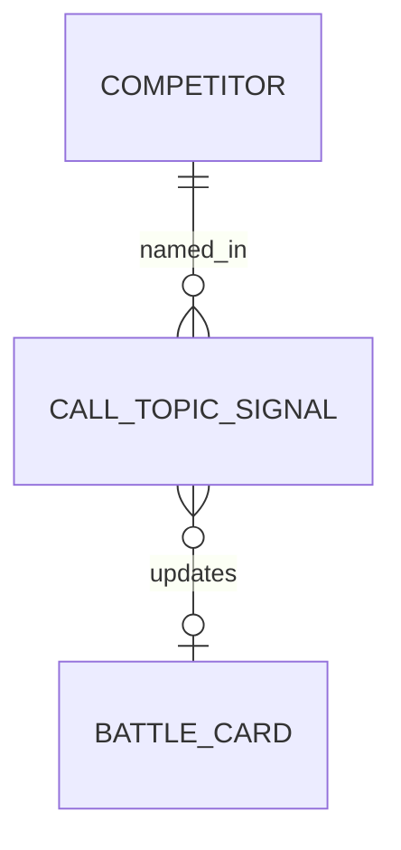
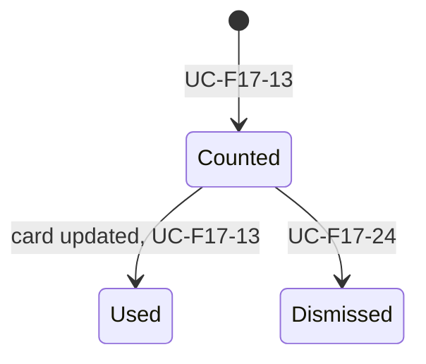

🏠 [Specs](../../../README.md) › 🧩 [Functional capabilities](../../README.md) ›
🔭 [F17 Competitive analysis](../README.md) › 🗃️ [Data](README.md) › 🗃️ E-F17-20 Call topic signal

# 🗃️ E-F17-20 Call topic signal

**Status:** ✅ specified

## Purpose

A theme from F4's call topics that names a competitor, counted per period, without people.

## Fields

| Name | Type | Required | Validation | Default | Example | Personal data | Custom fields |
|---|---|---|---|---|---|---|---|
| competitor | link | yes | a competitor | - | Rival SA | no | no |
| theme | text | yes | - | from F4 | price objection | no | no |
| count | number | yes | - | - | 14 | no | no |
| period | month | yes | - | - | 2026-11 | no | no |

## Relations

## Lifecycle

## Indexes and search

By competitor, theme and period.

## Retention

As collected facts: BR-F17-11.

## Audit

Every creation and change, with who, when, the old and the new value.

## Import and export

CSV and JSON export through the API (T5); no bulk import.

## Used by

- [UC-F17-24 Feed battle cards from call topics](../use-cases/07-sales-enablement/uc-f17-24-feed-battle-cards-from-call-topics.md)
- [UC-F17-13 Prepare battle cards for sales](../use-cases/03-analyse-and-arm-sales/uc-f17-13-prepare-battle-cards-for-sales.md)

## Open questions

None.

---

⬅️ [E-F17-19 Data cost line](e-f17-19-data-cost-line.md) · ⬆️ [Up](README.md) ·
➡️ [E-F17-21 Ad record](e-f17-21-ad-record.md)
