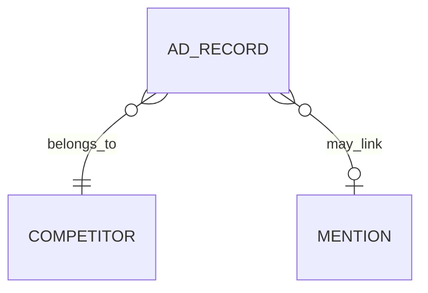
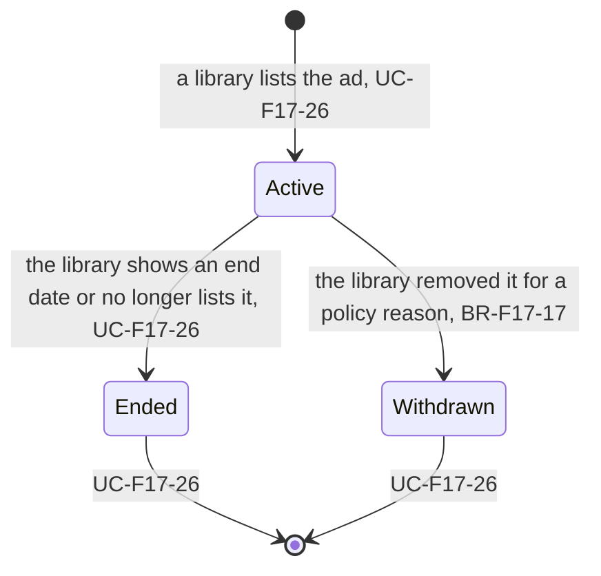

🏠 [Specs](../../../README.md) › 🧩 [Functional capabilities](../../README.md) ›
🔭 [F17 Competitive analysis](../README.md) › 🗃️ [Data](README.md) › 🗃️ E-F17-21 Ad record

# 🗃️ E-F17-21 Ad record

**Status:** ✅ specified

## Purpose

One ad of a competitor as the public ad library shows it, with its dates and its source
([D536](../../../06-decisions/f17-competitive-analysis/d536-benchmark-gaps-f17-competitive-analysis.md)). It differs
from a mention ([E-F17-08 Mention](e-f17-08-mention.md)): an ad is paid and comes from a library, a mention is an
article or post.

## Fields

| Name | Type | Required | Validation | Default | Example | Personal data | Custom fields |
|---|---|---|---|---|---|---|---|
| competitor | competitor (E-F17-01) | yes | a followed competitor | - | Northwind Ltd | no | no |
| library | text | yes | an allowed public ad library | - | Library A | no | no |
| channel | search, social, display, video | yes | one of the four | - | search | no | no |
| headline | text | no | at most 200 characters | - | Free delivery all June | no | no |
| text | text | no | as published | - | Free delivery on every order ... | no | no |
| landing address | link | no | a web address | - | northwind.example/june | no | no |
| countries | list of countries | no | ISO countries | - | FR, BE | no | no |
| first seen | date | yes | not in the future | - | 2026-06-02 | no | no |
| last seen | date | yes | on or after the first date | - | 2026-11-10 | no | no |
| source address | link | yes | the library's page for the ad | - | library-a.example/ad/812 | no | no |
| state | Active, Ended, Withdrawn | yes | the lifecycle below | Active | Ended | no | no |
| owner | user | yes | a user of the company | the creator | Claire P. | yes | no |

## Relations

- [E-F17-01 Competitor](e-f17-01-competitor.md)
- [E-F17-08 Mention](e-f17-08-mention.md)
- [E-F17-15 Collection rule](e-f17-15-collection-rule.md)

## Lifecycle

## Indexes and search

By competitor, channel, country, state, first seen and the words of the headline and text.

## Retention

Kept for the period the competitor facts are kept
([BR-F17-11](../business-rules/br-f17-11-facts-kept-for-a-set-period.md)); an ad's text may be reduced to a short
extract and its source link after that period.

## Audit

Every read, creation, change and end of an ad record, with the library and the time.

## Import and export

No import. The ads of a period are exported as a CSV with their sources.

## Used by

- [UC-F17-26](../use-cases/08-ads-pages-search-and-tech/uc-f17-26-follow-competitors-ads.md)

## Open questions

None.

---

⬅️ [E-F17-20 Call topic signal](e-f17-20-call-topic-signal.md) · ⬆️ [Up](README.md) ·
➡️ [E-F17-22 Watched page](e-f17-22-watched-page.md)
