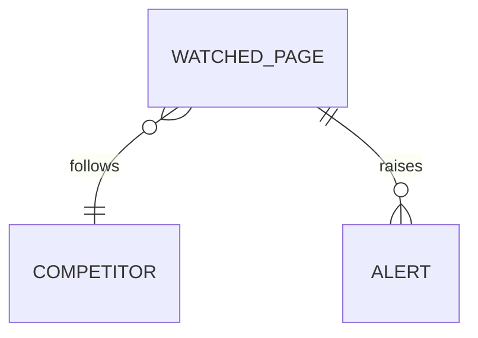
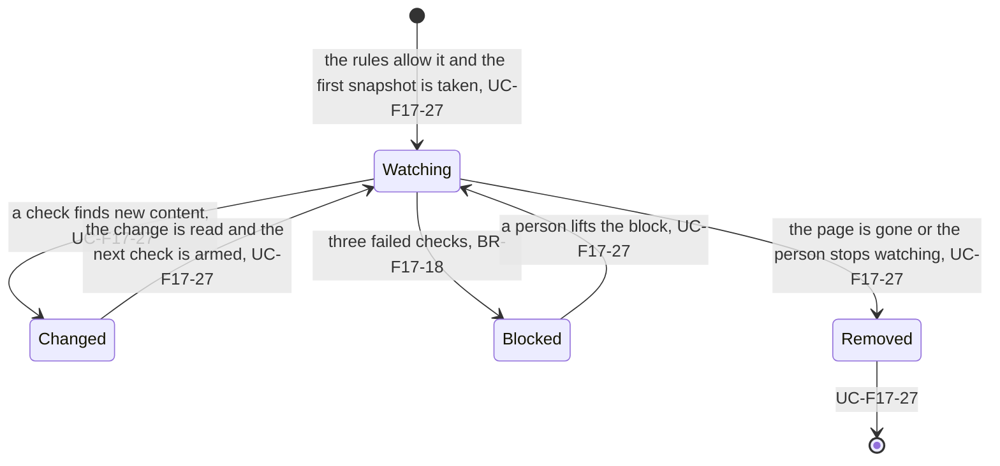

🏠 [Specs](../../../README.md) › 🧩 [Functional capabilities](../../README.md) ›
🔭 [F17 Competitive analysis](../README.md) › 🗃️ [Data](README.md) › 🗃️ E-F17-22 Watched page

# 🗃️ E-F17-22 Watched page

**Status:** ✅ specified

## Purpose

A public page of a competitor that simple-ERP checks at a set rhythm and keeps the changes of
([D536](../../../06-decisions/f17-competitive-analysis/d536-benchmark-gaps-f17-competitive-analysis.md)). It differs
from a price point ([E-F17-03 Price point](e-f17-03-price-point.md)): a price point is one price, a watched page is any
text that may change.

## Fields

| Name | Type | Required | Validation | Default | Example | Personal data | Custom fields |
|---|---|---|---|---|---|---|---|
| competitor | competitor (E-F17-01) | yes | a followed competitor | - | Northwind Ltd | no | no |
| address | link | yes | a public web address | - | northwind.example/pricing | no | no |
| rhythm | daily, weekly | yes | one of the two | weekly | daily | no | no |
| rules read | allowed, forbidden | yes | read from the site's robots rules | - | allowed | no | no |
| read rate | seconds between reads | yes | 10 or more | 10 | 10 | no | no |
| last check | date and time | no | - | - | 2026-11-14 06:00 | no | no |
| last change | date and time | no | - | - | 2026-11-13 06:00 | no | no |
| snapshots | list of texts with dates | no | short extracts, not whole sites | - | 2 snapshots | no | no |
| note | text | no | at most 1,000 characters | - | Pro plan up by 10 EUR | no | no |
| state | Watching, Changed, Blocked, Removed | yes | the lifecycle below | Watching | Changed | no | no |
| owner | user | yes | a user of the company | the creator | Claire P. | yes | no |

## Relations

- [E-F17-01 Competitor](e-f17-01-competitor.md)
- [E-F17-03 Price point](e-f17-03-price-point.md)
- [E-F17-13 Alert](e-f17-13-alert.md)
- [E-F17-15 Collection rule](e-f17-15-collection-rule.md)

## Lifecycle

## Indexes and search

By competitor, state, rhythm, last change and the words of the snapshots.

## Retention

Snapshots are kept as short extracts for the period the competitor facts are kept
([BR-F17-11](../business-rules/br-f17-11-facts-kept-for-a-set-period.md)); a removed page's history stays until then.

## Audit

Every page added, paused or removed; every check with its result; every change and every refusal with the rule that
caused it.

## Import and export

No import. The changes of a period are exported as a CSV with their dates and sources.

## Used by

- [UC-F17-27](../use-cases/08-ads-pages-search-and-tech/uc-f17-27-watch-competitors-web-pages.md)

## Open questions

None.

---

⬅️ [E-F17-21 Ad record](e-f17-21-ad-record.md) · ⬆️ [Up](README.md) · ➡️ [E-F17-23 Keyword](e-f17-23-keyword.md)
