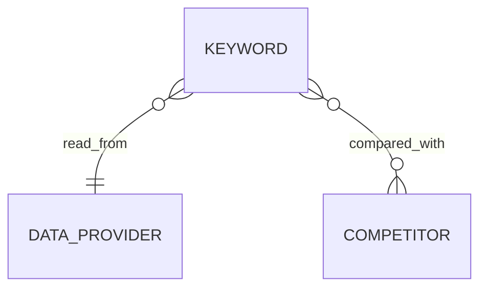
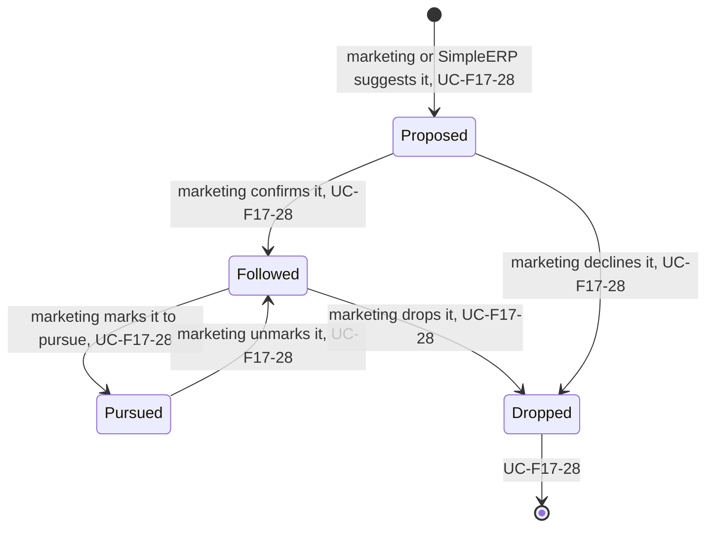

🏠 [Specs](../../../README.md) › 🧩 [Functional capabilities](../../README.md) ›
🔭 [F17 Competitive analysis](../README.md) › 🗃️ [Data](README.md) › 🗃️ E-F17-23 Keyword

# 🗃️ E-F17-23 Keyword

**Status:** ✅ specified

## Purpose

A search term the company follows, with the position of each followed site on it, read from a named provider on a date
([D536](../../../06-decisions/f17-competitive-analysis/d536-benchmark-gaps-f17-competitive-analysis.md)). It differs
from the search basics of the company's own site
([E-F18-18](../../f18-hosted-websites-and-domains/data/e-f18-18-search-settings.md)), which are settings, not figures.

## Fields

| Name | Type | Required | Validation | Default | Example | Personal data | Custom fields |
|---|---|---|---|---|---|---|---|
| keyword | text | yes | at most 100 characters | - | invoicing software | no | no |
| country and language | country and language | yes | ISO codes | - | France, French | no | no |
| volume | number per month | no | 0 or more | - | 8100 | no | no |
| positions | list of site and position | yes | 1 to 100 or none | - | us 14, Northwind 3 | no | no |
| provider | data provider (E-F17-09) | yes | a connected provider | - | Search data A | no | no |
| read on | date | yes | not in the future | - | 2026-11-03 | no | no |
| earlier positions | list of date and position | no | past readings | - | us 16 in October | no | no |
| pursue | yes, no | yes | one of the two | no | yes | no | no |
| state | Proposed, Followed, Pursued, Dropped | yes | the lifecycle below | Proposed | Followed | no | no |
| owner | user | yes | a user of the company | the creator | Claire P. | yes | no |

## Relations

- [E-F17-09 Data provider](e-f17-09-data-provider.md)
- [E-F17-01 Competitor](e-f17-01-competitor.md)
- [E-F18-18](../../f18-hosted-websites-and-domains/data/e-f18-18-search-settings.md)

## Lifecycle

## Indexes and search

By keyword, country and language, state, provider and read date.

## Retention

Positions are kept for the period the competitor facts are kept
([BR-F17-11](../business-rules/br-f17-11-facts-kept-for-a-set-period.md)), as monthly points.

## Audit

Every keyword added, confirmed, dropped or marked, and every refresh with its provider and date.

## Import and export

Import: a list of keywords from a CSV. Export: the overlap of a month as a CSV with the provider and date
columns.

## Used by

- [UC-F17-28](../use-cases/08-ads-pages-search-and-tech/uc-f17-28-compare-search-positions.md)

## Open questions

None.

---

⬅️ [E-F17-22 Watched page](e-f17-22-watched-page.md) · ⬆️ [Up](README.md) ·
➡️ [E-F17-24 Technology record](e-f17-24-technology-record.md)
