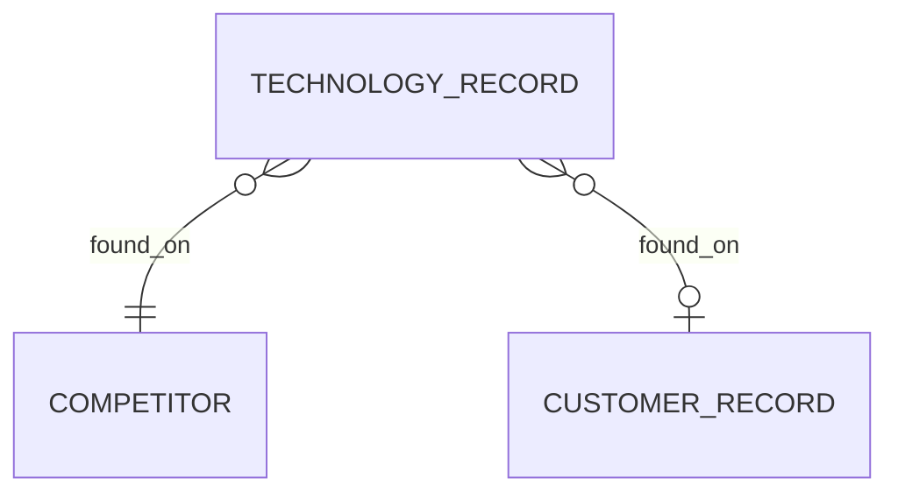
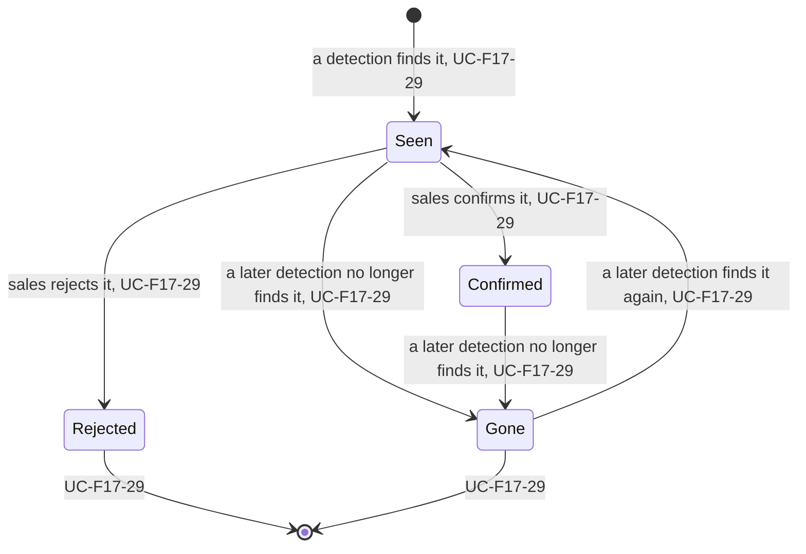

🏠 [Specs](../../../README.md) › 🧩 [Functional capabilities](../../README.md) ›
🔭 [F17 Competitive analysis](../README.md) › 🗃️ [Data](README.md) › 🗃️ E-F17-24 Technology record

# 🗃️ E-F17-24 Technology record

**Status:** ✅ specified

## Purpose

A technology found on a competitor's or prospect's public site, with the evidence and how sure the detection is
([D536](../../../06-decisions/f17-competitive-analysis/d536-benchmark-gaps-f17-competitive-analysis.md)). It differs
from a company fact ([E-F17-02 Company fact](e-f17-02-company-fact.md)): a fact comes from a register or filing, a
technology record from the site's own public pages.

## Fields

| Name | Type | Required | Validation | Default | Example | Personal data | Custom fields |
|---|---|---|---|---|---|---|---|
| site | link | yes | a public web address | - | northwind.example | no | no |
| competitor or prospect | competitor (E-F17-01) or customer record (E-F6-01) | yes | a followed competitor or a prospect | - | Northwind Ltd | no | no |
| category | text | yes | from the technology list | - | Shop | no | no |
| technology | text | yes | from the technology list or typed | - | Shop platform A | no | no |
| confidence | sure, probable, possible, stated | yes | one of the four | - | sure | no | no |
| evidence page | link | no | a page read | - | northwind.example/ | no | no |
| evidence mark | text | no | the mark found | - | generator tag | no | no |
| first seen | date | yes | not in the future | - | 2026-05-02 | no | no |
| last seen | date | yes | on or after the first date | - | 2026-11-14 | no | no |
| state | Seen, Confirmed, Rejected, Gone | yes | the lifecycle below | Seen | Confirmed | no | no |
| owner | user | yes | a user of the company | the creator | Claire P. | yes | no |

## Relations

- [E-F17-01 Competitor](e-f17-01-competitor.md)
- [E-F17-02 Company fact](e-f17-02-company-fact.md)
- [E-F6-01 Customer record](../../f06-customers-and-sales/data/e-f06-01-customer-record.md)

## Lifecycle

## Indexes and search

By site, category, technology, confidence, state and last seen.

## Retention

Kept for the period the competitor facts are kept
([BR-F17-11](../business-rules/br-f17-11-facts-kept-for-a-set-period.md)); a prospect's findings follow the prospect's
record.

## Audit

Every detection, finding, confirmation, rejection and hand-made addition, with who and when.

## Import and export

No import. The technologies of one or several sites are exported as a CSV with their confidence and evidence.

## Used by

- [UC-F17-29](../use-cases/08-ads-pages-search-and-tech/uc-f17-29-detect-a-sites-technologies.md)

## Open questions

None.

---

⬅️ [E-F17-23 Keyword](e-f17-23-keyword.md) · ⬆️ [Up](README.md)
