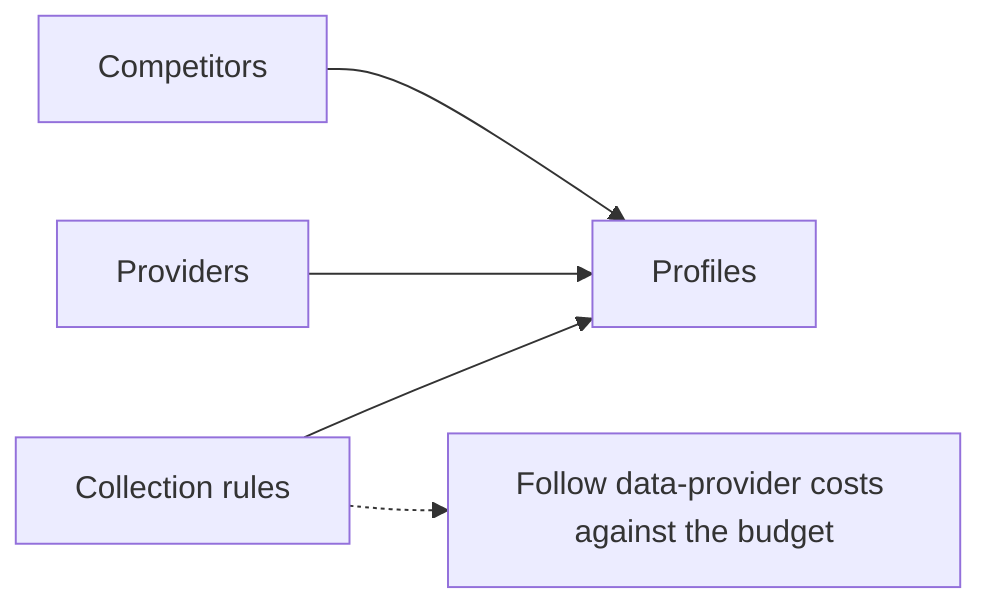

🏠 [Specs](../../../README.md) › 🧩 [Functional capabilities](../../README.md) ›
🔭 [F17 Competitive analysis](../README.md) › 🔀 [Flows](README.md) › 🔀 FL-F17-01 Set up and profiles

# 🔀 FL-F17-01 Set up and profiles

**Status:** ✅ specified

## Summary

Covers UC-F17-01, UC-F17-02, UC-F17-10, UC-F17-18.

## Personas

- [U07 Administrator](../../../01-users/personas/u07-administrator.md)
- [U12 Marketing](../../../01-users/personas/u12-marketing.md)
- [U13 Owner](../../../01-users/personas/u13-owner.md)

## Flowchart

## Sequence diagram

See each use case.

## Steps

| Step | Persona | Screen | Use case | What happens |
|---|---|---|---|---|
| 1 | U13, U12 | [S-F17-01](../screens/01-set-up-and-profiles/s-f17-01-competitors.md) | [UC-F17-01](../use-cases/01-set-up-and-profiles/uc-f17-01-list-competitors.md) | List competitors |
| 2 | U12 | [S-F17-02](../screens/01-set-up-and-profiles/s-f17-02-competitor-profile.md) | [UC-F17-02](../use-cases/01-set-up-and-profiles/uc-f17-02-build-a-profile-from-registers-and-filings.md) | Build a profile from registers and filings |
| 3 | U07 | [S-F17-10](../screens/01-set-up-and-profiles/s-f17-10-data-providers.md) | [UC-F17-10](../use-cases/01-set-up-and-profiles/uc-f17-10-connect-paid-data-providers.md) | Connect paid data providers |
| 4 | U07 | [S-F17-18](../screens/01-set-up-and-profiles/s-f17-18-collection-settings.md) | [UC-F17-18](../use-cases/01-set-up-and-profiles/uc-f17-18-set-lawful-collection-rules.md) | Set lawful collection rules |
| 5 | U13, U07 | [S-F17-22](../screens/01-set-up-and-profiles/s-f17-22-data-costs.md) | [UC-F17-22](../use-cases/01-set-up-and-profiles/uc-f17-22-follow-data-provider-costs-against-the-budget.md) | Follow data-provider costs against the budget |

### Entities and screens

| Entity | States in this flow | Shown at step and screen | Aggregated view |
|---|---|---|---|
| [E-F17-01 Competitor](../data/e-f17-01-competitor.md) | Active | 1 [S-F17-01](../screens/01-set-up-and-profiles/s-f17-01-competitors.md); 2 [S-F17-02](../screens/01-set-up-and-profiles/s-f17-02-competitor-profile.md) | Competitors |
| [E-F17-09 Data provider](../data/e-f17-09-data-provider.md) | Active | 3 [S-F17-10](../screens/01-set-up-and-profiles/s-f17-10-data-providers.md); 5 [S-F17-22](../screens/01-set-up-and-profiles/s-f17-22-data-costs.md) | Data providers |
| [E-F17-15 Collection rule](../data/e-f17-15-collection-rule.md) | Active | 4 [S-F17-18](../screens/01-set-up-and-profiles/s-f17-18-collection-settings.md) | Collection rules |
| [E-F17-19 Data cost line](../data/e-f17-19-data-cost-line.md) | Within, Warned, Stopped | 3 [S-F17-10](../screens/01-set-up-and-profiles/s-f17-10-data-providers.md); 5 [S-F17-22](../screens/01-set-up-and-profiles/s-f17-22-data-costs.md) | Data cost lines |
| [E-F22-06 Cost budget](../../f22-unified-cost-management/data/e-f22-06-cost-budget.md) | Active | Shown elsewhere: [S-F22-06 Budgets](../../f22-unified-cost-management/screens/02-budgets-and-stops/s-f22-06-budgets.md) | Cost budgets |

## Errors

As each use case.

## Images

Every step and error, for each persona taking part, in light and dark mode (D120). Steps are numbered as in the Steps
table; E rows are the error cases.

| Step | Persona | Device | Light | Dark |
|---|---|---|---|---|
| 1 | U13 | desktop | [light](../images/01-set-up-and-profiles/u13-owner/1-list-desktop-light.png) | [dark](../images/01-set-up-and-profiles/u13-owner/1-list-desktop-dark.png) |
| 1 | U13 | phone | [light](../images/01-set-up-and-profiles/u13-owner/1-list-phone-light.png) | [dark](../images/01-set-up-and-profiles/u13-owner/1-list-phone-dark.png) |
| 1 | U12 | desktop | [light](../images/01-set-up-and-profiles/u12-marketing/1-list-desktop-light.png) | [dark](../images/01-set-up-and-profiles/u12-marketing/1-list-desktop-dark.png) |
| 1 | U12 | phone | [light](../images/01-set-up-and-profiles/u12-marketing/1-list-phone-light.png) | [dark](../images/01-set-up-and-profiles/u12-marketing/1-list-phone-dark.png) |
| 2 | U12 | desktop | [light](../images/01-set-up-and-profiles/u12-marketing/2-profile-desktop-light.png) | [dark](../images/01-set-up-and-profiles/u12-marketing/2-profile-desktop-dark.png) |
| 2 | U12 | phone | [light](../images/01-set-up-and-profiles/u12-marketing/2-profile-phone-light.png) | [dark](../images/01-set-up-and-profiles/u12-marketing/2-profile-phone-dark.png) |
| 3 | U07 | desktop | [light](../images/01-set-up-and-profiles/u07-administrator/3-providers-desktop-light.png) | [dark](../images/01-set-up-and-profiles/u07-administrator/3-providers-desktop-dark.png) |
| 4 | U07 | desktop | [light](../images/01-set-up-and-profiles/u07-administrator/4-rules-desktop-light.png) | [dark](../images/01-set-up-and-profiles/u07-administrator/4-rules-desktop-dark.png) |
| E1 | U07 | desktop | [light](../images/01-set-up-and-profiles/u07-administrator/e1-rule-below-pack-desktop-light.png) | [dark](../images/01-set-up-and-profiles/u07-administrator/e1-rule-below-pack-desktop-dark.png) |
| 5 | U13 | desktop | [light](../images/01-set-up-and-profiles/u13-owner/5-data-costs-desktop-light.png) | [dark](../images/01-set-up-and-profiles/u13-owner/5-data-costs-desktop-dark.png) |
| 5 | U13 | phone | [light](../images/01-set-up-and-profiles/u13-owner/5-data-costs-phone-light.png) | [dark](../images/01-set-up-and-profiles/u13-owner/5-data-costs-phone-dark.png) |
| 5 | U07 | desktop | [light](../images/01-set-up-and-profiles/u07-administrator/5-data-costs-desktop-light.png) | [dark](../images/01-set-up-and-profiles/u07-administrator/5-data-costs-desktop-dark.png) |

## Open questions

None.

---

⬆️ [Up](README.md) · ➡️ [FL-F17-02 Collect signals](fl-f17-02-collect-signals.md)
