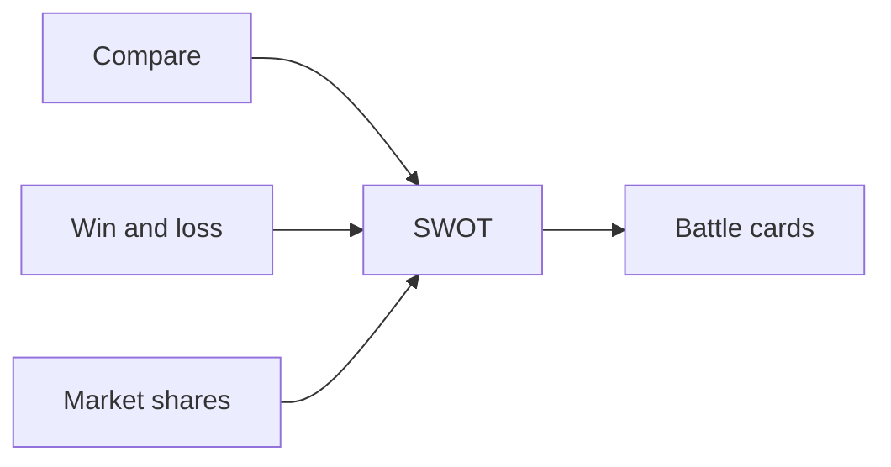

🏠 [Specs](../../../README.md) › 🧩 [Functional capabilities](../../README.md) ›
🔭 [F17 Competitive analysis](../README.md) › 🔀 [Flows](README.md) › 🔀 FL-F17-03 Analyse and arm sales

# 🔀 FL-F17-03 Analyse and arm sales

**Status:** ✅ specified

## Summary

Covers UC-F17-11, UC-F17-12, UC-F17-13, UC-F17-14, UC-F17-17, UC-F17-20.

## Personas

- [U02 Manager](../../../01-users/personas/u02-manager.md)
- [U03 Sales](../../../01-users/personas/u03-sales.md)
- [U12 Marketing](../../../01-users/personas/u12-marketing.md)
- [U13 Owner](../../../01-users/personas/u13-owner.md)

## Flowchart

## Sequence diagram

See each use case.

## Steps

| Step | Persona | Screen | Use case | What happens |
|---|---|---|---|---|
| 1 | U13, U03 | [S-F17-11](../screens/03-analyse-and-arm-sales/s-f17-11-comparison.md) | [UC-F17-11](../use-cases/03-analyse-and-arm-sales/uc-f17-11-compare-side-by-side.md) | Compare side by side |
| 2 | U13, U12 | [S-F17-12](../screens/03-analyse-and-arm-sales/s-f17-12-swot-and-positioning.md) | [UC-F17-12](../use-cases/03-analyse-and-arm-sales/uc-f17-12-write-a-sourced-swot-and-positioning.md) | Write a sourced SWOT and positioning |
| 3 | U03 | [S-F17-13](../screens/03-analyse-and-arm-sales/s-f17-13-battle-cards.md) | [UC-F17-13](../use-cases/03-analyse-and-arm-sales/uc-f17-13-prepare-battle-cards-for-sales.md) | Prepare battle cards for sales |
| 4 | U03, U02 | [S-F17-14](../screens/03-analyse-and-arm-sales/s-f17-14-win-and-loss.md) | [UC-F17-14](../use-cases/03-analyse-and-arm-sales/uc-f17-14-analyse-wins-and-losses.md) | Analyse wins and losses |
| 5 | U13 | [S-F17-17](../screens/03-analyse-and-arm-sales/s-f17-17-market-shares.md) | [UC-F17-17](../use-cases/03-analyse-and-arm-sales/uc-f17-17-estimate-market-shares-in-a-territory.md) | Estimate market shares in a territory |
| 6 | U13, U03 | [S-F17-20](../screens/03-analyse-and-arm-sales/s-f17-20-competitor-assistant.md) | [UC-F17-20](../use-cases/03-analyse-and-arm-sales/uc-f17-20-ask-the-assistant-about-a-competitor.md) | Ask the AI assistant about a competitor |

### Entities and screens

| Entity | States in this flow | Shown at step and screen | Aggregated view |
|---|---|---|---|
| [E-F17-10 Analysis](../data/e-f17-10-analysis.md) | Active | 1 [S-F17-11](../screens/03-analyse-and-arm-sales/s-f17-11-comparison.md); 2 [S-F17-12](../screens/03-analyse-and-arm-sales/s-f17-12-swot-and-positioning.md); 6 [S-F17-20](../screens/03-analyse-and-arm-sales/s-f17-20-competitor-assistant.md) | Analysis |
| [E-F17-11 Battle card](../data/e-f17-11-battle-card.md) | Active | 3 [S-F17-13](../screens/03-analyse-and-arm-sales/s-f17-13-battle-cards.md) | Battle cards |
| [E-F17-12 Win-loss record](../data/e-f17-12-win-loss-record.md) | Recorded | 4 [S-F17-14](../screens/03-analyse-and-arm-sales/s-f17-14-win-and-loss.md) | Win-loss records |
| [E-F17-14 Market estimate](../data/e-f17-14-market-estimate.md) | Active | 5 [S-F17-17](../screens/03-analyse-and-arm-sales/s-f17-17-market-shares.md) | Market estimates |

## Errors

As each use case.

## Images

Every step and error, for each persona taking part, in light and dark mode (D120). Steps are numbered as in the Steps
table; E rows are the error cases.

| Step | Persona | Device | Light | Dark |
|---|---|---|---|---|
| 1 | U13 | desktop | [light](../images/03-analyse-and-arm-sales/u13-owner/1-compare-desktop-light.png) | [dark](../images/03-analyse-and-arm-sales/u13-owner/1-compare-desktop-dark.png) |
| 1 | U13 | phone | [light](../images/03-analyse-and-arm-sales/u13-owner/1-compare-phone-light.png) | [dark](../images/03-analyse-and-arm-sales/u13-owner/1-compare-phone-dark.png) |
| 1 | U03 | desktop | [light](../images/03-analyse-and-arm-sales/u03-sales/1-compare-desktop-light.png) | [dark](../images/03-analyse-and-arm-sales/u03-sales/1-compare-desktop-dark.png) |
| 1 | U03 | phone | [light](../images/03-analyse-and-arm-sales/u03-sales/1-compare-phone-light.png) | [dark](../images/03-analyse-and-arm-sales/u03-sales/1-compare-phone-dark.png) |
| 1 | U03 | tablet | [light](../images/03-analyse-and-arm-sales/u03-sales/1-compare-tablet-light.png) | [dark](../images/03-analyse-and-arm-sales/u03-sales/1-compare-tablet-dark.png) |
| 2 | U13 | desktop | [light](../images/03-analyse-and-arm-sales/u13-owner/2-swot-desktop-light.png) | [dark](../images/03-analyse-and-arm-sales/u13-owner/2-swot-desktop-dark.png) |
| 2 | U13 | phone | [light](../images/03-analyse-and-arm-sales/u13-owner/2-swot-phone-light.png) | [dark](../images/03-analyse-and-arm-sales/u13-owner/2-swot-phone-dark.png) |
| 2 | U12 | desktop | [light](../images/03-analyse-and-arm-sales/u12-marketing/2-swot-desktop-light.png) | [dark](../images/03-analyse-and-arm-sales/u12-marketing/2-swot-desktop-dark.png) |
| 2 | U12 | phone | [light](../images/03-analyse-and-arm-sales/u12-marketing/2-swot-phone-light.png) | [dark](../images/03-analyse-and-arm-sales/u12-marketing/2-swot-phone-dark.png) |
| 3 | U03 | desktop | [light](../images/03-analyse-and-arm-sales/u03-sales/3-battle-card-desktop-light.png) | [dark](../images/03-analyse-and-arm-sales/u03-sales/3-battle-card-desktop-dark.png) |
| 3 | U03 | phone | [light](../images/03-analyse-and-arm-sales/u03-sales/3-battle-card-phone-light.png) | [dark](../images/03-analyse-and-arm-sales/u03-sales/3-battle-card-phone-dark.png) |
| 3 | U03 | tablet | [light](../images/03-analyse-and-arm-sales/u03-sales/3-battle-card-tablet-light.png) | [dark](../images/03-analyse-and-arm-sales/u03-sales/3-battle-card-tablet-dark.png) |
| 4 | U03 | desktop | [light](../images/03-analyse-and-arm-sales/u03-sales/4-win-loss-desktop-light.png) | [dark](../images/03-analyse-and-arm-sales/u03-sales/4-win-loss-desktop-dark.png) |
| 4 | U03 | phone | [light](../images/03-analyse-and-arm-sales/u03-sales/4-win-loss-phone-light.png) | [dark](../images/03-analyse-and-arm-sales/u03-sales/4-win-loss-phone-dark.png) |
| 4 | U03 | tablet | [light](../images/03-analyse-and-arm-sales/u03-sales/4-win-loss-tablet-light.png) | [dark](../images/03-analyse-and-arm-sales/u03-sales/4-win-loss-tablet-dark.png) |
| 4 | U02 | desktop | [light](../images/03-analyse-and-arm-sales/u02-manager/4-win-loss-desktop-light.png) | [dark](../images/03-analyse-and-arm-sales/u02-manager/4-win-loss-desktop-dark.png) |
| 4 | U02 | phone | [light](../images/03-analyse-and-arm-sales/u02-manager/4-win-loss-phone-light.png) | [dark](../images/03-analyse-and-arm-sales/u02-manager/4-win-loss-phone-dark.png) |
| 5 | U13 | desktop | [light](../images/03-analyse-and-arm-sales/u13-owner/5-market-desktop-light.png) | [dark](../images/03-analyse-and-arm-sales/u13-owner/5-market-desktop-dark.png) |
| 5 | U13 | phone | [light](../images/03-analyse-and-arm-sales/u13-owner/5-market-phone-light.png) | [dark](../images/03-analyse-and-arm-sales/u13-owner/5-market-phone-dark.png) |
| 6 | U03 | desktop | [light](../images/03-analyse-and-arm-sales/u03-sales/6-assistant-desktop-light.png) | [dark](../images/03-analyse-and-arm-sales/u03-sales/6-assistant-desktop-dark.png) |
| 6 | U03 | phone | [light](../images/03-analyse-and-arm-sales/u03-sales/6-assistant-phone-light.png) | [dark](../images/03-analyse-and-arm-sales/u03-sales/6-assistant-phone-dark.png) |
| 6 | U03 | tablet | [light](../images/03-analyse-and-arm-sales/u03-sales/6-assistant-tablet-light.png) | [dark](../images/03-analyse-and-arm-sales/u03-sales/6-assistant-tablet-dark.png) |
| 6 | U13 | desktop | [light](../images/03-analyse-and-arm-sales/u13-owner/6-assistant-desktop-light.png) | [dark](../images/03-analyse-and-arm-sales/u13-owner/6-assistant-desktop-dark.png) |
| 6 | U13 | phone | [light](../images/03-analyse-and-arm-sales/u13-owner/6-assistant-phone-light.png) | [dark](../images/03-analyse-and-arm-sales/u13-owner/6-assistant-phone-dark.png) |
| E1 | U13 | desktop | [light](../images/03-analyse-and-arm-sales/u13-owner/e1-not-comparable-desktop-light.png) | [dark](../images/03-analyse-and-arm-sales/u13-owner/e1-not-comparable-desktop-dark.png) |
| E1 | U13 | phone | [light](../images/03-analyse-and-arm-sales/u13-owner/e1-not-comparable-phone-light.png) | [dark](../images/03-analyse-and-arm-sales/u13-owner/e1-not-comparable-phone-dark.png) |

## Open questions

None.

---

⬅️ [FL-F17-02 Collect signals](fl-f17-02-collect-signals.md) · ⬆️ [Up](README.md) ·
➡️ [FL-F17-04 Alerts and sharing](fl-f17-04-alerts-and-sharing.md)
