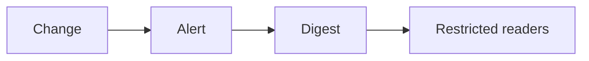

🏠 [Specs](../../../README.md) › 🧩 [Functional capabilities](../../README.md) ›
🔭 [F17 Competitive analysis](../README.md) › 🔀 [Flows](README.md) › 🔀 FL-F17-04 Alerts and sharing

# 🔀 FL-F17-04 Alerts and sharing

**Status:** ✅ specified

## Summary

Covers UC-F17-15, UC-F17-16, UC-F17-19.

## Personas

- [U03 Sales](../../../01-users/personas/u03-sales.md)
- [U07 Administrator](../../../01-users/personas/u07-administrator.md)
- [U12 Marketing](../../../01-users/personas/u12-marketing.md)
- [U13 Owner](../../../01-users/personas/u13-owner.md)

## Flowchart

## Sequence diagram

See each use case.

## Steps

| Step | Persona | Screen | Use case | What happens |
|---|---|---|---|---|
| 1 | U12, U03 | [S-F17-15](../screens/04-alerts-and-sharing/s-f17-15-alerts.md) | [UC-F17-15](../use-cases/04-alerts-and-sharing/uc-f17-15-get-alerts-on-changes.md) | Get alerts on changes |
| 2 | U13 | [S-F17-16](../screens/04-alerts-and-sharing/s-f17-16-digest.md) | [UC-F17-16](../use-cases/04-alerts-and-sharing/uc-f17-16-receive-a-periodic-digest.md) | Receive a periodic digest |
| 3 | U13, U07 | [S-F17-19](../screens/04-alerts-and-sharing/s-f17-19-access.md) | [UC-F17-19](../use-cases/04-alerts-and-sharing/uc-f17-19-restrict-access-to-analyses.md) | Restrict access to analyses |

### Entities and screens

| Entity | States in this flow | Shown at step and screen | Aggregated view |
|---|---|---|---|
| [E-F17-13 Alert](../data/e-f17-13-alert.md) | Sent, Received | 1 [S-F17-15](../screens/04-alerts-and-sharing/s-f17-15-alerts.md); 2 [S-F17-16](../screens/04-alerts-and-sharing/s-f17-16-digest.md) | Alerts |
| [E-F4-09 Scheduled digest](../../f04-meetings/data/e-f04-09-scheduled-digest.md) | Active, Paused | Shown elsewhere: [S-F4-14 Meeting automations](../../f04-meetings/screens/08-share-and-reuse-outside/s-f04-14-meeting-automations.md) | Scheduled digests |
| [E-F1-03 User](../../f01-administration/data/e-f01-03-user.md) | Invited, Active, Deactivated | Shown elsewhere: [S-F1-03 Users](../../f01-administration/screens/03-user-lifecycle/s-f01-03-users.md) | Users |

## Errors

As each use case.

## Images

Every step and error, for each persona taking part, in light and dark mode (D120). Steps are numbered as in the Steps
table; E rows are the error cases.

| Step | Persona | Device | Light | Dark |
|---|---|---|---|---|
| 1 | U12 | desktop | [light](../images/04-alerts-and-sharing/u12-marketing/1-alerts-desktop-light.png) | [dark](../images/04-alerts-and-sharing/u12-marketing/1-alerts-desktop-dark.png) |
| 1 | U12 | phone | [light](../images/04-alerts-and-sharing/u12-marketing/1-alerts-phone-light.png) | [dark](../images/04-alerts-and-sharing/u12-marketing/1-alerts-phone-dark.png) |
| 1 | U03 | desktop | [light](../images/04-alerts-and-sharing/u03-sales/1-alerts-desktop-light.png) | [dark](../images/04-alerts-and-sharing/u03-sales/1-alerts-desktop-dark.png) |
| 1 | U03 | phone | [light](../images/04-alerts-and-sharing/u03-sales/1-alerts-phone-light.png) | [dark](../images/04-alerts-and-sharing/u03-sales/1-alerts-phone-dark.png) |
| 1 | U03 | tablet | [light](../images/04-alerts-and-sharing/u03-sales/1-alerts-tablet-light.png) | [dark](../images/04-alerts-and-sharing/u03-sales/1-alerts-tablet-dark.png) |
| 2 | U13 | desktop | [light](../images/04-alerts-and-sharing/u13-owner/2-digest-desktop-light.png) | [dark](../images/04-alerts-and-sharing/u13-owner/2-digest-desktop-dark.png) |
| 2 | U13 | phone | [light](../images/04-alerts-and-sharing/u13-owner/2-digest-phone-light.png) | [dark](../images/04-alerts-and-sharing/u13-owner/2-digest-phone-dark.png) |
| 3 | U13 | desktop | [light](../images/04-alerts-and-sharing/u13-owner/3-access-desktop-light.png) | [dark](../images/04-alerts-and-sharing/u13-owner/3-access-desktop-dark.png) |
| 3 | U13 | phone | [light](../images/04-alerts-and-sharing/u13-owner/3-access-phone-light.png) | [dark](../images/04-alerts-and-sharing/u13-owner/3-access-phone-dark.png) |
| 3 | U07 | desktop | [light](../images/04-alerts-and-sharing/u07-administrator/3-access-desktop-light.png) | [dark](../images/04-alerts-and-sharing/u07-administrator/3-access-desktop-dark.png) |
| E1 | U03 | desktop | [light](../images/04-alerts-and-sharing/u03-sales/e1-export-refused-desktop-light.png) | [dark](../images/04-alerts-and-sharing/u03-sales/e1-export-refused-desktop-dark.png) |
| E1 | U03 | phone | [light](../images/04-alerts-and-sharing/u03-sales/e1-export-refused-phone-light.png) | [dark](../images/04-alerts-and-sharing/u03-sales/e1-export-refused-phone-dark.png) |
| E1 | U03 | tablet | [light](../images/04-alerts-and-sharing/u03-sales/e1-export-refused-tablet-light.png) | [dark](../images/04-alerts-and-sharing/u03-sales/e1-export-refused-tablet-dark.png) |

## Open questions

None.

---

⬅️ [FL-F17-03 Analyse and arm sales](fl-f17-03-analyse-and-arm-sales.md) · ⬆️ [Up](README.md) ·
➡️ [FL-F17-05 Tender watch](fl-f17-05-tender-watch.md)
