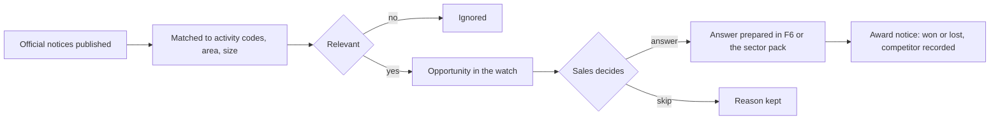
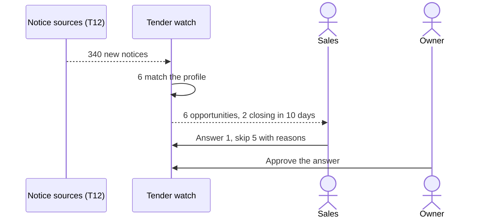

🏠 [Specs](../../../README.md) › 🧩 [Functional capabilities](../../README.md) ›
🔭 [F17 Competitive analysis](../README.md) › 🔀 [Flows](README.md) › 🔀 FL-F17-05 Tender watch

# 🔀 FL-F17-05 Tender watch

**Status:** ✅ specified

## Summary

Public tenders the company could answer are found in the official notices, matched to its activity and area, and handed
to sales to decide; tenders won by competitors (UC-F17-05) close the loop (D474).

## Personas

- [U03 Sales](../../../01-users/personas/u03-sales.md)
- [U13 Owner](../../../01-users/personas/u13-owner.md)

## Flowchart

## Sequence diagram

## Steps

| Step | Persona | Screen | Use case | What happens |
|---|---|---|---|---|
| 1 | U03, U13 | [S-F17-21](../screens/05-tender-watch/s-f17-21-tender-watch.md) | [UC-F17-21](../use-cases/05-tender-watch/uc-f17-21-watch-tenders-to-answer.md) | Watch tenders to answer |
| 2 | U03, U13 | [S-F17-05](../screens/02-collect-signals/s-f17-05-tenders-won.md) | [UC-F17-05](../use-cases/02-collect-signals/uc-f17-05-follow-tenders-won.md) | Follow tenders won by competitors |

### Entities and screens

| Entity | States in this flow | Shown at step and screen | Aggregated view |
|---|---|---|---|
| [E-F17-16 Tender opportunity](../data/e-f17-16-tender-opportunity.md) | New, Missed | 1 [S-F17-21](../screens/05-tender-watch/s-f17-21-tender-watch.md); 2 [S-F17-05](../screens/02-collect-signals/s-f17-05-tenders-won.md) | Tender opportunities |
| [E-F6-03 Quote](../../f06-customers-and-sales/data/e-f06-03-quote.md) | Draft, To approve, Refused, Sent, Expired, Accepted | Shown elsewhere: [S-F6-03 Quote editor](../../f06-customers-and-sales/screens/01-lead-to-quote/s-f06-03-quote-editor.md) | Quotes |
| [E-F17-05 Tender award](../data/e-f17-05-tender-award.md) | Active | 2 [S-F17-05](../screens/02-collect-signals/s-f17-05-tenders-won.md) | Tender awards |
| [E-F17-01 Competitor](../data/e-f17-01-competitor.md) | Active | Shown elsewhere: [S-F17-01 Competitors](../screens/01-set-up-and-profiles/s-f17-01-competitors.md) | Competitors |

## Errors

E1: a notice source is unreachable: the last read is kept and the administrator told; the flow resumes at step 1. E2: a
deadline passes before a decision: the opportunity closes as "missed".

## Images

Every step and error, for each persona taking part, in light and dark mode (D120). Steps are numbered as in the Steps
table; E rows are the error cases.

| Step | Persona | Device | Light | Dark |
|---|---|---|---|---|
| 1 | U03 | desktop | [light](../images/05-tender-watch/u03-sales/1-tender-watch-desktop-light.png) | [dark](../images/05-tender-watch/u03-sales/1-tender-watch-desktop-dark.png) |
| 1 | U03 | phone | [light](../images/05-tender-watch/u03-sales/1-tender-watch-phone-light.png) | [dark](../images/05-tender-watch/u03-sales/1-tender-watch-phone-dark.png) |
| 1 | U03 | tablet | [light](../images/05-tender-watch/u03-sales/1-tender-watch-tablet-light.png) | [dark](../images/05-tender-watch/u03-sales/1-tender-watch-tablet-dark.png) |
| 1 | U13 | desktop | [light](../images/05-tender-watch/u13-owner/1-tender-watch-desktop-light.png) | [dark](../images/05-tender-watch/u13-owner/1-tender-watch-desktop-dark.png) |
| 1 | U13 | phone | [light](../images/05-tender-watch/u13-owner/1-tender-watch-phone-light.png) | [dark](../images/05-tender-watch/u13-owner/1-tender-watch-phone-dark.png) |
| 2 | U03 | desktop | [light](../images/05-tender-watch/u03-sales/2-tenders-won-desktop-light.png) | [dark](../images/05-tender-watch/u03-sales/2-tenders-won-desktop-dark.png) |
| 2 | U03 | phone | [light](../images/05-tender-watch/u03-sales/2-tenders-won-phone-light.png) | [dark](../images/05-tender-watch/u03-sales/2-tenders-won-phone-dark.png) |
| 2 | U03 | tablet | [light](../images/05-tender-watch/u03-sales/2-tenders-won-tablet-light.png) | [dark](../images/05-tender-watch/u03-sales/2-tenders-won-tablet-dark.png) |
| 2 | U13 | desktop | [light](../images/05-tender-watch/u13-owner/2-tenders-won-desktop-light.png) | [dark](../images/05-tender-watch/u13-owner/2-tenders-won-desktop-dark.png) |
| 2 | U13 | phone | [light](../images/05-tender-watch/u13-owner/2-tenders-won-phone-light.png) | [dark](../images/05-tender-watch/u13-owner/2-tenders-won-phone-dark.png) |
| E1 | U03 | desktop | [light](../images/05-tender-watch/u03-sales/e1-tender-watch-refused-desktop-light.png) | [dark](../images/05-tender-watch/u03-sales/e1-tender-watch-refused-desktop-dark.png) |
| E1 | U03 | phone | [light](../images/05-tender-watch/u03-sales/e1-tender-watch-refused-phone-light.png) | [dark](../images/05-tender-watch/u03-sales/e1-tender-watch-refused-phone-dark.png) |
| E1 | U03 | tablet | [light](../images/05-tender-watch/u03-sales/e1-tender-watch-refused-tablet-light.png) | [dark](../images/05-tender-watch/u03-sales/e1-tender-watch-refused-tablet-dark.png) |

## Open questions

None.

---

⬅️ [FL-F17-04 Alerts and sharing](fl-f17-04-alerts-and-sharing.md) · ⬆️ [Up](README.md) ·
➡️ [FL-F17-06 Price intelligence](fl-f17-06-price-intelligence.md)
