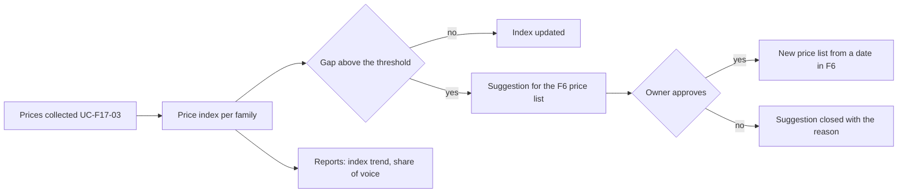
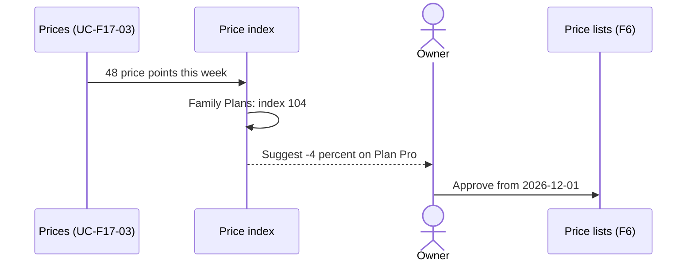

🏠 [Specs](../../../README.md) › 🧩 [Functional capabilities](../../README.md) ›
🔭 [F17 Competitive analysis](../README.md) › 🔀 [Flows](README.md) › 🔀 FL-F17-06 Price intelligence

# 🔀 FL-F17-06 Price intelligence

**Status:** ✅ specified

## Summary

Competitors' prices become a price index per product family; a change above the threshold suggests a price-list change
to F6, which applies only after approval; reports follow the index and the share of voice (D474).

## Personas

- [U12 Marketing and communication](../../../01-users/personas/u12-marketing.md)
- [U03 Sales](../../../01-users/personas/u03-sales.md)
- [U13 Owner](../../../01-users/personas/u13-owner.md)

## Flowchart

## Sequence diagram

## Steps

| Step | Persona | Screen | Use case | What happens |
|---|---|---|---|---|
| 1 | U12, U03 | [S-F17-03](../screens/02-collect-signals/s-f17-03-products-and-prices.md) | [UC-F17-03](../use-cases/02-collect-signals/uc-f17-03-track-products-and-prices.md) | Track products and prices |
| 2 | U13, U03 | [S-F17-23](../screens/06-price-intelligence/s-f17-23-price-suggestions.md) | [UC-F17-23](../use-cases/06-price-intelligence/uc-f17-23-suggest-price-list-changes-from-the-price-index.md) | Suggest price-list changes from the price index |
| 3 | U13, U12 | [S-F17-24](../screens/06-price-intelligence/s-f17-24-competitive-reports.md) | [UC-F17-25](../use-cases/06-price-intelligence/uc-f17-25-report-share-of-voice-and-the-price-index-trend.md) | Report share of voice and the price-index trend |

### Entities and screens

| Entity | States in this flow | Shown at step and screen | Aggregated view |
|---|---|---|---|
| [E-F17-03 Price point](../data/e-f17-03-price-point.md) | Active | 1 [S-F17-03](../screens/02-collect-signals/s-f17-03-products-and-prices.md) | Price points |
| [E-F17-17 Price index](../data/e-f17-17-price-index.md) | Computed, Superseded | 1 [S-F17-03](../screens/02-collect-signals/s-f17-03-products-and-prices.md); 2 [S-F17-23](../screens/06-price-intelligence/s-f17-23-price-suggestions.md); 3 [S-F17-24](../screens/06-price-intelligence/s-f17-24-competitive-reports.md) | Price indexes |
| [E-F17-18 Price suggestion](../data/e-f17-18-price-suggestion.md) | Proposed, Approved, Refused, Applied | 2 [S-F17-23](../screens/06-price-intelligence/s-f17-23-price-suggestions.md) | Price suggestions |
| [E-F6-08 Sales price list](../../f06-customers-and-sales/data/e-f06-08-sales-price-list.md) | Active | Shown elsewhere: [S-F6-10 Price lists](../../f06-customers-and-sales/screens/01-lead-to-quote/s-f06-10-price-lists.md) | Sales price lists |

## Errors

E1: too few like-for-like prices in a family: no index for that family (BR-F17-08). E2: the owner refuses the
suggestion: nothing changes in F6 and the reason is kept.

## Images

Every step and error, for each persona taking part, in light and dark mode (D120). Steps are numbered as in the Steps
table; E rows are the error cases.

| Step | Persona | Device | Light | Dark |
|---|---|---|---|---|
| 1 | U12 | desktop | [light](../images/06-price-intelligence/u12-marketing/1-products-and-prices-desktop-light.png) | [dark](../images/06-price-intelligence/u12-marketing/1-products-and-prices-desktop-dark.png) |
| 1 | U12 | phone | [light](../images/06-price-intelligence/u12-marketing/1-products-and-prices-phone-light.png) | [dark](../images/06-price-intelligence/u12-marketing/1-products-and-prices-phone-dark.png) |
| 1 | U03 | desktop | [light](../images/06-price-intelligence/u03-sales/1-products-and-prices-desktop-light.png) | [dark](../images/06-price-intelligence/u03-sales/1-products-and-prices-desktop-dark.png) |
| 1 | U03 | phone | [light](../images/06-price-intelligence/u03-sales/1-products-and-prices-phone-light.png) | [dark](../images/06-price-intelligence/u03-sales/1-products-and-prices-phone-dark.png) |
| 1 | U03 | tablet | [light](../images/06-price-intelligence/u03-sales/1-products-and-prices-tablet-light.png) | [dark](../images/06-price-intelligence/u03-sales/1-products-and-prices-tablet-dark.png) |
| 2 | U13 | desktop | [light](../images/06-price-intelligence/u13-owner/2-price-suggestions-desktop-light.png) | [dark](../images/06-price-intelligence/u13-owner/2-price-suggestions-desktop-dark.png) |
| 2 | U13 | phone | [light](../images/06-price-intelligence/u13-owner/2-price-suggestions-phone-light.png) | [dark](../images/06-price-intelligence/u13-owner/2-price-suggestions-phone-dark.png) |
| 2 | U03 | desktop | [light](../images/06-price-intelligence/u03-sales/2-price-suggestions-desktop-light.png) | [dark](../images/06-price-intelligence/u03-sales/2-price-suggestions-desktop-dark.png) |
| 2 | U03 | phone | [light](../images/06-price-intelligence/u03-sales/2-price-suggestions-phone-light.png) | [dark](../images/06-price-intelligence/u03-sales/2-price-suggestions-phone-dark.png) |
| 2 | U03 | tablet | [light](../images/06-price-intelligence/u03-sales/2-price-suggestions-tablet-light.png) | [dark](../images/06-price-intelligence/u03-sales/2-price-suggestions-tablet-dark.png) |
| 3 | U13 | desktop | [light](../images/06-price-intelligence/u13-owner/3-competitive-reports-desktop-light.png) | [dark](../images/06-price-intelligence/u13-owner/3-competitive-reports-desktop-dark.png) |
| 3 | U13 | phone | [light](../images/06-price-intelligence/u13-owner/3-competitive-reports-phone-light.png) | [dark](../images/06-price-intelligence/u13-owner/3-competitive-reports-phone-dark.png) |
| 3 | U12 | desktop | [light](../images/06-price-intelligence/u12-marketing/3-competitive-reports-desktop-light.png) | [dark](../images/06-price-intelligence/u12-marketing/3-competitive-reports-desktop-dark.png) |
| 3 | U12 | phone | [light](../images/06-price-intelligence/u12-marketing/3-competitive-reports-phone-light.png) | [dark](../images/06-price-intelligence/u12-marketing/3-competitive-reports-phone-dark.png) |
| E1 | U12 | desktop | [light](../images/06-price-intelligence/u12-marketing/e1-products-and-prices-refused-desktop-light.png) | [dark](../images/06-price-intelligence/u12-marketing/e1-products-and-prices-refused-desktop-dark.png) |
| E1 | U12 | phone | [light](../images/06-price-intelligence/u12-marketing/e1-products-and-prices-refused-phone-light.png) | [dark](../images/06-price-intelligence/u12-marketing/e1-products-and-prices-refused-phone-dark.png) |

## Open questions

None.

---

⬅️ [FL-F17-05 Tender watch](fl-f17-05-tender-watch.md) · ⬆️ [Up](README.md) ·
➡️ [FL-F17-07 Sales enablement](fl-f17-07-sales-enablement.md)
