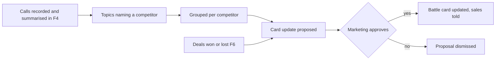
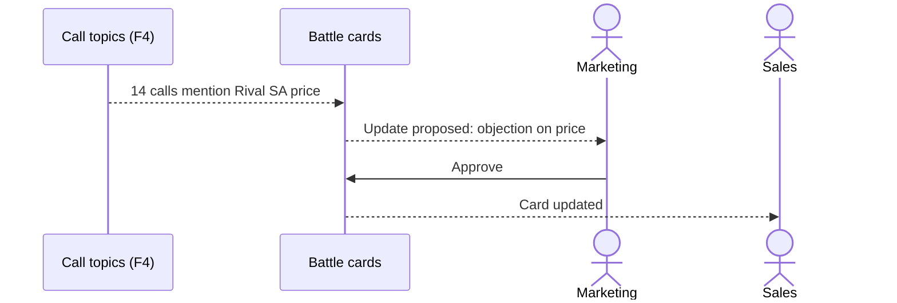

🏠 [Specs](../../../README.md) › 🧩 [Functional capabilities](../../README.md) ›
🔭 [F17 Competitive analysis](../README.md) › 🔀 [Flows](README.md) › 🔀 FL-F17-07 Sales enablement

# 🔀 FL-F17-07 Sales enablement

**Status:** ✅ specified

## Summary

What sales hears in calls (F4's call topics) and what deals teach (win and loss) keep each battle card current; sales
read the cards before and during calls (D474).

## Personas

- [U03 Sales](../../../01-users/personas/u03-sales.md)
- [U02 Manager](../../../01-users/personas/u02-manager.md)
- [U12 Marketing and communication](../../../01-users/personas/u12-marketing.md)

## Flowchart

## Sequence diagram

## Steps

| Step | Persona | Screen | Use case | What happens |
|---|---|---|---|---|
| 1 | U03, U02 | [S-F17-13](../screens/03-analyse-and-arm-sales/s-f17-13-battle-cards.md) | [UC-F17-24](../use-cases/07-sales-enablement/uc-f17-24-feed-battle-cards-from-call-topics.md) | Feed battle cards from call topics |
| 2 | U03 | [S-F17-13](../screens/03-analyse-and-arm-sales/s-f17-13-battle-cards.md) | [UC-F17-13](../use-cases/03-analyse-and-arm-sales/uc-f17-13-prepare-battle-cards-for-sales.md) | Prepare battle cards for sales |
| 3 | U03, U02 | [S-F17-14](../screens/03-analyse-and-arm-sales/s-f17-14-win-and-loss.md) | [UC-F17-14](../use-cases/03-analyse-and-arm-sales/uc-f17-14-analyse-wins-and-losses.md) | Analyse wins and losses |

### Entities and screens

| Entity | States in this flow | Shown at step and screen | Aggregated view |
|---|---|---|---|
| [E-F4-01 Meeting](../../f04-meetings/data/e-f04-01-meeting.md) | Planned, Live, Ended, Waiting for review, Checked | Shown elsewhere: [S-F4-01 Meeting](../../f04-meetings/screens/01-record-an-online-meeting/s-f04-01-meeting.md) | Meetings |
| [E-F17-20 Call topic signal](../data/e-f17-20-call-topic-signal.md) | Counted, Dismissed | 1, 2 [S-F17-13](../screens/03-analyse-and-arm-sales/s-f17-13-battle-cards.md) | Call topic signals |
| [E-F17-01 Competitor](../data/e-f17-01-competitor.md) | Active | Shown elsewhere: [S-F17-01 Competitors](../screens/01-set-up-and-profiles/s-f17-01-competitors.md) | Competitors |
| [E-F6-02 Opportunity](../../f06-customers-and-sales/data/e-f06-02-opportunity.md) | Active | Shown elsewhere: [S-F6-01 Pipeline](../../f06-customers-and-sales/screens/01-lead-to-quote/s-f06-01-pipeline.md) | Opportunities |
| [E-F17-11 Battle card](../data/e-f17-11-battle-card.md) | Active | 1, 2 [S-F17-13](../screens/03-analyse-and-arm-sales/s-f17-13-battle-cards.md) | Battle cards |
| [E-F4-13 Call topic](../../f04-meetings/data/e-f04-13-call-topic.md) | Recorded | Shown elsewhere: [S-F4-18 Topics](../../f04-meetings/screens/11-insights-and-accessibility/s-f04-18-topics.md) | Call topics |

## Errors

E1: no call topic names a competitor for a month: the card shows its last update date. E2: a proposal holds a person's
name: it is removed before the card (BR-F17-16).

## Images

Every step and error, for each persona taking part, in light and dark mode (D120). Steps are numbered as in the Steps
table; E rows are the error cases.

| Step | Persona | Device | Light | Dark |
|---|---|---|---|---|
| 1 | U03 | desktop | [light](../images/07-sales-enablement/u03-sales/1-battle-cards-desktop-light.png) | [dark](../images/07-sales-enablement/u03-sales/1-battle-cards-desktop-dark.png) |
| 1 | U03 | phone | [light](../images/07-sales-enablement/u03-sales/1-battle-cards-phone-light.png) | [dark](../images/07-sales-enablement/u03-sales/1-battle-cards-phone-dark.png) |
| 1 | U03 | tablet | [light](../images/07-sales-enablement/u03-sales/1-battle-cards-tablet-light.png) | [dark](../images/07-sales-enablement/u03-sales/1-battle-cards-tablet-dark.png) |
| 1 | U02 | desktop | [light](../images/07-sales-enablement/u02-manager/1-battle-cards-desktop-light.png) | [dark](../images/07-sales-enablement/u02-manager/1-battle-cards-desktop-dark.png) |
| 1 | U02 | phone | [light](../images/07-sales-enablement/u02-manager/1-battle-cards-phone-light.png) | [dark](../images/07-sales-enablement/u02-manager/1-battle-cards-phone-dark.png) |
| 2 | U03 | desktop | [light](../images/07-sales-enablement/u03-sales/2-battle-cards-desktop-light.png) | [dark](../images/07-sales-enablement/u03-sales/2-battle-cards-desktop-dark.png) |
| 2 | U03 | phone | [light](../images/07-sales-enablement/u03-sales/2-battle-cards-phone-light.png) | [dark](../images/07-sales-enablement/u03-sales/2-battle-cards-phone-dark.png) |
| 2 | U03 | tablet | [light](../images/07-sales-enablement/u03-sales/2-battle-cards-tablet-light.png) | [dark](../images/07-sales-enablement/u03-sales/2-battle-cards-tablet-dark.png) |
| 3 | U03 | desktop | [light](../images/07-sales-enablement/u03-sales/3-win-and-loss-desktop-light.png) | [dark](../images/07-sales-enablement/u03-sales/3-win-and-loss-desktop-dark.png) |
| 3 | U03 | phone | [light](../images/07-sales-enablement/u03-sales/3-win-and-loss-phone-light.png) | [dark](../images/07-sales-enablement/u03-sales/3-win-and-loss-phone-dark.png) |
| 3 | U03 | tablet | [light](../images/07-sales-enablement/u03-sales/3-win-and-loss-tablet-light.png) | [dark](../images/07-sales-enablement/u03-sales/3-win-and-loss-tablet-dark.png) |
| 3 | U02 | desktop | [light](../images/07-sales-enablement/u02-manager/3-win-and-loss-desktop-light.png) | [dark](../images/07-sales-enablement/u02-manager/3-win-and-loss-desktop-dark.png) |
| 3 | U02 | phone | [light](../images/07-sales-enablement/u02-manager/3-win-and-loss-phone-light.png) | [dark](../images/07-sales-enablement/u02-manager/3-win-and-loss-phone-dark.png) |
| E1 | U03 | desktop | [light](../images/07-sales-enablement/u03-sales/e1-battle-cards-refused-desktop-light.png) | [dark](../images/07-sales-enablement/u03-sales/e1-battle-cards-refused-desktop-dark.png) |
| E1 | U03 | phone | [light](../images/07-sales-enablement/u03-sales/e1-battle-cards-refused-phone-light.png) | [dark](../images/07-sales-enablement/u03-sales/e1-battle-cards-refused-phone-dark.png) |
| E1 | U03 | tablet | [light](../images/07-sales-enablement/u03-sales/e1-battle-cards-refused-tablet-light.png) | [dark](../images/07-sales-enablement/u03-sales/e1-battle-cards-refused-tablet-dark.png) |

## Open questions

None.

---

⬅️ [FL-F17-06 Price intelligence](fl-f17-06-price-intelligence.md) · ⬆️ [Up](README.md) ·
➡️ [FL-F17-08 Ads, pages, search and technologies](fl-f17-08-ads-pages-search-and-tech.md)
