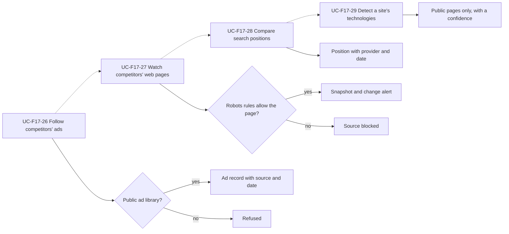
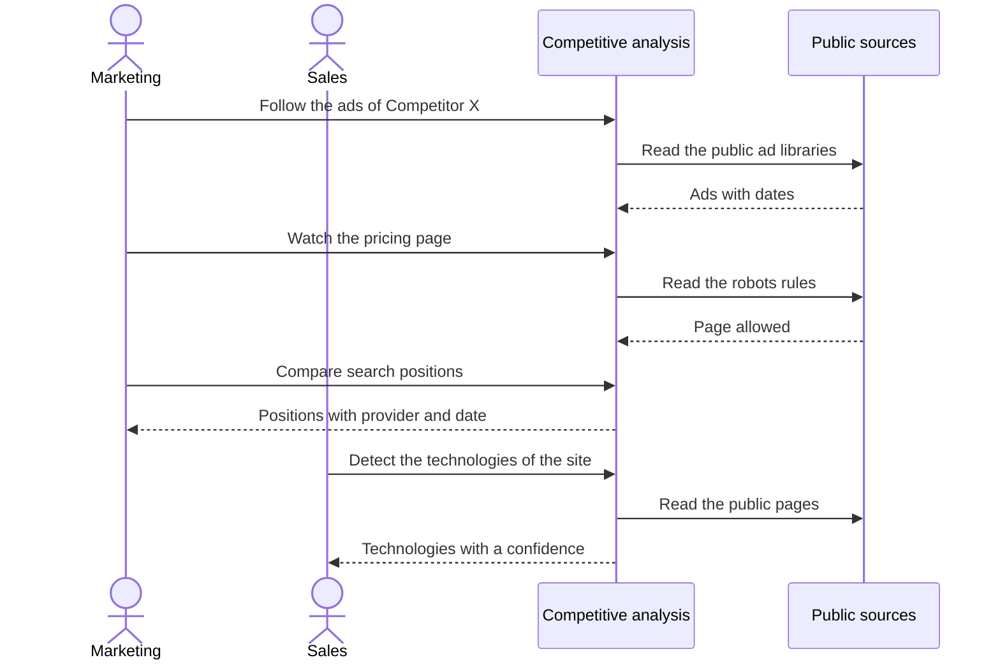

🏠 [Specs](../../../README.md) › 🧩 [Functional capabilities](../../README.md) ›
🔭 [F17 Competitive analysis](../README.md) › 🔀 [Flows](README.md) › 🔀 FL-F17-08 Ads, pages, search and technologies

# 🔀 FL-F17-08 Ads, pages, search and technologies

**Status:** ✅ specified

## Summary

The marketing person follows what competitors advertise from the public ad libraries, watches their public pages for
changes within the robots rules, compares search positions keyword by keyword, and the sales person reads the
technologies their public sites run. Every figure keeps its source and date and nothing is read that is not public
([D536](../../../06-decisions/f17-competitive-analysis/d536-benchmark-gaps-f17-competitive-analysis.md)).

## Personas

- [U12 Marketing and communication](../../../01-users/personas/u12-marketing.md), who follows ads, pages and search
  positions
- [U13 Owner](../../../01-users/personas/u13-owner.md), who reads the changes marked important from a phone
- [U03 Sales](../../../01-users/personas/u03-sales.md), who reads the technologies before a call

## Flowchart

## Sequence diagram

## Steps

| Step | Persona | Screen | Use case | What happens |
|---|---|---|---|---|
| 1 | [U12](../../../01-users/personas/u12-marketing.md) | [S-F17-25](../screens/08-ads-pages-search-and-tech/s-f17-25-competitor-ads.md) | [UC-F17-26](../use-cases/08-ads-pages-search-and-tech/uc-f17-26-follow-competitors-ads.md) | The marketing person reads a competitor's ads from the public ad libraries |
| 2 | [U12](../../../01-users/personas/u12-marketing.md) | [S-F17-26](../screens/08-ads-pages-search-and-tech/s-f17-26-page-watch.md) | [UC-F17-27](../use-cases/08-ads-pages-search-and-tech/uc-f17-27-watch-competitors-web-pages.md) | The marketing person watches a public page and is alerted when its content changes |
| 3 | [U12](../../../01-users/personas/u12-marketing.md) | [S-F17-27](../screens/08-ads-pages-search-and-tech/s-f17-27-search-overlap.md) | [UC-F17-28](../use-cases/08-ads-pages-search-and-tech/uc-f17-28-compare-search-positions.md) | The marketing person compares search positions with the competitors' and follows the gaps |
| 4 | [U03](../../../01-users/personas/u03-sales.md) | [S-F17-28](../screens/08-ads-pages-search-and-tech/s-f17-28-tech-detection.md) | [UC-F17-29](../use-cases/08-ads-pages-search-and-tech/uc-f17-29-detect-a-sites-technologies.md) | The sales person reads the technologies a public site runs, with the evidence |

### Entities and screens

| Entity | States in this flow | Shown at step and screen | Aggregated view |
|---|---|---|---|
| [E-F17-21 Ad record](../data/e-f17-21-ad-record.md) | Active, Ended, Withdrawn | 1 [S-F17-25](../screens/08-ads-pages-search-and-tech/s-f17-25-competitor-ads.md) | Ad records |
| [E-F17-22 Watched page](../data/e-f17-22-watched-page.md) | Watching, Changed, Blocked, Removed | 2 [S-F17-26](../screens/08-ads-pages-search-and-tech/s-f17-26-page-watch.md) | Watched pages |
| [E-F17-23 Keyword](../data/e-f17-23-keyword.md) | Proposed, Followed, Pursued, Dropped | 3 [S-F17-27](../screens/08-ads-pages-search-and-tech/s-f17-27-search-overlap.md) | Keywords |
| [E-F17-24 Technology record](../data/e-f17-24-technology-record.md) | Seen, Confirmed, Rejected, Gone | 4 [S-F17-28](../screens/08-ads-pages-search-and-tech/s-f17-28-tech-detection.md) | Technology records |
| [E-F11-02 Web page](../../f11-online-shop/data/e-f11-02-web-page.md) | Draft, Published | Shown elsewhere: [S-F11-01 Website editor](../../f11-online-shop/screens/01-build-the-shop/s-f11-01-website-editor.md) | Web pages |

## Errors

- **E1 The source blocks the collection.** The site's robots rules or a bot check stop the read: the page or library is
  marked Blocked, nothing is bypassed and the person is told why
  ([BR-F17-18](../business-rules/br-f17-18-page-watching-respects-robots-rules-and-rate-limits.md), step 2).

## Images

Every step and error, for each persona taking part, in light and dark mode (D120). Steps are numbered as in the Steps
table; E rows are the error cases.

| Step | Persona | Device | Light | Dark |
|---|---|---|---|---|
| 1 | U12 | desktop | [light](../images/08-ads-pages-search-and-tech/u12-marketing/1-competitor-ads-desktop-light.png) | [dark](../images/08-ads-pages-search-and-tech/u12-marketing/1-competitor-ads-desktop-dark.png) |
| 1 | U12 | phone | [light](../images/08-ads-pages-search-and-tech/u12-marketing/1-competitor-ads-phone-light.png) | [dark](../images/08-ads-pages-search-and-tech/u12-marketing/1-competitor-ads-phone-dark.png) |
| 2 | U12 | desktop | [light](../images/08-ads-pages-search-and-tech/u12-marketing/2-page-watch-desktop-light.png) | [dark](../images/08-ads-pages-search-and-tech/u12-marketing/2-page-watch-desktop-dark.png) |
| 2 | U13 | phone | [light](../images/08-ads-pages-search-and-tech/u13-owner/2-page-watch-phone-light.png) | [dark](../images/08-ads-pages-search-and-tech/u13-owner/2-page-watch-phone-dark.png) |
| 2 | U12 | phone | [light](../images/08-ads-pages-search-and-tech/u12-marketing/2-page-watch-phone-light.png) | [dark](../images/08-ads-pages-search-and-tech/u12-marketing/2-page-watch-phone-dark.png) |
| 3 | U12 | desktop | [light](../images/08-ads-pages-search-and-tech/u12-marketing/3-search-overlap-desktop-light.png) | [dark](../images/08-ads-pages-search-and-tech/u12-marketing/3-search-overlap-desktop-dark.png) |
| 3 | U12 | phone | [light](../images/08-ads-pages-search-and-tech/u12-marketing/3-search-overlap-phone-light.png) | [dark](../images/08-ads-pages-search-and-tech/u12-marketing/3-search-overlap-phone-dark.png) |
| 4 | U03 | desktop | [light](../images/08-ads-pages-search-and-tech/u03-sales/4-tech-detection-desktop-light.png) | [dark](../images/08-ads-pages-search-and-tech/u03-sales/4-tech-detection-desktop-dark.png) |
| 4 | U03 | phone | [light](../images/08-ads-pages-search-and-tech/u03-sales/4-tech-detection-phone-light.png) | [dark](../images/08-ads-pages-search-and-tech/u03-sales/4-tech-detection-phone-dark.png) |
| 4 | U03 | tablet | [light](../images/08-ads-pages-search-and-tech/u03-sales/4-tech-detection-tablet-light.png) | [dark](../images/08-ads-pages-search-and-tech/u03-sales/4-tech-detection-tablet-dark.png) |
| E1 | U12 | desktop | [light](../images/08-ads-pages-search-and-tech/u12-marketing/e1-the-source-blocks-the-collection-desktop-light.png) | [dark](../images/08-ads-pages-search-and-tech/u12-marketing/e1-the-source-blocks-the-collection-desktop-dark.png) |
| E1 | U12 | phone | [light](../images/08-ads-pages-search-and-tech/u12-marketing/e1-the-source-blocks-the-collection-phone-light.png) | [dark](../images/08-ads-pages-search-and-tech/u12-marketing/e1-the-source-blocks-the-collection-phone-dark.png) |

## Open questions

None.

---

⬅️ [FL-F17-07 Sales enablement](fl-f17-07-sales-enablement.md) · ⬆️ [Up](README.md)
