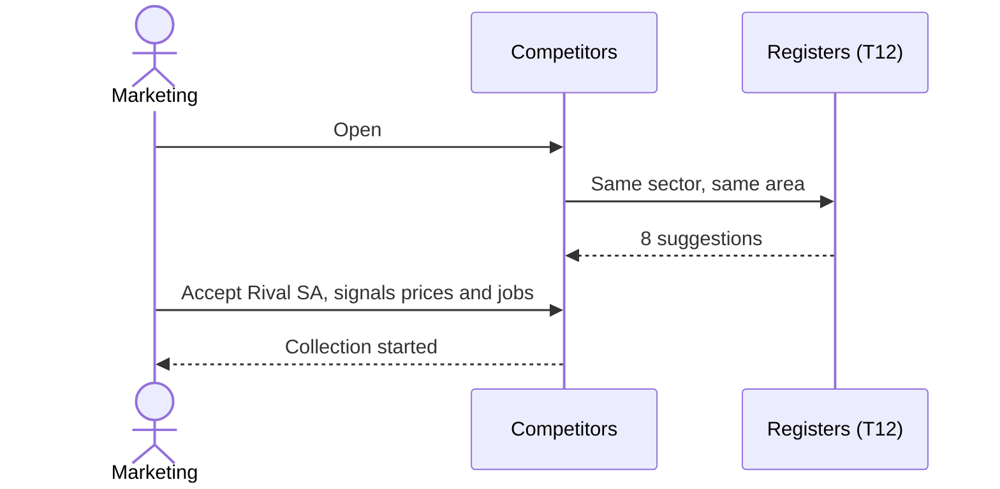

🏠 [Specs](../../../../README.md) › 🧩 [Functional capabilities](../../../README.md) ›
🔭 [F17 Competitive analysis](../../README.md) › 📝 [Use cases](../README.md) ›
📝 [Use cases: FL-F17-01 Set up and profiles](README.md) › 📝 UC-F17-01 List competitors

# 📝 UC-F17-01 List competitors

**Status:** ✅ specified

## Summary

The owner and marketing build the list of competitors to follow, from suggestions drawn from the sector and area or by
hand, and choose the signals to follow for each.

## Personas

- [U13 Owner](../../../../01-users/personas/u13-owner.md)
- [U12 Marketing](../../../../01-users/personas/u12-marketing.md)

## Goal

The right competitors followed for the right signals.

## Trigger

Setting up F17; a new competitor seen in a lost deal.

## Frequency

Once, then a few changes a quarter.

## Preconditions

- The company's sector and areas are set.

## Postconditions

- Success: competitors listed with their followed signals.
- Failure: nothing followed.

## Main flow

1. Marketing opens Competitors (S-F17-01); simple-ERP suggests companies of the same sector and area.
2. Marketing accepts suggestions or adds a company by name or identifier.
3. For each, they choose the signals: prices, jobs, tenders, filings, reviews, news, events.
4. The owner checks the list.
5. Collection starts for each competitor within the collection rules (UC-F17-18).

## Alternative flows

- 2a. A competitor named in a lost deal (F6) is suggested.

## Error flows

- 2e. The identifier is unknown in the registers: the company is added by hand and flagged.
- Any step: a service does not answer; the call is retried first (BR-F3-32), then the message follows the error pattern
  (D122) and what was typed stays on the screen.

## Business rules

- [BR-F17-09 Analyses are confidential by default](../../business-rules/br-f17-09-analyses-are-confidential.md)

## Entities

- [E-F17-01 Competitor](../../data/e-f17-01-competitor.md)

## Permissions

Owner and marketing.

## Notifications

- Marketing when a lost deal names a new competitor.

## Audit events

Competitors added and removed, signals changed.

## AI involvement

The AI assistant may suggest competitors from the sector and area.

## API, MCP and A2A exposure

Through T5 and T6 with the caller's rights (BR-F3-34).

## Screens

- [S-F17-01 Competitors](../../screens/01-set-up-and-profiles/s-f17-01-competitors.md)

## Flowchart

See [FL-F17-01 Set up and profiles](../../flows/fl-f17-01-set-up-and-profiles.md#flowchart).

## Sequence diagram

## Acceptance criteria

1. **Given** the home-care example company in Lyon **when** the list opens **then** home-care companies of the area are
   suggested.
2. **Given** Rival SA accepted with prices and jobs **when** saved **then** only those signals are collected.
3. **Given** a lost deal naming Other Co **when** lost **then** Other Co is suggested.

## Non-functional notes

D408's targets ([Performance](../../../../05-non-functional/performance.md)): 95 % of screens within 1 second; lists
paged on the server, the first page within 1 second; reports within 5 seconds or in the background.

## Regulatory references

Collection rules of the France country pack:
[CR-FR-192 Trade secrets](../../../../10-country-packs/france/trade/cr-fr-192-trade-secrets.md),
[CR-FR-193 Database producer's right](../../../../10-country-packs/france/trade/cr-fr-193-database-producer-right.md),
[CR-FR-196 Legitimate interest needs a documented balance](../../../../10-country-packs/france/data-protection/cr-fr-196-legitimate-interest-balancing.md),
[CR-FR-198 Comparative advertising](../../../../10-country-packs/france/consumer/cr-fr-198-comparative-advertising.md),
[CR-FR-060 Copyrighted standards and text mining](../../../../10-country-packs/france/ai-and-recording/cr-fr-060-text-and-data-mining-opt-out.md),
[CR-FR-052 Personal data kept no longer than needed](../../../../10-country-packs/france/data-protection/cr-fr-052-storage-limitation.md),
[CR-FR-051 Access and erasure requests](../../../../10-country-packs/france/data-protection/cr-fr-051-access-and-erasure.md).

## Related use cases

- [UC-F17-02 Build a profile from registers and filings](uc-f17-02-build-a-profile-from-registers-and-filings.md)
- [UC-F17-18 Set lawful collection rules](uc-f17-18-set-lawful-collection-rules.md)

## Open questions

None.

---

⬆️ [Up](README.md) ·
➡️ [UC-F17-02 Build a profile from registers and filings](uc-f17-02-build-a-profile-from-registers-and-filings.md)
