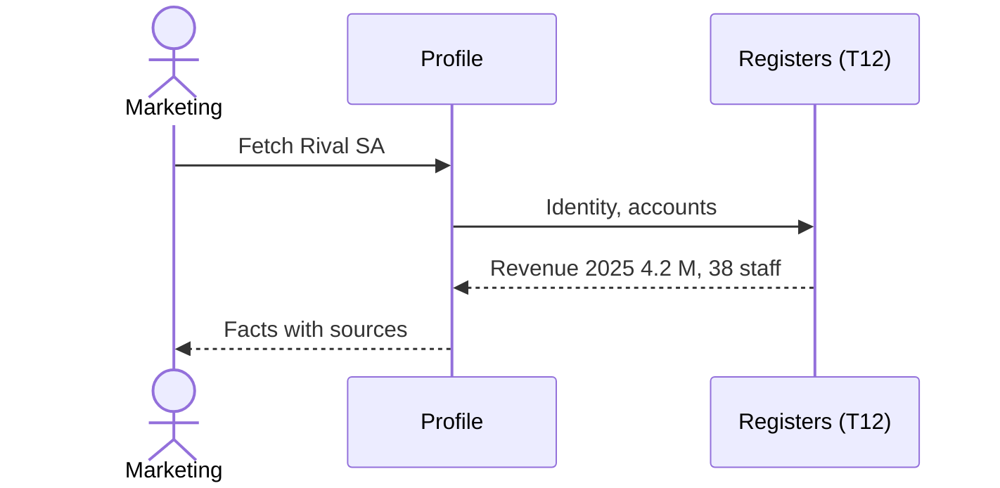

🏠 [Specs](../../../../README.md) › 🧩 [Functional capabilities](../../../README.md) ›
🔭 [F17 Competitive analysis](../../README.md) › 📝 [Use cases](../README.md) ›
📝 [Use cases: FL-F17-01 Set up and profiles](README.md) › 📝 UC-F17-02 Build a profile from registers and filings

# 📝 UC-F17-02 Build a profile from registers and filings

**Status:** ✅ specified

## Summary

Marketing builds a competitor's profile from public registers and filings: identity, size, accounts, officers as company
officers only, and sites, each fact with its source and date.

## Personas

- [U12 Marketing](../../../../01-users/personas/u12-marketing.md)

## Goal

A sourced profile of each competitor.

## Trigger

A competitor added; a yearly refresh.

## Frequency

Once per competitor, then yearly.

## Preconditions

- The competitor is followed.

## Postconditions

- Success: facts recorded with sources.
- Failure: facts missing are listed.

## Main flow

1. Marketing opens a competitor's profile (S-F17-02) and chooses "Fetch".
2. simple-ERP reads the registers and filings.
3. Facts are stored with source and date (BR-F17-02).
4. Officers appear only as company officers (BR-F17-04).
5. Marketing reviews the profile.

## Alternative flows

- 2a. A paid provider adds data within its licence (BR-F17-06).

## Error flows

- 2e. A register is unreachable: the last facts are kept, the date shown.
- Any step: a service does not answer; the call is retried first (BR-F3-32), then the message follows the error pattern
  (D122) and what was typed stays on the screen.

## Business rules

- [BR-F17-02 Every fact keeps its source and date](../../business-rules/br-f17-02-every-fact-keeps-its-source.md)
- [BR-F17-04 No profiling of individual people](../../business-rules/br-f17-04-no-profiling-of-people.md)

## Entities

- [E-F17-01 Competitor](../../data/e-f17-01-competitor.md)
- [E-F17-02 Company fact](../../data/e-f17-02-company-fact.md)

## Permissions

Owner and marketing; others as granted.

## Notifications

- None.

## Audit events

Fetches.

## AI involvement

The AI assistant summarises the profile with its sources.

## API, MCP and A2A exposure

Through T5 and T6 with the caller's rights (BR-F3-34).

## Screens

- [S-F17-02 Competitor profile](../../screens/01-set-up-and-profiles/s-f17-02-competitor-profile.md)

## Flowchart

See [FL-F17-01 Set up and profiles](../../flows/fl-f17-01-set-up-and-profiles.md#flowchart).

## Sequence diagram

## Acceptance criteria

1. **Given** Rival SA **when** fetched **then** its revenue 2025 shows with the register link and date.
2. **Given** an officer **when** shown **then** only as a company officer, never scored.
3. **Given** a register down **when** fetched **then** the last facts show with their date.

## Non-functional notes

D408's targets ([Performance](../../../../05-non-functional/performance.md)): 95 % of screens within 1 second; lists
paged on the server, the first page within 1 second; reports within 5 seconds or in the background.

## Regulatory references

Collection rules of the France country pack:
[CR-FR-192 Trade secrets](../../../../10-country-packs/france/trade/cr-fr-192-trade-secrets.md),
[CR-FR-193 Database producer's right](../../../../10-country-packs/france/trade/cr-fr-193-database-producer-right.md),
[CR-FR-196 Legitimate interest needs a documented balance](../../../../10-country-packs/france/data-protection/cr-fr-196-legitimate-interest-balancing.md),
[CR-FR-198 Comparative advertising](../../../../10-country-packs/france/consumer/cr-fr-198-comparative-advertising.md),
[CR-FR-060 Copyrighted standards and text mining](../../../../10-country-packs/france/ai-and-recording/cr-fr-060-text-and-data-mining-opt-out.md),
[CR-FR-052 Personal data kept no longer than needed](../../../../10-country-packs/france/data-protection/cr-fr-052-storage-limitation.md),
[CR-FR-051 Access and erasure requests](../../../../10-country-packs/france/data-protection/cr-fr-051-access-and-erasure.md).

## Related use cases

- [UC-F17-01 List competitors](uc-f17-01-list-competitors.md)
- [UC-F17-09 Follow funding, deals and legal events](../02-collect-signals/uc-f17-09-follow-funding-deals-and-legal-events.md)

## Open questions

None.

---

⬅️ [UC-F17-01 List competitors](uc-f17-01-list-competitors.md) · ⬆️ [Up](README.md) ·
➡️ [UC-F17-03 Track products and prices](../02-collect-signals/uc-f17-03-track-products-and-prices.md)
