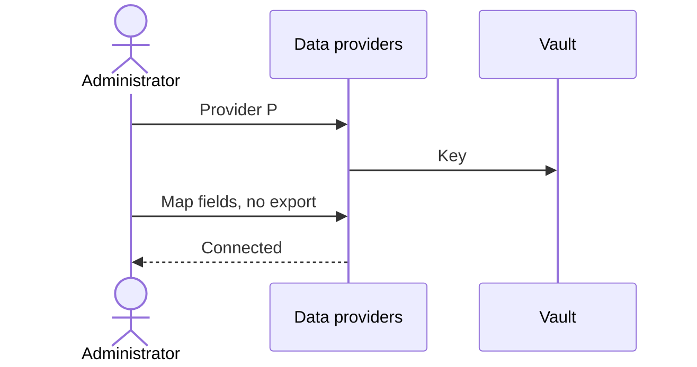

🏠 [Specs](../../../../README.md) › 🧩 [Functional capabilities](../../../README.md) ›
🔭 [F17 Competitive analysis](../../README.md) › 📝 [Use cases](../README.md) ›
📝 [Use cases: FL-F17-01 Set up and profiles](README.md) › 📝 UC-F17-10 Connect paid data providers

# 📝 UC-F17-10 Connect paid data providers

**Status:** ✅ specified

## Summary

The administrator connects paid data providers, puts their keys in the vault, maps their fields and records their
licence limits; their spend is followed against a budget (UC-F17-22).

## Personas

- [U07 Administrator](../../../../01-users/personas/u07-administrator.md)

## Goal

Paid data used within licence and budget.

## Trigger

A provider chosen.

## Frequency

Rare.

## Preconditions

- A contract with the provider.

## Postconditions

- Success: provider connected with its limits.
- Failure: not connected.

## Main flow

1. The administrator opens Data providers (S-F17-10).
2. They choose a provider and enter the key, stored in the vault.
3. They map its fields to facts.
4. They record its licence limits (BR-F17-06) and its budget in F22.
5. simple-ERP tests the connection.

## Alternative flows

- 3a. A provider with ready-made mapping.

## Error flows

- 5e. The key is refused: not saved.
- Any step: a service does not answer; the call is retried first (BR-F3-32), then the message follows the error pattern
  (D122) and what was typed stays on the screen.

## Business rules

- [BR-F17-06 Paid sources used under their licence](../../business-rules/br-f17-06-paid-sources-under-their-licence.md)
- [BR-F17-14 Data costs within their budget](../../business-rules/br-f17-14-data-costs-within-their-budget.md)

## Entities

- [E-F17-09 Data provider](../../data/e-f17-09-data-provider.md)
- [E-F17-19 Data cost line](../../data/e-f17-19-data-cost-line.md)

## Permissions

Administrator; the owner approves.

## Notifications

- The administrator when a provider fails.

## Audit events

Connections and limits.

## AI involvement

None.

## API, MCP and A2A exposure

Through T5 and T6 with the caller's rights (BR-F3-34).

## Screens

- [S-F17-10 Data providers](../../screens/01-set-up-and-profiles/s-f17-10-data-providers.md)

## Flowchart

See [FL-F17-01 Set up and profiles](../../flows/fl-f17-01-set-up-and-profiles.md#flowchart).

## Sequence diagram

## Acceptance criteria

1. **Given** Provider P with "no export" **when** connected **then** its data cannot be exported.
2. **Given** a refused key **when** tested **then** nothing is saved.
3. **Given** a budget of 500.00 EUR in F22 **when** connected **then** its spend is counted.

## Non-functional notes

D408's targets ([Performance](../../../../05-non-functional/performance.md)): 95 % of screens within 1 second; lists
paged on the server, the first page within 1 second; reports within 5 seconds or in the background.

## Regulatory references

Collection rules of the France country pack:
[CR-FR-192 Trade secrets](../../../../10-country-packs/france/trade/cr-fr-192-trade-secrets.md),
[CR-FR-193 Database producer's right](../../../../10-country-packs/france/trade/cr-fr-193-database-producer-right.md),
[CR-FR-196 Legitimate interest needs a documented balance](../../../../10-country-packs/france/data-protection/cr-fr-196-legitimate-interest-balancing.md),
[CR-FR-198 Comparative advertising](../../../../10-country-packs/france/consumer/cr-fr-198-comparative-advertising.md),
[CR-FR-060 Copyrighted standards and text mining](../../../../10-country-packs/france/ai-and-recording/cr-fr-060-text-and-data-mining-opt-out.md),
[CR-FR-052 Personal data kept no longer than needed](../../../../10-country-packs/france/data-protection/cr-fr-052-storage-limitation.md),
[CR-FR-051 Access and erasure requests](../../../../10-country-packs/france/data-protection/cr-fr-051-access-and-erasure.md).

## Related use cases

- [UC-F17-22 Follow data-provider costs against the budget](uc-f17-22-follow-data-provider-costs-against-the-budget.md)

## Open questions

None.

---

⬅️ [UC-F17-09](../02-collect-signals/uc-f17-09-follow-funding-deals-and-legal-events.md) · ⬆️ [Up](README.md) ·
➡️ [UC-F17-11 Compare side by side](../03-analyse-and-arm-sales/uc-f17-11-compare-side-by-side.md)
