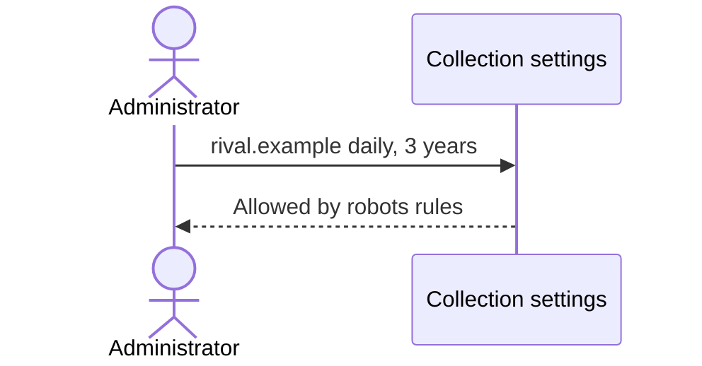

🏠 [Specs](../../../../README.md) › 🧩 [Functional capabilities](../../../README.md) ›
🔭 [F17 Competitive analysis](../../README.md) › 📝 [Use cases](../README.md) ›
📝 [Use cases: FL-F17-01 Set up and profiles](README.md) › 📝 UC-F17-18 Set lawful collection rules

# 📝 UC-F17-18 Set lawful collection rules

**Status:** ✅ specified

## Summary

The administrator sets which sources are allowed, at which rate and for how long facts are kept, within the law of the
country pack.

## Personas

- [U07 Administrator](../../../../01-users/personas/u07-administrator.md)

## Goal

Collection lawful by design.

## Trigger

Setting up; a new source.

## Frequency

Rare.

## Preconditions

- Administrator role.

## Postconditions

- Success: rules saved.
- Failure: a source refused.

## Main flow

1. The administrator opens Collection settings (S-F17-18).
2. They review each source's terms and robots rules (BR-F17-03).
3. They set the rate and retention (BR-F17-11).
4. They save; collection follows the rules.

## Alternative flows

- 3a. Default retention 3 years.

## Error flows

- 2e. A source's terms forbid it: refused.
- Any step: a service does not answer; the call is retried first (BR-F3-32), then the message follows the error pattern
  (D122) and what was typed stays on the screen.

## Business rules

- [BR-F17-01 Collection follows the country pack](../../business-rules/br-f17-01-analysis-follows-the-country-pack.md)
- [BR-F17-03 Sites' terms and robots rules respected](../../business-rules/br-f17-03-terms-and-robots-respected.md)
- [BR-F17-11 Facts kept for a set period](../../business-rules/br-f17-11-facts-kept-for-a-set-period.md)
- [BR-F17-05 No trade secrets, no deception](../../business-rules/br-f17-05-no-trade-secrets-or-deception.md)

## Entities

- [E-F17-15 Collection rule](../../data/e-f17-15-collection-rule.md)

## Permissions

Administrator; owner approves.

## Notifications

- The administrator when a source is blocked.

## Audit events

Rules changed.

## AI involvement

None.

## API, MCP and A2A exposure

Through T5 and T6 with the caller's rights (BR-F3-34).

## Screens

- [S-F17-18 Collection settings](../../screens/01-set-up-and-profiles/s-f17-18-collection-settings.md)

## Flowchart

See [FL-F17-01 Set up and profiles](../../flows/fl-f17-01-set-up-and-profiles.md#flowchart).

## Sequence diagram

## Acceptance criteria

1. **Given** rival.example allows it **when** saved **then** daily collection runs.
2. **Given** a source forbidding it **when** added **then** refused.
3. **Given** 3 years **when** passed **then** facts are summarised.

## Non-functional notes

D408's targets ([Performance](../../../../05-non-functional/performance.md)): 95 % of screens within 1 second; lists
paged on the server, the first page within 1 second; reports within 5 seconds or in the background.

## Regulatory references

Collection rules of the France country pack:
[CR-FR-192 Trade secrets](../../../../10-country-packs/france/trade/cr-fr-192-trade-secrets.md),
[CR-FR-193 Database producer's right](../../../../10-country-packs/france/trade/cr-fr-193-database-producer-right.md),
[CR-FR-196 Legitimate interest needs a documented balance](../../../../10-country-packs/france/data-protection/cr-fr-196-legitimate-interest-balancing.md),
[CR-FR-198 Comparative advertising](../../../../10-country-packs/france/consumer/cr-fr-198-comparative-advertising.md),
[CR-FR-060 Copyrighted standards and text mining](../../../../10-country-packs/france/ai-and-recording/cr-fr-060-text-and-data-mining-opt-out.md),
[CR-FR-052 Personal data kept no longer than needed](../../../../10-country-packs/france/data-protection/cr-fr-052-storage-limitation.md),
[CR-FR-051 Access and erasure requests](../../../../10-country-packs/france/data-protection/cr-fr-051-access-and-erasure.md).

## Related use cases

- [UC-F17-01 List competitors](uc-f17-01-list-competitors.md)
- [UC-F17-22 Follow data-provider costs against the budget](uc-f17-22-follow-data-provider-costs-against-the-budget.md)

## Open questions

None.

---

⬅️ [UC-F17-17](../03-analyse-and-arm-sales/uc-f17-17-estimate-market-shares-in-a-territory.md) · ⬆️ [Up](README.md) ·
➡️ [UC-F17-19 Restrict access to analyses](../04-alerts-and-sharing/uc-f17-19-restrict-access-to-analyses.md)
