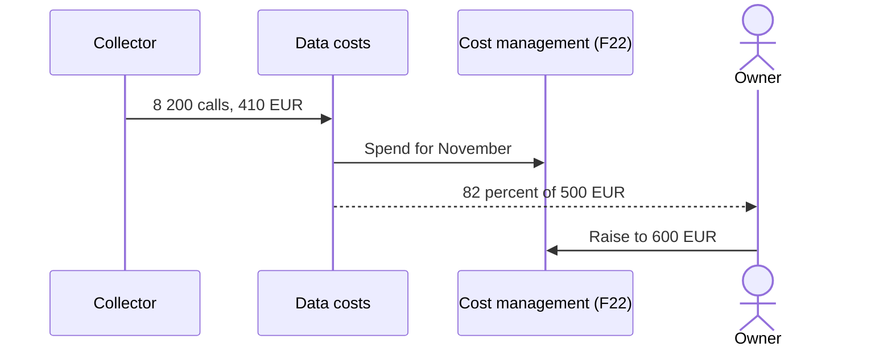

🏠 [Specs](../../../../README.md) › 🧩 [Functional capabilities](../../../README.md) ›
🔭 [F17 Competitive analysis](../../README.md) › 📝 [Use cases](../README.md) ›
📝 [Use cases: FL-F17-01 Set up and profiles](README.md) › 📝 UC-F17-22 Follow data-provider costs against the budget

# 📝 UC-F17-22 Follow data-provider costs against the budget

**Status:** ✅ specified

## Summary

The owner and the administrator follow what each paid data provider costs each month against its budget in F22; the
owner is warned near the budget and collection stops at it.

## Personas

- [U13 Owner](../../../../01-users/personas/u13-owner.md)
- [U07 Administrator](../../../../01-users/personas/u07-administrator.md)

## Goal

Competitive data never costs more than planned.

## Trigger

Each call to a paid provider; the month's end.

## Frequency

Monthly review; warnings when they happen.

## Preconditions

- The provider is connected (UC-F17-10) and has a budget in F22.

## Postconditions

- Success: spend counted per provider and period, within budget.
- Failure: collection from the provider stops at 100 %.

## Main flow

1. Each collection from a paid provider counts its calls and cost (S-F17-22).
2. simple-ERP adds the cost to the provider's line for the month and to F22's view of platform costs.
3. At the warning level the owner is warned with the spend and the forecast to the month's end (BR-F17-14).
4. The owner raises the budget or lets it run.
5. At 100 %, collection from that provider stops until the next month or a higher budget.

## Alternative flows

- 4a. The owner moves the provider to a cheaper plan or a free source.

## Error flows

- 2e. The provider's bill differs from the meter: the bill wins and the difference is shown.
- Any step: a service does not answer; the call is retried first (BR-F3-32), then the message follows the error pattern
  (D122) and what was typed stays on the screen.

## Business rules

- [BR-F17-14 Data costs within their budget](../../business-rules/br-f17-14-data-costs-within-their-budget.md)
- [BR-F17-06 Paid sources used under their licence](../../business-rules/br-f17-06-paid-sources-under-their-licence.md)

## Entities

- [E-F17-19 Data cost line](../../data/e-f17-19-data-cost-line.md)
- [E-F17-09 Data provider](../../data/e-f17-09-data-provider.md)

## Permissions

Owner and administrator; accounting reads the costs in F22.

## Notifications

- The owner at the warning level and when collection stops.

## Audit events

Spend counted, warnings, stops, budget changes.

## AI involvement

The AI assistant may suggest which signals cost most for the least use.

## API, MCP and A2A exposure

Through the API (T5) and as AI assistant tools (T6), with the caller's rights (BR-F3-34).

## Screens

- [S-F17-22 Data costs](../../screens/01-set-up-and-profiles/s-f17-22-data-costs.md)

## Flowchart

See [FL-F17-01 Set up and profiles](../../flows/fl-f17-01-set-up-and-profiles.md#flowchart).

## Sequence diagram

## Acceptance criteria

1. **Given** Provider P at 410.00 EUR of a 500.00 EUR budget **when** counted **then** the owner is warned at 82 %.
2. **Given** the spend reaches 500.00 EUR on 2026-11-24 **when** the next call is due **then** collection from Provider
   P stops.
3. **Given** the owner raises the budget to 600.00 EUR **when** saved **then** collection resumes.
4. **Given** a bill of 432.00 EUR for a meter of 410.00 EUR **when** the bill arrives **then** 432.00 EUR is kept and
   the difference shown.

## Non-functional notes

D408's targets ([Performance](../../../../05-non-functional/performance.md)): 95 % of screens within 1 second; lists
paged on the server, the first page within 1 second; reports within 5 seconds or in the background.

## Regulatory references

None.

## Related use cases

- [UC-F17-10 Connect paid data providers](uc-f17-10-connect-paid-data-providers.md)
- [UC-F17-18 Set lawful collection rules](uc-f17-18-set-lawful-collection-rules.md)

## Open questions

None.

---

⬅️ [UC-F17-21 Watch tenders to answer](../05-tender-watch/uc-f17-21-watch-tenders-to-answer.md) · ⬆️ [Up](README.md) ·
➡️ [UC-F17-23](../06-price-intelligence/uc-f17-23-suggest-price-list-changes-from-the-price-index.md)
