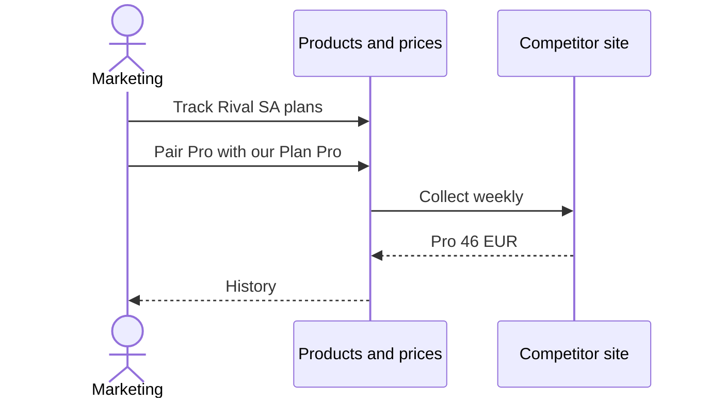

🏠 [Specs](../../../../README.md) › 🧩 [Functional capabilities](../../../README.md) ›
🔭 [F17 Competitive analysis](../../README.md) › 📝 [Use cases](../README.md) ›
📝 [Use cases: FL-F17-02 Collect signals](README.md) › 📝 UC-F17-03 Track products and prices

# 📝 UC-F17-03 Track products and prices

**Status:** ✅ specified

## Summary

Marketing and sales track competitors' products, plans and prices from their websites and catalogues, within the sites'
terms, and read the price history that feeds the price index (UC-F17-23).

## Personas

- [U12 Marketing](../../../../01-users/personas/u12-marketing.md)
- [U03 Sales](../../../../01-users/personas/u03-sales.md)

## Goal

Up-to-date, dated competitor prices.

## Trigger

Pages or products chosen; the collection schedule.

## Frequency

Weekly collection.

## Preconditions

- The sources are allowed by the collection rules (BR-F17-03).

## Postconditions

- Success: price points with history.
- Failure: a source blocked is reported.

## Main flow

1. Marketing opens Products and prices (S-F17-03) and chooses pages or products.
2. They pair each with the company's own product when like for like (BR-F17-08).
3. SimpleERP collects on schedule at a polite rate.
4. Each price is stored with its date and source.
5. Sales read the history; the price index is computed (UC-F17-23).

## Alternative flows

- 1a. A catalogue file from a provider within its licence.

## Error flows

- 3e. A site's terms forbid collection: the source is refused.
- Any step: a service does not answer; the call is retried first (BR-F3-32), then the message follows the error pattern
  (D122) and what was typed stays on the screen.

## Business rules

- [BR-F17-03 Sites' terms and robots rules respected](../../business-rules/br-f17-03-terms-and-robots-respected.md)
- [BR-F17-02 Every fact keeps its source and date](../../business-rules/br-f17-02-every-fact-keeps-its-source.md)
- [BR-F17-08 Comparisons are like for like](../../business-rules/br-f17-08-comparisons-are-like-for-like.md)

## Entities

- [E-F17-03 Price point](../../data/e-f17-03-price-point.md)
- [E-F17-17 Price index](../../data/e-f17-17-price-index.md)

## Permissions

Marketing and owner; sales read.

## Notifications

- Followers when a change passes a threshold (UC-F17-15).

## Audit events

Sources added, collections.

## AI involvement

The AI assistant may pair products like for like for marketing to confirm.

## API, MCP and A2A exposure

Through T5 and T6 with the caller's rights (BR-F3-34).

## Screens

- [S-F17-03 Products and prices](../../screens/02-collect-signals/s-f17-03-products-and-prices.md)

## Flowchart

See [FL-F17-02 Collect signals](../../flows/fl-f17-02-collect-signals.md#flowchart).

## Sequence diagram

## Acceptance criteria

1. **Given** Rival SA's Pro paired with Plan Pro **when** collected **then** 46.00 EUR is stored with date and link.
2. **Given** a site whose terms forbid it **when** added **then** it is refused.
3. **Given** 12 weeks of prices **when** opened **then** the history chart shows them.

## Non-functional notes

D408's targets ([Performance](../../../../05-non-functional/performance.md)): 95 % of screens within 1 second; lists
paged on the server, the first page within 1 second; reports within 5 seconds or in the background.

## Regulatory references

Collection rules of the France country pack:
[CR-FR-192 Trade secrets](../../../../10-country-packs/france/trade/cr-fr-192-trade-secrets.md),
[CR-FR-193 Database producer's right](../../../../10-country-packs/france/trade/cr-fr-193-database-producer-right.md),
[CR-FR-196 Legitimate interest needs a documented balance](../../../../10-country-packs/france/data-protection/cr-fr-196-legitimate-interest-balancing.md),
[CR-FR-198 Comparative advertising](../../../../10-country-packs/france/consumer/cr-fr-198-comparative-advertising.md),
[CR-FR-060 Copyrighted standards and text mining](../../../../10-country-packs/france/ai-and-recording/cr-fr-060-text-and-data-mining-opt-out.md),
[CR-FR-052 Personal data kept no longer than needed](../../../../10-country-packs/france/data-protection/cr-fr-052-storage-limitation.md),
[CR-FR-051 Access and erasure requests](../../../../10-country-packs/france/data-protection/cr-fr-051-access-and-erasure.md).

## Related use cases

- [UC-F17-23 Suggest price-list changes from the price index](../06-price-intelligence/uc-f17-23-suggest-price-list-changes-from-the-price-index.md)
- [UC-F17-11 Compare side by side](../03-analyse-and-arm-sales/uc-f17-11-compare-side-by-side.md)

## Open questions

None.

---

⬅️ [UC-F17-02](../01-set-up-and-profiles/uc-f17-02-build-a-profile-from-registers-and-filings.md) · ⬆️ [Up](README.md) ·
➡️ [UC-F17-04 Follow job offers](uc-f17-04-follow-job-offers.md)
